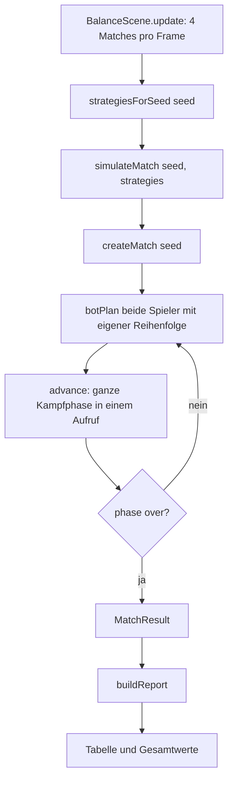

# Anwendung: Dev-Szene mit Balancing-Statistik aus simulierten Spielen

Diese Seite beschreibt, was der Auftrag „Dev-Szene mit Balancing-Statistik aus simulierten Spielen“ umgesetzt hat und
worauf zu achten ist. Die Szene liefert Daten für Balancing-Entscheidungen. Sie ändert keine Spielregeln und keine
Basiswerte.

## Aufruf

```
npm run dev
# dann im Browser: http://localhost:5180/?scene=balance
```

- Die Szene (Key `balance`) gibt es nur im Dev-Server. `src/main.ts` lädt sie nur bei `import.meta.env.DEV` per
  dynamischem Import. Mit `?scene=balance` startet sie zuerst, sonst bleibt `MainScene` die Startszene.
- Im Produktions-Build (`npm run build`) ist nur `main` registriert. Es gibt keinen Menüeintrag und keine Dev-Taste.
- Die Szene simuliert 1000 Matches (`MATCH_COUNT`), 4 pro Frame (`MATCHES_PER_FRAME`), und zeigt eine Fortschrittsanzeige.
- „Neu simulieren“ startet den nächsten Seed-Bereich (`startSeed + 1000`), wirkt aber erst nach Abschluss der laufenden
  Simulation. „Zurück“ startet die Szene `main`.
- Die Tabelle lässt sich über den Spaltenkopf der Siegquote auf- oder absteigend sortieren.
- Die Szene hält den fertigen Bericht im lesbaren Feld `current` (`BalanceReport` oder `null` während der Simulation).
  Der Smoke-Test liest es.

## Aufbau der Simulation



Alles in `src/logic/balance-sim.ts` ist reine Logik (kein `phaser`, kein DOM, kein `Math.random`). Zufall kommt nur über
`nextRandom`, daher liefert derselbe Seed immer dasselbe Ergebnis.

| Funktion | Aufgabe |
| --- | --- |
| `shuffledPriority(seed)` | Karten-IDs aus `CARD_DEFS` per Fisher-Yates in zufällige Reihenfolge bringen |
| `strategiesForSeed(seed)` | Reihenfolge für Spieler 0 und 1 allein aus dem Match-Seed würfeln |
| `simulateMatch(seed, strategies)` | Ein Match Bot gegen Bot bis `phase === 'over'`; liefert `MatchResult` (Ergebnis, Runden, `endedBy`, gespielte Karten je Spieler) |
| `buildReport(results, startSeed)` | Ergebnisse zu `BalanceReport` verdichten; ohne Ergebnisse alle Werte 0, kein `NaN` |
| `runSimulation({ startSeed, count })` | `count` Matches mit Seeds `startSeed`, `startSeed + 1`, … ausführen und aggregieren |

`simulateMatch` plant je Runde beide Bots und lässt die Kampfphase dann mit `advance(state, COMBAT_TICKS * TICK_MS)` in
einem einzigen Aufruf laufen. Das spart das `structuredClone` bei jedem Tick. `endedBy` ist `towers`, wenn ein Tower-Satz
zerstört wurde (`destroyedOutcome`), sonst `round-limit`. Endet ein Match nicht, wirft `simulateMatch` einen Fehler.

### Änderung am Bot

`botPlan(state, playerIndex, priority = PRIORITY)` hat einen dritten, optionalen Parameter für die Kartenreihenfolge.
Ohne ihn verhält sich der Bot exakt wie vorher. Karten, die in der übergebenen Liste fehlen, spielt der Bot nicht. Das
ist die einzige Änderung am Produktionscode; `match.ts`, `combat.ts` und `cards.ts` sind unverändert.

## Kennzahlen

`BalanceReport` (gesamt):

- `totalMatches`, `startSeed`
- `winRatePlayer0`, `winRatePlayer1`, `drawRate` (zusammen 1)
- `avgRounds`, `minRounds`, `maxRounds`
- `towerKillShare` und `roundLimitShare` (zusammen 1)
- `baselineWinRate`: Siege über alle Spieler-Matches (2 je Match)

`CardStats` (je Eintrag in `CARD_DEFS`, auch bei 0 Einsätzen):

- `matchesWithCard`: Spieler-Matches mit mindestens einem Einsatz der Karte
- `plays`: Einsätze insgesamt
- `winRate`, `drawRate`, `lossRate` bezogen auf `matchesWithCard`
- `deltaToBaseline`: `winRate` minus `baselineWinRate` (0 bei 0 Einsätzen)

Neue Karten erscheinen automatisch, weil die Statistik über `CARD_DEFS` läuft.

## Geänderte Dateien

| Datei | Änderung |
| --- | --- |
| `src/logic/balance-sim.ts` | Neu: Simulation und Kennzahlen |
| `src/logic/balance-sim.test.ts` | Neu: Determinismus, Rundengrenze, Quotensumme, alle Karten ohne `NaN`, von Hand gerechnetes Beispiel, Laufzeit für 200 Matches |
| `src/logic/bot.ts` | `botPlan` mit optionalem Parameter `priority` |
| `src/logic/bot.test.ts` | Drei Tests: Reihenfolge ändert die Auswahl, Default unverändert |
| `src/scenes/balance-scene.ts` | Neu: Dev-Szene mit Tabelle, Balken, Fortschritt, Schaltflächen |
| `src/main.ts` | `BalanceScene` nur bei `import.meta.env.DEV` per dynamischem Import registrieren; `?scene=balance` |
| `e2e/smoke.spec.ts` | Neue Tests: Dev-Szene (Bericht, „Neu simulieren“, „Zurück“, keine Konsolenfehler) und Produktions-Build ohne `balance` |
| `playwright.config.ts` | Zusätzlicher Dev-Server für den Smoke-Test |
| `README.md` | Abschnitt „Dev-Szene Balancing“ |

## Prüfung

`npm run typecheck`, die Tests in `balance-sim` und `bot` (48 Tests) und `npm run test:smoke` (4 Tests) waren grün. Der
Review war freigegeben, der visuelle Test der Hauptseite ohne Befund. Die Testabdeckung konnte nicht gemessen werden,
weil `@vitest/coverage-v8` fehlt.

## Worauf zu achten ist

- **Aussagekraft:** Die Werte sind Bot-Statistik, kein Spielerverhalten. Beide Seiten nutzen denselben Bot-Typ mit
  zufälliger Reihenfolge, und die Karten kommen aus demselben Deck. Kartenwerte sind daher korreliert; eine hohe
  Siegquote einer Karte heißt nicht, dass sie allein stark ist. Die Szene weist darauf hin.
- **Zwei Ports im Smoke-Test:** Der Lauf startet Preview (4174) und Dev-Server (5181). Ist ein Port belegt, schlägt der
  Lauf wegen `strictPort` fehl. `SMOKE_DEV_PORT` ändert den Dev-Port.
- **Ablaufsteuerung in der Szene:** `update()` baut die Schleife aus `simulateMatch` und `strategiesForSeed` selbst
  nach, weil die Szene blockweise rechnen muss. `runSimulation` wird von der Szene nicht benutzt, ist aber getestet und
  für Skripte und Tests gedacht. Ändert sich die Ablauflogik (Seed-Zählung), beide Stellen angleichen.
- **Laufzeit:** 200 Matches brauchen im Test rund 0,7 s, 1000 also grob 3,5 s Rechenzeit. Die Szene verteilt sie auf 250 Frames
  (etwa 4 s bei 60 fps; im Headless-Smoke-Test mit niedriger Bildrate länger, daher dort 40 s Poll- und 100 s Testtimeout), der Canvas bleibt bedienbar.
- **Balance im Terminal:** `npm run balance` (Tabelle) bzw. `npm run balance -- --json` liefert denselben Bericht ohne
  Browser. Die Leitplanken (Seite 40–60 %, |`deltaToBaseline`| ≤ 15 Punkte) stehen in `balance-guardrails.ts`;
  Details in `docs/anwendung-balance-cli.md`.
- **Nicht gebaut:** Die JSON-Ausgabe in der Dev-Szene fehlt (das CLI hat sie).
- **Formatierung:** In `playwright.config.ts` stehen `use: { baseURL: ... }` und `projects: [...]` auf einer Zeile.
  Das hat keine Folgen.
- **Unverändert:** Spielregeln, Kartenwerte, Basiswerte, Bot-Verhalten ohne Zusatzparameter und die Smoke-Prüfung der
  `main`-Szene.
