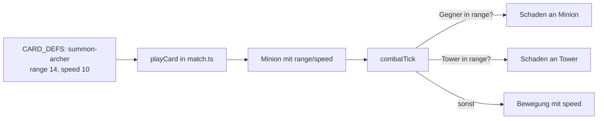

# Anwendung: Fernkämpfer Bogenschütze mit Minion-Reichweite

Diese Seite beschreibt, was der Auftrag „Fernkämpfer Bogenschütze mit Minion-Reichweite“ umgesetzt hat und worauf zu
achten ist. Die Regel steht im [Designkonzept](designkonzept.md) (Abschnitt 3 und 4).

## Die Regel

Jeder `Minion` (`src/logic/combat.ts`) hat das Pflichtfeld `range` (Reichweite in Einheiten), neben `speed`. `combatTick`
sucht Ziele mit `minion.range`: zuerst den nächsten gegnerischen Minion auf der Line, sonst den Tower, wenn
`LINE_LENGTH - position <= minion.range`. Ohne Ziel läuft der Minion mit `minion.speed * deltaSeconds` weiter. Die
Berechnung bleibt gleichzeitig und deterministisch, die Zeit läuft über `deltaSeconds`.

`MINION_RANGE = 4` und `MINION_SPEED = 10` sind nur noch Standardwerte für Nahkämpfer.

| Karte | Kosten | LP | Schaden/s | `range` | `speed` | Kopien im Deck |
| --- | --- | --- | --- | --- | --- | --- |
| `summon-minion` (Minion) | 1 | 30 | 6 | 4 (Standard) | 10 | 4 |
| `summon-brute` (Brocken) | 2 | 80 | 12 | 4 (Standard) | 8 | 2 |
| `summon-archer` (Bogenschütze) | 2 | 20 | 7 | 14 | 10 | 2 |

Beispiele: Ein Bogenschütze trifft einen gegnerischen Minion in 10 Einheiten Abstand, ein Nahkämpfer nicht. Den Tower
trifft er aus 14 Einheiten, ein Nahkämpfer erst ab 4.

## Geänderte Dateien

| Datei | Änderung |
| --- | --- |
| `src/logic/combat.ts` | `Minion.range` ergänzt; `combatTick` nutzt `minion.range` für Minion- und Tower-Ziele; Kommentar an `MINION_RANGE` |
| `src/logic/cards.ts` | `summon`-Variante mit optionalem `range` und `speed`; neue Karte `summon-archer`; `COPIES`: 2 Kopien |
| `src/logic/match.ts` | Beschwören setzt `range: def.range ?? MINION_RANGE` und `speed: def.speed ?? MINION_SPEED` |
| `src/logic/bot.ts` | `summon-archer` in `PRIORITY` hinter `summon-minion`; der `summon`-Zweig der Zielwahl gilt auch für die neue Karte |
| `src/logic/combat.test.ts` | Fernkämpfer trifft Minion aus 10 und Tower aus 14, Nahkämpfer nicht bzw. erst ab 4; Stehenbleiben und Weiterlaufen |
| `src/logic/cards.test.ts` | Kartenwerte des Bogenschützen, 2 Kopien pro Deck |
| `src/logic/match.test.ts` | `range` 14 (Bogenschütze) bzw. 4 (Minion, Brocken) nach dem Beschwören |
| `src/logic/bot.test.ts` | Bot kann `summon-archer` spielen |
| `src/logic/placement.test.ts` | Fixtures um `range` ergänzt |
| `docs/designkonzept.md` | Bogenschütze „vorhanden“; Konstanten-Abschnitt nennt `range`; Folgeauftrag 5 umgesetzt |

`src/scenes/main-scene.ts` blieb unverändert: Karten werden generisch über `def.name` angezeigt, der Bogenschütze
erscheint automatisch.

## Prüfung

`npm run typecheck`, die Tests in `bot`, `cards`, `combat`, `match` und `placement` (128 Tests) und `npm run test:smoke`
(10 Tests) waren grün. Der Review war freigegeben, ohne blockierende Befunde.

## Worauf zu achten ist

- **Neue Minions:** Wer einen `Minion` direkt anlegt (Tests, Fixtures), muss `range` setzen (Standard `MINION_RANGE`);
  sonst schlägt die Typprüfung fehl. Erwartungswerte bestehender Tests blieben unverändert.
- **Deckreihenfolge:** Das Deck ist um 2 Karten länger, die Reihenfolge nach Seed ändert sich. Tests mit fester
  Deckreihenfolge müssen darauf geprüft werden.
- **Balance:** `TOWER_RANGE` (20) gegen Reichweite 14 ist ein eigener Schritt im Designkonzept. Es wurde keine neue
  Balance-Simulation durchgeführt.
- **E2E-Test:** Das Ziehen eines beschworenen Minions läuft ohne `skip` mit festem Seed über `dragMinion`
  (`e2e/helpers.ts`, Tests „Drag: …“ in `gameplay.spec.ts`).
- **Nicht enthalten:** Projektile, Animationen, neue Assets, weitere Rollen; keine Änderung an `TOWER_RANGE`,
  `START_HAND`, `DRAW_PER_ROUND`, `MAX_ENERGY` oder am Brocken-Tempo.
- **Bot:** Keine Strategie über die Aufnahme in `PRIORITY` hinaus.
