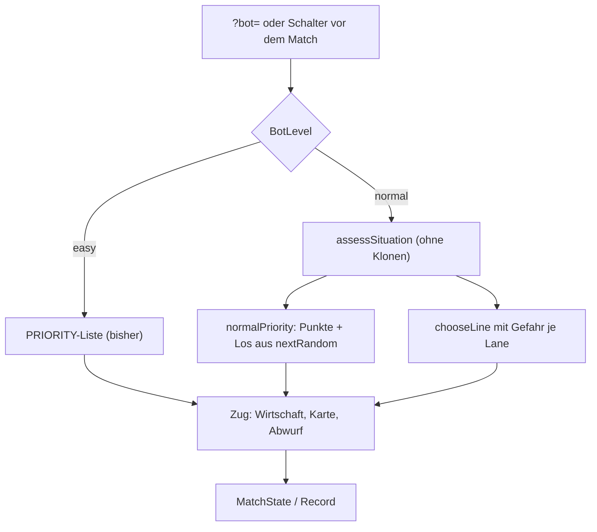

# Anwendung: Bot-Stufen „Leicht“ und „Normal“

Diese Seite beschreibt die zwei Stufen des Gegners, die Lagebewertung von „Normal“, die Wahl der Stufe und den Vergleich im
Balance-Bericht. Es ändert sich nichts an Kartenwerten, Synergien oder Match-Regeln. Der Bot liest weiter nur den eigenen
Spieler und die sichtbare Lage, nie die Hand des Gegners.

## Stufen

| Stufe | Typ | Anzeige | Verhalten |
| --- | --- | --- | --- |
| `easy` | `BotLevel` | „Leicht“ | Wie bisher: feste `PRIORITY`-Liste, kein Zufall. `botStepFor('easy', …)` ist exakt `botStep` |
| `normal` | `BotLevel` | „Normal“ | Bewertet die Lage (`assessSituation`), ordnet die Hand danach (`normalPriority`) und wählt die Ziel-Lane nach Gefahr |

`BOT_LEVELS` und `BOT_LEVEL_NAMES` stehen in `src/logic/bot.ts`. Einstiegspunkte: `botStepFor(level, state, player, priority?)`
und `botPlanFor(level, state, player, priority?)`. Bei „Normal“ wird `priority` ignoriert. Die bestehenden `botStep` und
`botPlan` sind unverändert.

## Lagebewertung `assessSituation(state, playerIndex)`

Reine Funktion; sie liest nur und kopiert den Zustand nicht (wichtig, weil sie bei jedem Zug läuft und `structuredClone`
teuer ist). Je Lane (`LaneAssessment`):

- `towerHp`: HP plus Schild der lebenden Tower der Lane.
- `enemyMinions`, `threat`: lebende gegnerische Minions derselben Lane und ihre Stärke `damage * 5 + hp / 4`.
- `danger = threat - towerHp`; `endangered`, wenn Gegner in der Lane stehen, die Lane offen ist und `threat > towerHp` oder
  `threat >= THREAT_LIMIT` (90, etwa drei einfache Minions). Ohne Gegner ist nie etwas gefährdet, auch nicht bei niedrigen HP.
- `ownMinions`, `ownPower`: eigene lebende Minions; `strong`, wenn nicht gefährdet, `ownPower >= STRONG_LIMIT` (70) und größer
  als die Bedrohung.

Dazu `synergies` (`player.synergies`), `triggers` (Karten, die mit der Partnerkarte aus `player.played` eine noch nicht aktive
Synergie aus `SYNERGY_DEFS` auslösen würden) und `keeps` (Karten schon aktiver Synergien).

## Kartenwahl `normalPriority(state, playerIndex, seed)`

Jede Handkarte (jede ID einmal) bekommt Punkte, dazu `upgrade` und `buy-lane`; `draw` steht immer zuletzt:

| Punkte | Wann |
| --- | --- |
| 10 | Grundwert jeder Karte |
| +40 | Verteidigung (`tower-hp`, `tower-shield`, `tower-armor`, `lane-shield`, alle Beschwörungen), wenn eine Lane gefährdet ist |
| +20 | Angriff und Buff (`tower-damage`, `tower-lightning`, `lane-buff`, `buff-minion`, `minion-upgrade-*`), wenn eine Lane stark ist |
| +15 / +5 | Karte löst eine Synergie aus / gehört zu einer schon aktiven Synergie |
| 25 | `upgrade` (steht damit vor neutralen Karten, hinter Verteidigung bei Gefahr) |
| 12 | `buy-lane` |

Wirtschaftsaktionen laufen danach wie bei „Leicht“ über `tryEconomy` (Upgrade und Lane nur, wenn sie sich bis zum Spielende
lohnen; Ziehen nur als Rückfall). Abwerfen (`discardStep`) gilt unverändert.

## Zielwahl (`chooseLine`)

- Beschwörungen und Tower-Upgrades (`tower-hp`, `tower-damage`, `tower-armor`): die gefährdetste Lane (größtes `danger`,
  bei Gleichstand die mit weniger eigenen Minions, dann die niedrigste).
- Lane-Karten: Schild auf die gefährdetste, Buff auf die stärkste Lane (nur Lanes mit eigenen Minions und freiem Lane-Slot).
- Spezialisierungen und Minion-Upgrades behalten die Regeln von „Leicht“.

## Zufall und Reproduzierbarkeit

Zufall gibt es nur für Gleichstände der Punkte, nur über `nextRandom`. Der Seed kommt aus dem Matchzustand (`botSeed`: Match-Seed,
Runde, Spieler, Energie, Hand, gespielte Karten, Minions). Gleicher Zustand ergibt denselben Zug; ein anderer Seed darf bei
Gleichstand eine andere Karte wählen. `bot.ts` importiert weder `phaser` noch nutzt es DOM oder `Math.random` (ein Test prüft das).

## Stufe wählen

- URL: `?bot=easy|normal`, gelesen von `parseBotLevel(search)` in `src/logic/seed.ts`. Fehlt der Wert oder ist er ungültig,
  gilt `easy`.
- Im Spiel zeigt der Schalter „Bot: Leicht/Normal“ oben (zwischen „Ziehen“ und „Upgrade“) die Stufe. Er lässt sich nur in Runde 1
  tippen, solange der Mensch noch nichts getan hat. Ein Tippen wechselt die Stufe und beginnt dasselbe Match (gleicher Seed)
  neu, damit der Bot mit der neuen Stufe plant. Danach steht dort „Bot Normal · 5 Karten“.
- Die Stufe wird nicht über Sitzungen gespeichert. Nach „Neues Spiel“ gilt wieder der Wert aus der URL.

## Aufzeichnung und Replay

- `RecordedMatch.botLevel` trägt die Stufe (nur für „Normal“; fehlt bei „Leicht“). `createRecord(seed, level)` setzt sie,
  `botPlanRecorded(state, record, player, priority?, level?)` nimmt die Stufe aus `level`, sonst aus dem Record.
- Das Nachspielen (`replayRecorded`, Replay-Szene) braucht die Stufe nicht, weil die Bot-Züge als Aktionen im Record stehen: ein
  mit „Normal“ aufgezeichnetes Match läuft mit identischem Ergebnis (Test in `match-record.test.ts` und `replay.test.ts`).
- `shareQuery` hängt bei „Normal“ `&bot=normal` an; die Replay-Szene liest es und führt die Stufe in `ReplayState.levels`.
  Das Zugformat (`RECORD_VERSION`) ist unverändert, alte Links bleiben gültig.
- `createReplay(seed, levels)` (Bot gegen Bot) nutzt `botStepFor` mit den Stufen; Standard ist Leicht gegen Leicht.

## Balance-Vergleich

`simulateMatch(seed, strategies, levels?)` und `runSimulation({ startSeed, count, compareLevels })` spielen mit
`levelsForSeed(seed)` Leicht gegen Normal: bei geradem Seed hat Spieler 0 „Leicht“, bei ungeradem „Normal“ (Seitenwechsel je
Seed). „Leicht“ nutzt dabei die zufällige Reihenfolge der Seite, „Normal“ ignoriert sie. `BalanceReport.levelStats` enthält je
Stufe `matches`, `wins` und `winRate` aus den Matches mit verschiedenen Stufen (Remis zählen als Match, nicht als Sieg). Ohne
Stufenvergleich sind alle Werte 0. Die Dev-Szene (`?scene=balance`) zeigt „Sieg Leicht x % Normal y %“; Seed-Fortschritt
(`nextStartSeed`) und `MATCH_COUNT` (1000) sind unverändert, `runSimulation` ohne `compareLevels` und der Regressionstest
ändern sich nicht.

## Tests

| Datei | Inhalt |
| --- | --- |
| `src/logic/bot.test.ts` | Stufen, `easy` = `botStep`, Lagebewertung (Schwelle, HP, Synergien, kein Klonen), Verteidigung vor Angriff, Synergie-Bonus, Zielwahl, Determinismus und Gleichstand |
| `src/logic/seed.test.ts` | `parseBotLevel` |
| `src/logic/match-record.test.ts`, `src/logic/replay.test.ts` | Stufe im Record, `shareQuery`, Replay eines „Normal“-Matches mit gleichem Ergebnis |
| `src/logic/balance-sim.test.ts` | Seitenwechsel, beide Stufen im Bericht, Siegquoten je Stufe |
| `e2e/gameplay.spec.ts` | `?bot=normal` startet mit „Normal“ und zeigt die Stufe; Schalter vor der ersten Aktion |

`npm run test:coverage` zeigt keine neuen Lücken in `src/logic/` (`bot.ts` 100 %).

## Grenzen

Keine Stufe „Schwer“, kein Lernen, kein Blick auf die Hand des Gegners, kein Mehrspielermodus. Die Punktwerte und Schwellen
(`SCORE`, `THREAT_LIMIT`, `STRONG_LIMIT`) sind Startwerte; ob „Normal“ stärker ist als „Leicht“, zeigt der Balance-Bericht.
