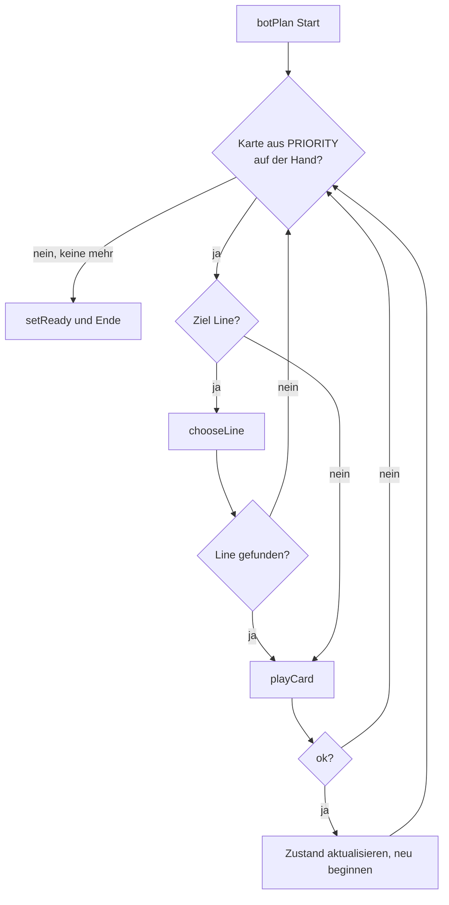

# Anwendung: Bot-Strategie mit Unit-Tests

Diese Seite beschreibt, was der Auftrag „Bot-Strategie mit gezielten Unit-Tests absichern“ umgesetzt hat und worauf zu
achten ist. Getestet wird `botPlan(state, playerIndex)` in `src/logic/bot.ts`.

## Ergebnis des Auftrags

`src/logic/bot.test.ts` existierte schon (5 Tests) und wurde **ergänzt**, nicht neu angelegt. Die 5 Tests stehen
unverändert am Anfang. Die Datei hat jetzt **33 Tests**. `bot.ts`, `match.ts`, `cards.ts` und die Szenen blieben
**unverändert**; ein Fehler in `bot.ts` wurde nicht gefunden.

| Datei | Änderung |
| --- | --- |
| `src/logic/bot.test.ts` | Neue Imports, Hilfsfunktionen `withHand`, `addMinions`, `cost`, `minionCount` und sechs `describe`-Blöcke |

## Verhalten, das die Tests festhalten

- **Reihenfolge `PRIORITY`:** `summon-minion`, `tower-hp`, `line-upgrade`, `minion-upgrade-line`, `summon-brute`,
  `tower-damage`, `minion-upgrade-all`. Die Handreihenfolge spielt keine Rolle.
- **Linienwahl:**
  - `summon`: wenigste Minions, bei Gleichstand die niedrigste Line; volle Lines (`lineCapacity`) werden übersprungen.
    Sind alle voll, bleibt die Karte auf der Hand.
  - `line-upgrade`: niedrigstes Level; Lines auf `MAX_LINE_LEVEL` werden übersprungen.
  - `tower-upgrade`: schwächster Tower (`tower.hp`).
  - `minion-upgrade` je Line: höchster `bonus.hp`.
- **Energie:** Bei 0 Energie wird nichts gespielt, nur `ready` gesetzt. Eine zu teure Karte blockiert günstigere nicht.
  Die Energie sinkt genau um die Summe der Kosten der gespielten Karten.

## Die Tests (`src/logic/bot.test.ts`)

| Block | Prüft |
| --- | --- |
| (bestehend, 5 Tests) | Karten spielen und bereit melden, Determinismus, Verteilung der Minions, Energiegrenze, Spiegelgleichheit |
| Priorisierung | `summon-minion` vor `tower-hp` trotz Handreihenfolge; frühere Karte aus `PRIORITY` bei knapper Energie; alle Karten bei genug Energie |
| Energie | 0 Energie; zu teure Karte (`minion-upgrade-all` bei 2 Energie) blockiert `tower-hp` nicht; Energieabnahme gleich Kostensumme; Start-Energie |
| Kartenkombinationen | nur teure Karten; nur `minion-upgrade-all` (ohne Linienziel); mehrere gleiche Karten mit Neuwahl der Line nach jeder Karte; leere Hand; gemischte Hand mit Energiegrenze |
| Linienwahl | `summon` (wenigste Minions, Gleichstand, volle Lines, alle voll); `line-upgrade` (niedrigstes Level, `MAX_LINE_LEVEL`, alle auf Maximum); `tower-hp`; `minion-upgrade-line` |
| Determinismus und Isolation | gleiche Ergebnisse für die Seeds 1, 4, 8, 42 und 1234 und beide Seiten; Eingabezustand unverändert (`structuredClone`); Gegner unverändert, `ready[playerIndex]` ist `true` |
| Abbruch | `botPlan` terminiert bei `already-ready` und `not-planning` (`playCard` lehnt ab, Hand bleibt gleich) und wenn nach einigen Karten keine mehr spielbar ist |

Die Tests setzen die Hand selbst, hängen also nicht an der Deck-Reihenfolge eines Seeds. Kosten lesen sie über
`getCardDef(id).cost`, damit Balancing-Änderungen sie nicht brechen. `Math.random`, `Date` und Phaser kommen nicht vor.

## Testlauf

`npm run typecheck`, `npx vitest run src/logic/bot.test.ts` (33 Tests) und `npm run test:smoke` waren grün. Der Review
war freigegeben, ohne blockierende Befunde.

## Spezialisierungen: Vorrang (Auftrag „Bot spielt Spezialisierungen sinnvoll“)

`botStep` probiert die Karten `tower-lightning` und `tower-shield` **vor** der übrigen Reihenfolge, sofern `priority`
sie enthält. Der Bot nutzt sie damit, solange er die Energie noch nicht für Beschwörungen ausgegeben hat. Die Lane-Wahl
bleibt (`chooseLine`: nur Lanes mit `laneUnlockLevel ≥ SPECIALIZE_MIN_LEVEL` und freiem Tower, höchstes Level zuerst).
Findet `chooseLine` keine Lane oder reicht die Energie nicht, fällt die Karte durch und der Bot spielt wie bisher.

Tests im Block „Spezialisierung › Vorrang vor Beschwörungen“ in `bot.test.ts`:

| Fall | Erwartung |
| --- | --- |
| Beschwörung steht in `priority` vor der Spezialisierung | Spezialisierung zuerst, danach die Beschwörung |
| Keine Lane ab Lvl 2 (kein passendes Ziel) | Beschwörung zuerst |
| Alle Tower der Lanes ab Lvl 2 sind schon spezialisiert | Beschwörung zuerst |
| Spezialisierung fehlt in `priority` | bleibt auf der Hand |
| Energie reicht nicht für die Spezialisierung | Beschwörung zuerst |

Wirkung im Messlauf (Seed 1, 1000 Matches): mittlere Spielrunde von 5,1 auf 4,7. Die Abweichung zur Basis ändert das
kaum (siehe `anwendung-balance-cli.md`, „Ursache der Abweichung“). Der Lane-Kauf bleibt unverändert; ihn an eine
Spezialisierung zu koppeln, wurde gemessen und verworfen.

## Worauf zu achten ist

- **`PRIORITY` ist im Test kopiert:** Sie ist in `bot.ts` nicht exportiert. Ändert sich die Reihenfolge dort, schlagen
  die Priorisierungstests an und zeigen die Abweichung. Sie sind dann bewusst mitzuziehen.
- **Test „mehrere gleiche Karten“:** Die Erwartungen (`hp[1] > 60`, `hp[2] > 80`) gelten nur, solange der Zuwachs von
  `tower-hp` klein bleibt. Bei großem Zuwachs würde der Bot Line 1 ein zweites Mal wählen. Bei Balancing-Änderungen
  die erwartete Wahlreihenfolge prüfen.
- **`playCard`-Fehler:** Über `botPlan` lassen sich nur `already-ready` und `not-planning` herstellen. `slot-taken`
  ist so nicht erreichbar.
- **Casts:** `as { hp: number }` auf `getCardDef(...)` sind etwas unschön, aber typsicher genug.
- **Nicht gemessen:** `npm test` für die ganze Suite lief im Entwicklerschritt nicht; der Testlauf des Auftrags war auf
  `bot.test.ts` beschränkt.
