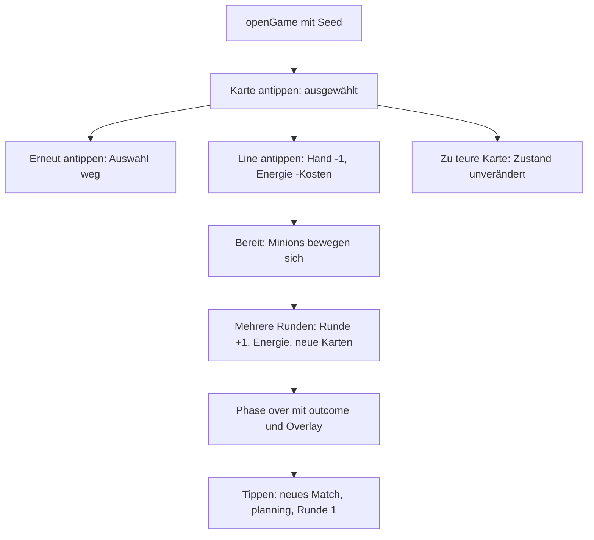

# Anwendung: E2E-Tests für vollständige Spielabläufe

Diese Seite beschreibt, was der Auftrag „E2E-Tests für vollständige Spielabläufe im Browser“ umgesetzt hat und worauf zu
achten ist. Die Tests laufen mit Playwright (Chromium) gegen `vite preview` und gehören zu `npm run test:smoke`.

## Ergebnis des Auftrags

Neben `e2e/smoke.spec.ts` (unverändert) gibt es jetzt `e2e/gameplay.spec.ts` mit gemeinsamen Hilfen in `e2e/helpers.ts`.
Es wurden **keine Spielregeln** geändert; `src/logic/match.ts` blieb unberührt.

| Datei | Änderung |
| --- | --- |
| `e2e/gameplay.spec.ts` | Neu: sechs Tests für Kartenauswahl, Spielen, Fehlerfall, Bewegung, mehrere Runden, Spielende und Neustart |
| `e2e/helpers.ts` | Neu: Koordinaten, Zustand lesen, Fehler sammeln, Schnellvorlauf |
| `src/logic/seed.ts` | Neu: `parseSeed(search)` liest `?seed=` aus der URL |
| `src/logic/seed.test.ts` | Neu: 3 Unit-Tests für `parseSeed` |
| `src/scenes/main-scene.ts` | `create()` nutzt `parseSeed(...) ?? Date.now()`; neuer lesender Getter `selectedCard` |

## Fester Seed per URL

Ohne Parameter startet die Szene wie bisher mit `Date.now()`. Mit `/?seed=1` ist das Match reproduzierbar.
`parseSeed` akzeptiert nur 1 bis 15 Ziffern und bildet den Wert auf 32 Bit ab (`>>> 0`); alles andere ergibt `null`
und damit den zufälligen Seed. Der Parameter gilt auch im Produktions-Build, er legt nur den Zufall der eigenen Partie
fest. Die Tests suchen Karten trotzdem nach `getCardDef(...).target` statt nach festen Indizes.

## Hilfen in `e2e/helpers.ts`

| Hilfe | Zweck |
| --- | --- |
| `openGame(page, seed = SEED)` | Öffnet `/?seed=…` und wartet, bis die Szene `main` läuft |
| `tap`, `tapCard`, `tapLine`, `tapReady` | Tippen in Spielkoordinaten (360×640), umgerechnet auf die Canvas-Box |
| `readState`, `readSelected` | Liest `current` und `selectedCard` der Szene `main` über `window.game` (nicht aus Pixeln) |
| `collectErrors(page)` | Sammelt `console.error` und `pageerror`; Tests prüfen am Ende `expect(errors).toEqual([])` |
| `fastForwardCombat(page)` | Ruft `update(0, 1000)` der Szene wiederholt auf, bis die Kampfphase endet |
| `hasVisibleText(page, text)` | Prüft, ob ein sichtbarer Text (z. B. „Tippen für ein neues Spiel“) in der Szene steht |

Der Typ `MainSceneView` liegt jetzt in den Helfern.

## Szenarien



- **Kartenauswahl:** Handkarte mit Ziel „Line“ antippen wählt sie aus, zweites Antippen hebt die Auswahl auf.
- **Karte auf Line:** Handkartenzahl −1, Energie sinkt um die Kartenkosten, die Line ändert sich (Minion oder Stufe).
- **Fehlerfall:** Eine nicht bezahlbare Karte lässt den Zustand unverändert, es gibt keinen Konsolenfehler.
- **Bewegung:** Nach „Bereit“ ändert sich die Position eines gespielten Minions im Zustand.
- **Mehrere Runden:** Die Runde steigt, die Energie folgt `energyForRound`, neue Karten werden gezogen.
- **Spielende und Neustart:** Nach höchstens `MAX_ROUNDS` (8) Runden ist die Phase `over`, `outcome` ist gesetzt, das
  Overlay erscheint. Ein Tippen startet ein neues Match (`planning`, Runde 1). Über den Sieger wird nichts behauptet,
  weil der Bot zufallsabhängig spielt.

## Worauf zu achten ist

- **Schnellvorlauf:** Eine echte Kampfphase dauert 20 s, acht Runden wären zu lang. `fastForwardCombat` ruft deshalb
  `scene.update` mit großem `delta` auf. Tippen auf „Bereit“ und auf den Neustart laufen weiterhin über die echte UI.
  Die Gameplay-Tests brauchen etwa 1 bis 2 s pro Test.
- **Keine festen Pausen:** Gewartet wird mit `expect.poll` bzw. `page.waitForFunction`, nie mit `waitForTimeout`.
- **Fehlerfall „volle Line“** ist nicht abgedeckt: Mit dem Energiebudget von Runde 1 ist keine vierte Beschwörung
  bezahlbar. Der Auftrag verlangte „zu teure Karte *oder* volle Line“, die zu teure Karte genügt.
- **Keine `console.error` für erwartete Fälle** im Spiel, sonst schlagen Smoke- und Gameplay-Tests an.
- **Offener Punkt (eigener Auftrag):** Der Drag-Test in `e2e/smoke.spec.ts` überspringt sich gelegentlich, wenn der
  zufällige Seed keinen Minion in die Starthand bringt. Mit `openGame(page)` bzw. `?seed=1` würde das nie passieren.

## Prüfen

```
npm run build
npm test
npm run test:smoke
npx playwright test e2e/gameplay.spec.ts --repeat-each=10
```
