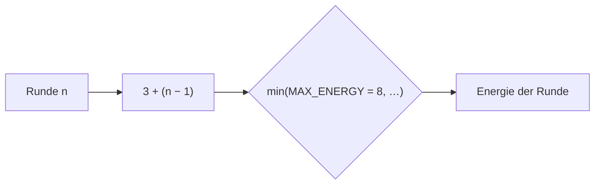

# Anwendung: Energie-Maximum von 10 auf 8 senken

Diese Seite beschreibt, was der Auftrag „Energie-Maximum von 10 auf 8 senken“ umgesetzt hat und worauf zu achten ist. Die
Regel steht im [Designkonzept](designkonzept.md).

## Die Regel

`MAX_ENERGY` (`src/logic/match.ts`) ist jetzt `8` (vorher `10`). `energyForRound` blieb **unverändert**:

```ts
Math.min(MAX_ENERGY, BASE_ENERGY + (round - 1) * ENERGY_PER_ROUND)
```

Die Deckelung wirkt allein über die Konstante. `startRound` ruft `energyForRound` beim Rundenstart auf, daher hat kein
Spieler in irgendeiner Runde mehr als 8 Energie.



| Runde | 1 | 2 | 3 | 4 | 5 | 6 | 7+ |
|---|---|---|---|---|---|---|---|
| Energie vorher (Max. 10) | 3 | 4 | 5 | 6 | 7 | 8 | 9, dann 10 |
| Energie nachher (Max. 8) | 3 | 4 | 5 | 6 | 7 | 8 | 8 |

Folge fürs Spiel: Die Ausgaben pro Runde sind früher begrenzt, teure Karten (Kosten 3) lassen sich ab Runde 6 nicht mehr
beliebig kombinieren.

## Geänderte Dateien

| Datei | Änderung |
| --- | --- |
| `src/logic/match.ts` | `MAX_ENERGY` von 10 auf 8 |
| `src/logic/match.test.ts` | Obergrenzen-Test prüft `MAX_ENERGY` = 8 und die Werte 3–8 für Runde 1–6 sowie 8 für Runde 7 und 100; neuer Match-Test: kein Spieler hat in einer Runde mehr als `MAX_ENERGY`, Rundenstart eingeschlossen; `withHand` und der Kostenabzug-Test nutzen `MAX_ENERGY` statt der festen 10 |
| `src/logic/placement.test.ts` | Testenergie von 10 auf 8, damit kein im Spiel unerreichbarer Zustand abgebildet wird |
| `docs/designkonzept.md` | `MAX_ENERGY` in der Tabelle „Soll-Änderungen“ als umgesetzt markiert (Ist 8, vorher 10) |
| `README.md` | Abschnitt „Basiswerte“: „Energie 3 + 1 pro Runde (max. 8)“ (Hinweis des Reviewers) |

Szenen und UI (`src/scenes/`) verwenden keinen festen Energiewert 10; dort war nichts anzupassen.

## Prüfung

`npm run typecheck`, `npx vitest run src/logic/match.test.ts src/logic/placement.test.ts` (61 Tests), `npm test`
(124 Tests), `npm run build` und `npm run test:smoke` (2 Tests) waren grün. Der Review war freigegeben.

## Worauf zu achten ist

- **Konstante statt Zahl:** Tests und Code sollen `MAX_ENERGY` verwenden, nicht die Zahl 8. Eine spätere Änderung
  bleibt dann auf eine Stelle beschränkt.
- **Unverändert:** `BASE_ENERGY`, `ENERGY_PER_ROUND` und die Kartenkosten wurden nicht angefasst; kein weiteres Balancing.
- **Kein Login im Projekt:** Der Hinweis „Anmeldung testen“ im Tester-Schritt ließ sich nicht umsetzen, es gibt keine
  Anmeldung in `src/` oder `e2e/`.
- **Abdeckung nicht messbar:** Prozentwerte liegen nicht vor, `@vitest/coverage-v8` ist nicht installiert.
