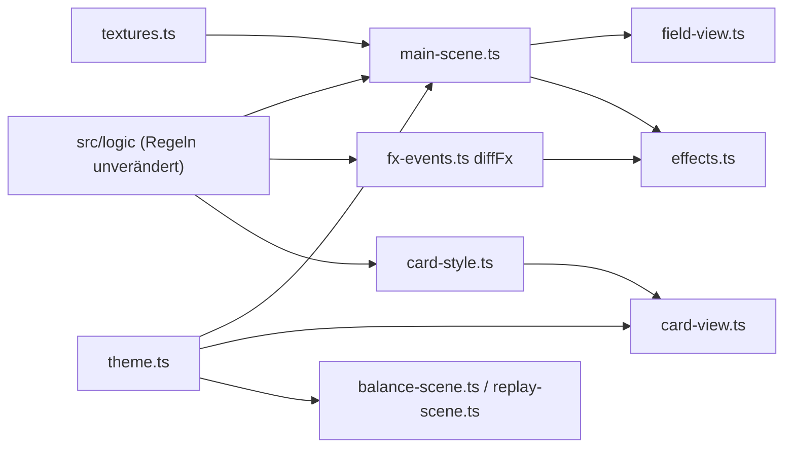

# Anwendung: Grafische Überarbeitung im Fantasy-Kartenspiel-Stil

Reine Darstellungsänderung. Spielregeln, Kartenwerte, Bot und Seed-Logik sind unverändert; die bestehenden Unit-Tests in
`src/logic/` laufen ohne Anpassung. Palette, Assets und Lizenzen stehen in [grafik-stil.md](grafik-stil.md).

## Was umgesetzt wurde

- **Theme:** `src/scenes/theme.ts` definiert Palette, Schriften und Rahmenparameter zentral; `main-scene.ts`,
  `balance-scene.ts` und `replay-scene.ts` nutzen nur noch diese Werte (das alte `COLORS` in `main-scene.ts` entfällt).
- **Karten:** `card-view.ts` zeichnet Rahmen, Kopfzeile mit Namen, Kosten-Kristall, Bildfläche mit Typ-Symbol, Textfeld und
  Typ-Banner. Die vier Typen unterscheiden sich durch Rahmenfarbe und Symbol. Hover und Auswahl heben die Karte an
  (Skalierung, Schatten, Leuchten); das Ausspielen ist kurz animiert.
- **Spielfeld:** `field-view.ts` (Tower, Minions, Bauplätze) mit Schatten, Leuchten und Teamfarben (Blau = du, Orange =
  Gegner). `textures.ts` erzeugt Hintergrundverlauf, Vignette, Boden, Wege und Partikeltexturen zur Laufzeit.
- **HUD:** Lebens- und Turmbalken, Ressourcen und Statistik-Overlay mit Gold-/Metallrahmen und Verlaufsfüllung.
- **Effekte:** `effects.ts` erzeugt Partikel, Ringe und Tweens für Treffer, Tod, Beschwörung und Turmfall sowie aufsteigende
  Schadenszahlen. Die Ereignisse leitet die reine Funktion `diffFx` (`src/logic/fx-events.ts`) aus zwei Spielzuständen ab.
- **Reine Logik mit Test:** `card-style.ts` (Kartentyp → Farbe/Symbol/Banner, `describeCard`) und `fx-events.ts`.
- **Hilfsmodul:** `labels.ts` enthält den aus `main-scene.ts` herausgelösten `LabelPool`.

## Geänderte Dateien

| Bereich | Dateien |
| --- | --- |
| Logik (neu) | `src/logic/card-style.ts`, `card-style.test.ts`, `fx-events.ts`, `fx-events.test.ts` |
| Szenen (neu) | `src/scenes/theme.ts`, `textures.ts`, `effects.ts`, `labels.ts`, `card-view.ts`, `field-view.ts` |
| Szenen (geändert) | `src/scenes/main-scene.ts`, `replay-scene.ts`, `balance-scene.ts` |
| Sonstiges | `src/main.ts`, `index.html`, `e2e/grafik.spec.ts` (neu), `docs/grafik-stil.md` |

`drawBoard` und `drawMinions` liegen jetzt in `field-view.ts`. Die Feldnamen `state`, `handFilter` und `selected` der
Szene bleiben, die bestehenden E2E-Tests mussten nicht angepasst werden. `e2e/grafik.spec.ts` liest zur Laufzeit das Feld
`lifts` der Szene.

## Worauf zu achten ist

- Effekte und Animationen laufen über `delta` bzw. Phaser-Tweens, nie über Frames. Bei Zeitsprüngen über 500 ms
  (z. B. Tab im Hintergrund) entfallen Effekte. Partikel, Ringe und Zahlen sind begrenzt (höchstens 20 Zahlen, 150 lebende
  Partikel je Emitter).
- Die Karten sind klein (66×62 px), der Beschreibungstext hat etwa 6,5 px und ist bewusst auf zwei kurze Zeilen gekürzt.
  Die Lesbarkeit auf echten Geräten ist nicht per Screenshot geprüft.
- Schriften sind Systemschriften mit Fallback, kein Webfont; das Spiel sieht auch offline gleich aus.
- Es gibt keine Fremdassets, `public/assets/` bleibt leer; Texturen entstehen im Code. Neue Dateien müssten in
  `grafik-stil.md` mit Lizenz eingetragen werden.
- Offene, kosmetische Punkte aus dem Review: einzelne Farben und Maße in `card-view.ts` (z. B. `0x3a3068` fürs Textfeld)
  stehen noch im Code statt in `theme.ts`; der Energie-Kristall in `main-scene.ts` ist mit Pixelkoordinaten verdrahtet.

## Prüfung

`npm run typecheck`, die Unit-Tests und `npm run test:smoke` (17 Tests) waren grün; der Tester hat Code und E2E-Tests
gelesen, aber keine Screenshots geprüft.

