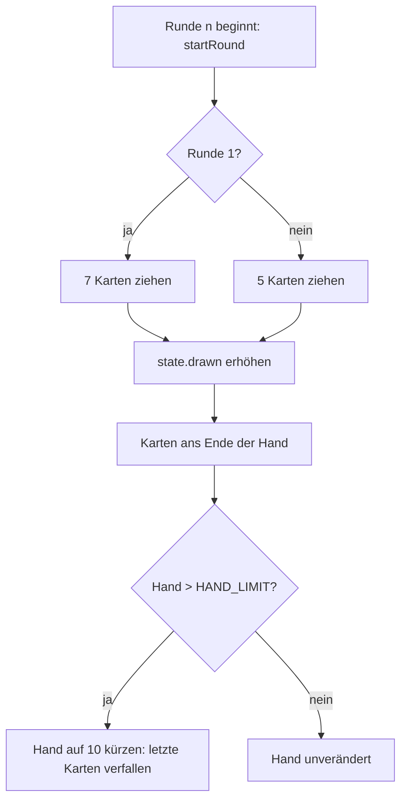

# Anwendung: Handlimit-Regel mit Tests

Diese Seite beschreibt, was der Auftrag „Handlimit-Regel mit Tests absichern und dokumentieren“ umgesetzt hat und worauf
zu achten ist. Die Regel steht im [Designkonzept](designkonzept.md), Abschnitt 3 „Kartenhandling“.

## Die Regel

`HAND_LIMIT = 10` ist **bestätigt** (`src/logic/match.ts`). `startRound` hängt die neu gezogenen Karten ans Ende der Hand
und kürzt die Hand danach auf `HAND_LIMIT`:

- Es gilt die **Reihenfolge der Ankunft**: Die ersten 10 Karten bleiben, die zuletzt gezogenen verfallen.
- Verfallene Karten zählen als gezogen (`state.drawn` steigt um `DRAW_PER_ROUND`). Die nächste Runde zieht die nächsten
  Deckkarten, nicht die verfallenen noch einmal.
- Das Limit gilt **pro Spieler**. Wer weniger Karten hat, wird nicht gekappt.
- Es gibt keine Ablage für verfallene Karten. Die Ablage enthält nur gespielte Karten.

Mit den Startwerten (7 Startkarten, 5 Karten pro Runde) greift das Limit schon in Runde 2: 7 + 5 = 12, davon bleiben 10.

## Ergebnis des Auftrags

`startRound` war richtig und blieb **unverändert**; alle neuen Tests waren auf Anhieb grün.

| Datei | Änderung |
| --- | --- |
| `src/logic/match.test.ts` | Neuer `describe`-Block „Handlimit“ mit neun Tests |
| `src/logic/match.ts` | Kommentar zu `HAND_LIMIT`: „bestätigt“ statt „noch zu bestätigen“ |
| `README.md` | `HAND_LIMIT = 10` als bestätigt; Karten verfallen am Ende der Hand, es gilt die Ankunftsreihenfolge |
| `docs/designkonzept.md` | „wandern in die Ablage“ ersetzt durch „verfallen“; die Ablage-Zeile nennt nur gespielte Karten |

Die Zeile zur Ablage im Designkonzept wurde zusätzlich angepasst, weil sie sonst dem neuen Text widersprochen hätte.
`src/scenes/main-scene.ts` (`human.hand.slice(0, HAND_LIMIT)`) ist reine Darstellung und blieb unberührt.

## Die Tests (`src/logic/match.test.ts`, Block „Handlimit“)

Alle Tests nutzen feste Seeds und rechnen die Zeit über `advance(state, COMBAT_TICKS * TICK_MS)`; es gibt weder
Zufallswerte noch Frame-Zählung.

| Test | Prüft |
| --- | --- |
| Runde 1 | 7 Startkarten liegen unter dem Limit, nichts verfällt |
| Ab Runde 2 | Beide Spieler halten genau `HAND_LIMIT` Karten |
| Reihenfolge | Die ersten 10 in Ankunftsreihenfolge bleiben (7 Startkarten + die ersten 3 neuen), die letzten 2 verfallen |
| Genau am Limit | Bei 5 Handkarten vor dem Ziehen (5 + 5 = 10) verfällt nichts |
| Unter dem Limit | Bei weniger als 5 Handkarten kommen alle 5 neuen Karten auf die Hand |
| `drawn` | `state.drawn` steigt auch bei verfallenen Karten um `DRAW_PER_ROUND`; die nächste Runde zieht die nächsten Deckkarten |
| Pro Spieler | Ein Spieler mit weniger Handkarten wird nicht auf 10 gekappt |
| Alle Runden | Bis `MAX_ROUNDS` überschreitet keine Hand `HAND_LIMIT` |
| Reproduzierbarkeit | Gleicher Seed ergibt dieselbe Hand nach dem Verfall |

Hilfsfunktionen im Block: `nextRound(state)` (beide „Bereit“, dann der ganze Kampf) und
`withPlayerHand(state, player, count)` (setzt die Hand eines Spielers auf die ersten `count` Deckkarten).

Testlauf: `npm run typecheck`, `npx vitest run src/logic/match.test.ts` und `npm run test:smoke` waren grün. Der Review
war freigegeben, ohne blockierende Befunde.

## Worauf zu achten ist

- **Abdeckung nicht messbar:** `@vitest/coverage-v8` ist nicht installiert, Prozentwerte liegen deshalb nicht vor.
- **Schwacher Test Runde 1:** Er prüft nur `createMatch`, nicht den Weg über `startRound`. Das genügt, weil
  `createMatch` die Runde 1 aufbaut.
- **Verfallene Karten indirekt geprüft:** Der Reihenfolge-Test prüft die Länge der verfallenen Karten und die
  verbleibende Hand per `toEqual`, nicht ausdrücklich „nicht auf der Hand“.
- **Formatierung:** Im Test „genau `HAND_LIMIT`“ ist die Zeile mit `withPlayerHand(withPlayerHand(...))` sehr lang.
- **Soll-Werte im Designkonzept:** Die Tabelle „Soll-Änderungen an Konstanten“ (Abschnitt 3) sieht `START_HAND` 5 und
  `DRAW_PER_ROUND` 3 vor; dann greift das Limit erst später. Die Tests verwenden die Konstanten, nicht feste Zahlen für
  die Hand, bleiben aber in einigen Erwartungen (z. B. „letzte 2 verfallen“ im Testtitel) an die Startwerte 7 und 5
  gebunden. Bei einer Änderung der Konstanten (Folgeauftrag 4) sind diese Tests zu prüfen.
- **Folgeauftrag, falls gewünscht:** Eine Ablage für verfallene Karten gehört nicht zu diesem Auftrag. Sie müsste als
  eigener Auftrag mit Zustandsfeld, Tests und Anzeige umgesetzt werden.
