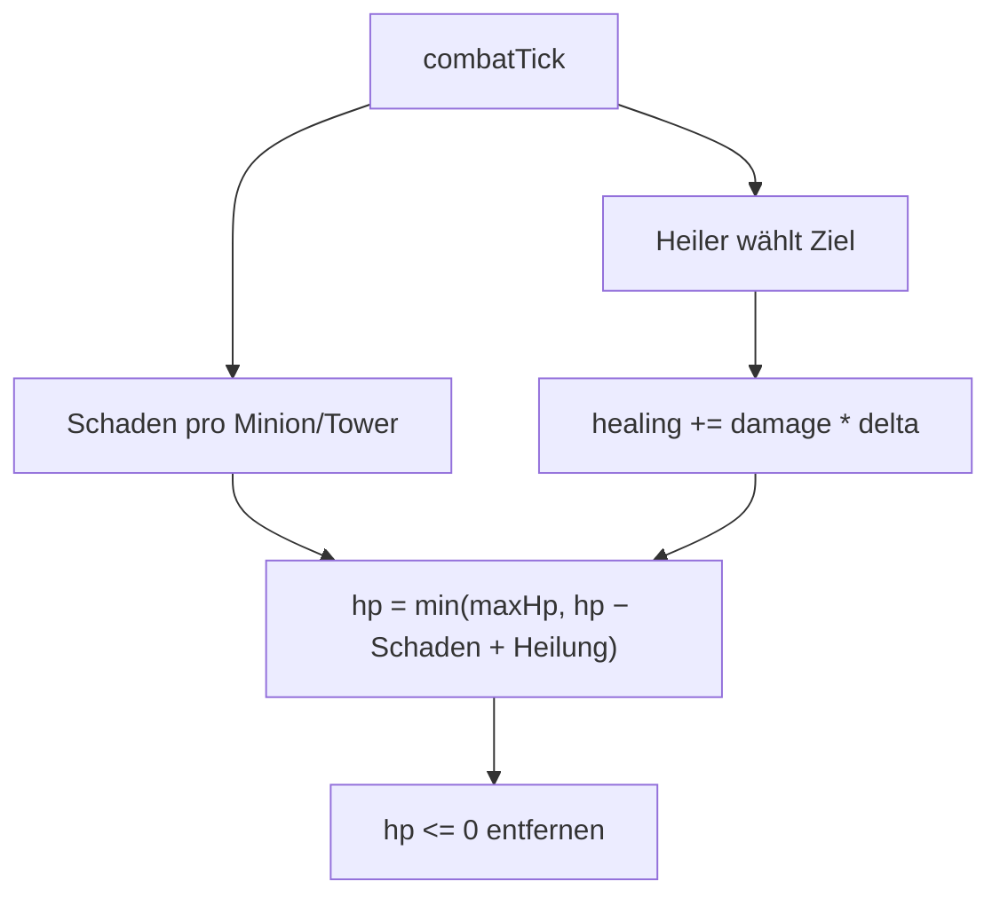

# Anwendung: Heiler-Karte mit Heilung für Minions derselben Line

Die Regel steht im [Designkonzept](designkonzept.md) (Abschnitt 4). Der Heiler ist nach dem Bogenschützen die zweite
Rolle mit eigener Reichweite; neu ist nur die Regeneration im Kampf-Tick.

## Die Regel

| Karte | Kosten | LP | Heilung/s (`damage`) | `range` | `speed` | Kopien im Deck |
| --- | --- | --- | --- | --- | --- | --- |
| `summon-healer` (Heiler) | 2 | 20 | 5 | 10 | 10 | 1 |

- Die Karte trägt `role: 'healer'`; beim Beschwören setzt `playCard` am Minion `heals: true` und `maxHp` (= `hp` samt
  Line-Bonus). Andere Minions haben kein `heals`.
- `combatTick` (`src/logic/combat.ts`): Ein Heiler heilt pro Tick `damage * deltaSeconds` auf **einen** verbündeten
  Minion derselben Line mit Abstand `|position − heiler.position| <= range`. Ziel: verwundet (`hp < maxHp`), lebend,
  nicht der Heiler selbst, niedrigster HP-Anteil, bei Gleichstand der kleinere Index.
- Ein Heiler greift nie an (weder Minion noch Tower) und läuft immer mit seinem Tempo weiter.
- Heilung wird wie Schaden aus dem Zustand vor dem Tick berechnet und danach angewendet:
  `hp = min(maxHp, hp − Schaden + Heilung)`. Stirbt ein Minion im selben Tick (`hp <= 1e-9`), wird er entfernt, auch
  wenn er geheilt würde; die Heilung wird also mit dem Schaden verrechnet.
- Der `DamageCollector` und `match-stats.ts` kennen Heilung nicht; die Statistik bleibt unverändert.

## Entscheidungen

- `Minion.maxHp` und `Minion.heals` sind optional (`maxHp ?? hp`), damit bestehende Fixtures unverändert bleiben.
- Minion-Upgrades wirken nur über den Line-Bonus beim Beschwören; bereits stehende Minions ändern sich nicht. `maxHp`
  nimmt den Bonus daher beim Beschwören mit, ein späteres Upgrade erhöht ihn nicht.
- Anzeige: gleiche Farbe wie andere Minions, dazu ein grüner Punkt in der Mitte (`drawMinions`); Name über `def.name`.
- Bot: `summon-healer` steht in `PRIORITY` hinter `summon-archer`, Linewahl wie bei jedem `summon`.

## Geänderte Dateien

`src/logic/cards.ts`, `combat.ts`, `match.ts`, `bot.ts`, `src/scenes/main-scene.ts`, Tests in `combat.test.ts`,
`cards.test.ts`, `bot.test.ts`, dazu diese Seite und `docs/designkonzept.md`.

## Nicht enthalten

Heilung von Towern, über Lines hinweg oder für den Gegner; Wiederbelebung, Schilde, Auren; Stehenbleiben des Heilers;
Balance-Feinjustierung.
