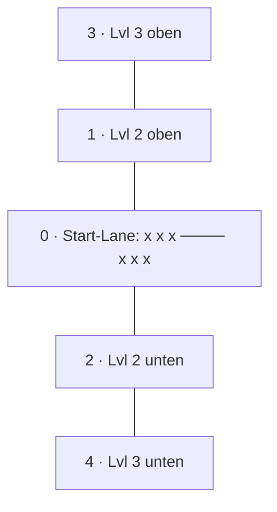

# Anwendung: Horizontale Lane mit Level-Ausbau nach oben und unten

Diese Seite beschreibt den Umbau des Spielfelds von drei senkrechten Lines auf eine waagrechte Lane, die pro
Ausbaustufe nach oben und unten wächst (Auftrag „Horizontale Lane mit Level-Ausbau nach oben und unten“).

## Entscheidungen und Annahmen

| Frage aus dem Auftrag | Entscheidung |
| --- | --- |
| Gibt es weiter einen Gegner, und wo steht er? | Ja. Der Mensch (Spieler 0) steht links, der Bot (Spieler 1) rechts. Beide haben dasselbe Layout; Minions laufen aufeinander zu. |
| „Jewels / drei Formen horizontal“ | **Annahme:** Gemeint sind die drei Tower der Start-Lane, die nebeneinander am eigenen Ende stehen. Es sind echte Tower (je 100 LP), kein bloßes Bild: Der Spieler verliert, wenn alle seine Tower fallen, wie vorher bei drei Lines. Die Annahme ist nicht mit dem Auftraggeber bestätigt. |
| Tower der Ausbau-Lanes | Je ein Tower pro Lane und Spieler (Annahme, Skizze zeigt sie nicht). Er entsteht beim Freischalten mit vollen Werten. |
| Was löst den Ausbau aus? | Die Karte `line-upgrade` (jetzt „Lane +1“, Kosten 2) wirkt auf das ganze Feld und hat kein Ziel mehr. Höchststufe `MAX_FIELD_LEVEL = 3` (vorher Line-Stufe bis 5). |
| Kapazität | `lineCapacity(level) = 2 + level` je freier Lane, abhängig von der Feld-Stufe des Spielers (nicht mehr je Line). |
| Platzierungszone „um die Tower herum“ | Slots liegen weiter auf Position 2, 6, … bis 30 und umschließen damit die Tower der Start-Lane bei 0, 8 und 16 (Plätze zwischen und vor den Towern). Gezeichnet stehen Minions quer zur Lane auf drei Bahnen (`laneStagger`), also oberhalb, auf und unterhalb der Tower. |
| Tower-Upgrade auf der Start-Lane | `tower-hp` und `tower-damage` treffen den lebenden Tower der Lane mit den wenigsten LP (bei Gleichstand den hinteren), sonst den ersten. Ein Upgrade verstärkt also nie alle drei Tower. |
| Alte Links und Replays | `RECORD_VERSION` steigt auf 2 (Präfix `v2`). Links mit `v1` gelten als ungültig und führen zu „Replay nicht möglich“. |
| Balancing | Nur das Nötige: Werte der Karten, Tower und Energie sind unverändert. Folge des Umbaus: Ein Spieler mit mehr freien Lanes hat mehr Tower-LP (Rundenlimit-Wertung) und mehr Kapazität; das ist ungeprüft (siehe offene Punkte). |

## Lane-Layout (`src/logic/lanes.ts`)

Lane-Index → Reihe im Feld (0 = Start-Lane, negativ oben, positiv unten) und Freischalt-Stufe:

| Index | Name | Reihe | Ab Stufe | Tower |
| --- | --- | --- | --- | --- |
| 0 | Start-Lane | 0 | 1 | 3 (Standort 0, 8, 16) |
| 1 | Lvl 2 oben | −1 | 2 | 1 |
| 2 | Lvl 2 unten | +1 | 2 | 1 |
| 3 | Lvl 3 oben | −2 | 3 | 1 |
| 4 | Lvl 3 unten | +2 | 3 | 1 |

- `unlockedLanes(level)` liefert die freien Lanes von oben nach unten (Stufe 1: `[0]`, 2: `[1, 0, 2]`, 3: `[3, 1, 0, 2, 4]`).
- `isLaneUnlocked(level, lane)`, `laneRow`, `laneUnlockLevel`, `laneTowerOffsets`, `laneName`, `laneShortName`.
- `PlayerState.lines` hat immer 5 Einträge (`LINE_COUNT = LANE_COUNT`); gesperrte Lanes haben `towers: []`. Beim Spielen von
  „Lane +1“ bekommen die frisch freien Lanes ihre Tower (`createLaneTowers`).
- `PlayerState.level` ist die Feld-Stufe, `LineState.level` entfällt. `laneSlotCounts(level)` liefert die Slot-Zahl je Lane
  (0 für gesperrte) für die Zeiger-Zuordnung.

## Geänderte Regeln

- **Kampf (`combat.ts`):** `Tower.offset`, `lines[i].towers`. Ein Minion greift den nächsten lebenden Tower seiner Lane an
  (`towerDistance ≤ range`), jeder Tower schießt von seinem Standort aus (`TOWER_RANGE`). Lanes ohne Tower (gesperrt) treffen
  Minions nicht; sie laufen bis ans Ende. `towersAlive` und `totalTowerHp` zählen über alle Tower.
- **Match (`match.ts`):** Beschwören, Verschieben und Karten mit Ziel verlangen eine freie Lane (sonst `invalid-line`).
  `line-upgrade` ist `target: 'none'`; ab Stufe 3 meldet `playCard` `max-level`. `respawnSurvivors` ist unverändert: Überlebende
  behalten Lane und Werte, stehen auf den niedrigsten freien Slots ihrer Lane, Tote entfallen.
- **Platzierung (`placement.ts`):** `LineGeometry` ist waagrecht (`laneCenters`, `laneHalfHeight`, `ownTowerX`,
  `enemyTowerX`), `positionToX`/`xToPosition` ersetzen `positionToY`/`yToPosition`. `dropTargetAt` trifft nur freie Lanes.
- **Bot (`bot.ts`):** wählt nur freie Lanes; „Lane +1“ spielt er ohne Ziel (Priorität unverändert).
- **Aufzeichnung (`match-record.ts`, `replay.ts`):** Version 2, Lane-Namen im Replay-Kommentar („auf Lvl 2 oben“).
- **Effekte (`fx-events.ts`):** `tower-damage` und `tower-down` tragen den Tower-Index (`tower`).
- **Statistik:** „Karten pro Lane“ mit fünf Spalten (Start, O2, U2, O3, U3).

## Darstellung (`src/scenes/`)

- Spielfläche 360 × 640: Lanes im Abstand von 70 px (Start-Lane bei y = 232), Position 0 bei x = 30, Position 100 bei x = 330.
- Gesperrte Lanes liegen abgedunkelt mit „mit Lane +1 (Lvl n)“; die Tower des Bots werden auch dort gezeichnet.
- Tower sind kompakt (20 px), Lebensbalken darüber. Minions schauen nach rechts (Mensch) bzw. links (Bot).
- Der Hintergrund (`textures.ts`) zeichnet alle fünf Wege einmal; Freischaltung wirkt nur über die dunkle Abdeckung.
- `iso.ts` wird von keiner Szene genutzt und bleibt unverändert (vertikales Welt-Modell, `LINE_COUNT` ist jetzt 5).

## Tests

- `lanes.test.ts`: Anzahl und Anordnung nach Stufe 1, 2 und 3, Symmetrie, ungültige Indizes, Tower-Standorte, Namen.
- `match.test.ts`: Start (eine Lane, drei Tower), Ausbau Lvl 2 und Lvl 3 mit Towern, `max-level`, gesperrte Lanes lehnen
  Beschwörung ab, Tower-Upgrade, Sieg und Respawn über mehrere Lanes (Überlebende unverändert, Tote entfallen).
- `placement.test.ts`: belegter und ungültiger Platz, gesperrte Lane, volle Lane, Verschieben und Zurücknehmen
  (auch Spieler 1 und außerhalb der Planung), Zeiger → Lane/Slot.
- `combat.test.ts`: mehrere Tower je Lane (nächster Tower zuerst, Standort-Reichweite, Rest-HP-Deckel, Lane ohne Tower).
- `bot.test.ts`, `fx-events.test.ts`, `match-record.test.ts`, `replay.test.ts`, `minion-look.test.ts`, `card-style.test.ts`:
  an das neue Layout angepasst; neu u. a. Ablehnung von `v1`-Links und gesperrten Lanes.
- E2E (`e2e/*.spec.ts`): Drag-and-Drop auf Lane-Koordinaten (Hilfe `unlockField` schaltet Lanes im Test frei), Ausbau
  Lvl 1 → 2 → 3 sichtbar, Karte ohne Ziel wird beim Antippen sofort gespielt.

## Offene Punkte

- Annahme zu den drei Towern und zum Tower je Ausbau-Lane mit dem Auftraggeber bestätigen.
- Balance: Der Bot baut das Feld ebenso aus; ob 3 Tower an der Start-Lane und Ausbau-Lanes mit einem Tower ausgewogen sind,
  ist ungeprüft (`balance-sim.ts` läuft weiter, die Dev-Szene zeigt die neuen Werte).
- Nicht erreichbare Absicherungen in `match.ts` (`slot-taken` ohne Slot-Angabe, Standardtempo) und `cards.ts` (Kopienzahl)
  sowie ein paar ältere Zweige in `replay.ts` und `balance-sim.ts` bleiben in der Coverage als Lücke stehen.
