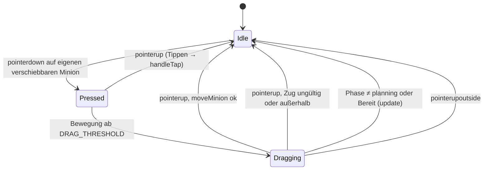

# Anwendung: Drag-and-Drop zum Verschieben von Minions

Diese Seite beschreibt, was der Auftrag „Drag-and-Drop zum Verschieben von Minions“ umgesetzt hat und wie man es
verwendet. Die Regeln stehen im [Designkonzept](designkonzept.md); die Slot-Grundlagen in
[Anwendung: Iso-Umrechnung, Kamera und Slot-Platzierung](anwendung-iso-platzierung.md).

## Was der Spieler tut

In der Planungsphase zieht der Mensch einen **eigenen, in dieser Planung beschworenen** Minion mit Maus oder Finger auf
einen anderen freien Slot, auch auf einer anderen Line.

- Der Minion folgt dem Zeiger. Die Ziel-Line und (falls getroffen) der Ziel-Slot sind grün markiert, wenn der Zug gültig
  ist, sonst rot.
- Loslassen über einem freien Slot verschiebt den Minion (kostenlos).
- Bei einem Fehler bleibt der Minion am alten Platz, und die Szene zeigt die Meldung aus `explain()`:
  „Line ist voll“, „Platz ist belegt“ oder „Hier ist kein Platz“.
- Loslassen außerhalb aller Lines: nichts passiert, keine Meldung.
- Loslassen auf dem eigenen Slot lässt den Minion liegen, ohne Fehler.
- Minions früherer Planungen, Gegner-Minions sowie alles nach „Bereit“ oder im Kampf lassen sich nicht ziehen.
- Ein kurzes Antippen (Bewegung unter 8 px) verhält sich wie vorher: Kartenauswahl, Line-Auswahl und „Bereit“.

## Ablauf (Zustände)



## Geänderte Dateien

| Datei | Änderung |
| --- | --- |
| `src/logic/placement.ts` | Neue reine Funktionen und Typen für die Zuordnung Zeiger ↔ (Line, Slot) |
| `src/logic/placement.test.ts` | Tests dafür (Treffer auf Slot, Line ohne Slot, außerhalb, Umrechnung y ↔ Position) |
| `src/scenes/main-scene.ts` | Drag-Zustand, Pointer-Handler, Zeichnen von Minion und Zielmarkierung |
| `index.html` | `touch-action: none` für den Canvas (kein Scrollen/Zoomen beim Ziehen) |
| `e2e/smoke.spec.ts` | Browser-Test „ein beschworener Minion lässt sich in der Planung ziehen, danach nicht mehr“ |

`moveMinion`, `playCard` und die Kampflogik sind unverändert; es gibt keine neuen Spielregeln.

## Reine Logik (`src/logic/placement.ts`)

Alle Funktionen sind ohne Phaser und DOM und rechnen mit `slotPosition` und `LINE_LENGTH`.

| Name | Zweck |
| --- | --- |
| `LineGeometry` | Anzeige-Geometrie: `lineCenters`, `lineHalfWidth`, `ownTowerY`, `enemyTowerY` |
| `DropTarget` | `{ line, slot }`; `slot` ist `null`, wenn auf der Line kein Slot unter dem Zeiger liegt |
| `positionToY(position, geometry)` | Line-Position → Anzeige-y des eigenen Spielers |
| `yToPosition(y, geometry)` | Umkehrung davon |
| `slotAtPosition(position, slotCount)` | Nächster gültiger Slot, höchstens `SLOT_SPACING / 2` entfernt, sonst `null` |
| `dropTargetAt(x, y, geometry, slotCounts)` | Zeigerpunkt → `DropTarget`, oder `null` außerhalb aller Lines |

Beispiel:

```ts
const counts = state.players[HUMAN].lines.map((line) => lineCapacity(line.level));
const target = dropTargetAt(pointer.worldX, pointer.worldY, GEOMETRY, counts);
if (target) {
  const result = moveMinion(state, HUMAN, minionId, target.line, target.slot ?? -1);
}
```

`dropTargetAt` akzeptiert y von 30 px über dem gegnerischen Tower bis 12 px unter dem eigenen Tower. Ein `slot` von
`null` wird als `-1` an `moveMinion` gegeben und ergibt `invalid-slot` („Hier ist kein Platz“).

## Szene (`src/scenes/main-scene.ts`)

- Konstanten: `MINION_RADIUS` 7 (gezeichnet), `GRAB_RADIUS` 18 (Trefferfläche zum Greifen, großzügig für Touch),
  `DRAG_THRESHOLD` 8 (Spielpixel).
- `DragState` hält `minionId`, Startpunkt, aktuellen Punkt, `dragging`, `target` und `valid`.
- `grabbableMinionAt` liefert nur Minions aus `player.placements` und nur in der Planung vor „Bereit“. Bei mehreren
  Treffern gewinnt der nächste.
- `onPointerDown` startet einen Drag, sonst läuft `handleTap` wie bisher. `onPointerMove` setzt Ziel und Gültigkeit
  (Probelauf mit `moveMinion`, der Zustand wird nicht übernommen). `onPointerUp` wendet den Zug an oder behandelt ein
  Tippen.
- `update()` verwirft den Drag, sobald die Phase nicht mehr `planning` ist oder der Mensch „Bereit“ ist. `pointerupoutside`
  bricht ebenfalls ab.
- `lineY` zeichnet die Position des Menschen über `positionToY`, damit gezeichnete und logische Position übereinstimmen.
  Die Bot-Seite behält ihre eigene Formel, da nur der Mensch Zeigerkoordinaten braucht.
- Gezeichnet wird in `render()`: Zielmarkierung (Line und Slot), der gezogene Minion am Zeiger, der Originalplatz ohne
  Minion.

## Tests

- `placement.test.ts`: 23 Tests, darunter die neuen Funktionen.
- Geprüft im Testlauf: `npm run typecheck`, Vitest und `npm run test:smoke` laufen grün. Die visuelle Prüfung (Desktop und
  Handy) war ohne Befund. Der Review war ohne blockierende Befunde.

## Worauf zu achten ist

- **Der Drag-Browsertest wurde im Testlauf übersprungen.** Er startet nur, wenn die Starthand zufällig einen Minion
  enthält (`test.skip` sonst). Das Ziehen ist deshalb nicht per Browser abgesichert. Abhilfe: fester Seed oder gezielt
  gesetzte Hand. Die Prüfung nach „Bereit“ (`line` ungleich 2) ist schwach; besser ist ein Vergleich mit Line und
  Position vor dem Drag. Die Testkoordinaten (400, 310) sind fest eingetragen.
- **Ein Mensch sollte Ziehen mit Maus und Touch einmal von Hand prüfen**; echtes Touch-Verhalten auf einem Gerät ist
  nicht automatisch getestet.
- `pointermove` und `pointerup` unterscheiden nicht nach Pointer-Id. Ein zweiter Finger kann einen laufenden Drag
  stören. Mehrfinger-Gesten sind laut Auftrag ausgeklammert.
- Der Drag nutzt Spielkoordinaten (`pointer.worldX/worldY`, Ansicht 360 × 640). Wird später die Iso-Kamera angebunden
  (siehe [Iso-Seite](anwendung-iso-platzierung.md), „Nächste Schritte“), muss `dropTargetAt` bzw. die Geometrie dafür
  angepasst werden (z. B. über `screenToWorld`).
- Kein Kartendrag aus der Hand, kein Verschieben von Gegner-Minions, kein Undo per Geste (`undoSummon` bleibt unberührt).
