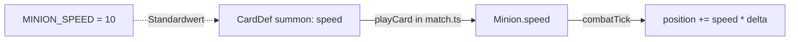

# Anwendung: Minion-Tempo als Feld, Brocken mit Tempo 8

Diese Seite beschreibt, was der Auftrag „Minion-Tempo als Feld, Brocken mit Tempo 8“ umgesetzt hat und worauf zu achten
ist. Die Regel steht im [Designkonzept](designkonzept.md) (Abschnitt 3 und 4).

## Die Regel

Jeder `Minion` (`src/logic/combat.ts`) hat das Pflichtfeld `speed` (Einheiten pro Sekunde). `combatTick` bewegt ihn mit
`minion.speed * deltaSeconds`; die Position bleibt bei `LINE_LENGTH` gedeckelt. Ein Minion bleibt wie bisher stehen,
sobald ein Ziel oder der Tower in Reichweite ist, unabhängig vom Tempo.

```ts
nextPosition = Math.min(LINE_LENGTH, minion.position + minion.speed * deltaSeconds)
```

`MINION_SPEED = 10` bleibt als Standardwert erhalten. Er wird nur noch in `cards.ts` für `summon-minion` und in Tests
verwendet, nicht mehr direkt in der Bewegung.

| Karte | `speed` |
| --- | --- |
| `summon-minion` (Minion) | `MINION_SPEED` (10) |
| `summon-brute` (Brocken) | 8 |



Beim Beschwören übernimmt `playCard` (`match.ts`) `def.speed` in den neuen Minion. Line-Boni und `minion-upgrade`-Karten
ändern nur `hp` und `damage`, nie `speed`. Nach 1 s (20 Ticks) liegen Tempo 10 und Tempo 8 vom gleichen Start 2 Einheiten
auseinander, die Wellen staffeln sich.

## Geänderte Dateien

| Datei | Änderung |
| --- | --- |
| `src/logic/combat.ts` | `Minion.speed` ergänzt; `combatTick` nutzt `minion.speed`; Kommentar an `MINION_SPEED` |
| `src/logic/cards.ts` | `CardDef` für `summon` um `speed` erweitert; Minion 10 (`MINION_SPEED`), Brocken 8 |
| `src/logic/match.ts` | Beschwören setzt `speed: def.speed` |
| `src/logic/combat.test.ts` | Neue Tempo-Tests: 8 bzw. 10 Einheiten in 1 s, Differenz 2, Stehenbleiben bei Ziel/Tower, `LINE_LENGTH` bei hohem Tempo |
| `src/logic/match.test.ts` | Brocken `speed === 8`, Minion `speed === 10`, Upgrades ändern `speed` nicht; Fixtures um `speed` ergänzt |
| `src/logic/cards.test.ts` | Jede Summon-Karte hat ein positives `speed` |
| `src/logic/bot.test.ts`, `src/logic/placement.test.ts` | Fixtures um `speed: 10` ergänzt |
| `docs/designkonzept.md` | Brocken „vorhanden“; Zeile `MINION_SPEED` in Abschnitt 3 angepasst |

Außerhalb von `match.ts` und den Tests werden keine `Minion`-Objekte angelegt. Szenen, Grafiken und Anzeige sind nicht
betroffen.

## Prüfung

`npm run typecheck`, die Tests in `bot`, `cards`, `combat`, `match` und `placement` (116 Tests) und `npm run test:smoke`
(2 Tests) waren grün. Der Review war freigegeben, ohne blockierende Befunde.

## Worauf zu achten ist

- **Balance:** Mit Tempo 8 treffen sich Wellen mit Brocken später; Bot-Verhalten und Spielausgang verschieben sich leicht.
  Es wurde keine neue Balance-Simulation durchgeführt. Bestehende Tests mit festen Positionen nach Zeit mussten nicht
  geändert werden.
- **Neue Minions:** Wer einen `Minion` direkt anlegt (Tests, Fixtures), muss `speed` setzen; sonst schlägt die
  Typprüfung fehl.
- **Folgeauftrag Bogenschütze:** Das Tempo wird direkt in der Karten-Definition gesetzt. `MINION_RANGE` bleibt global; ein
  Feld `range` am Minion gehört zum Folgeauftrag.
- **Zeilenlänge:** Die Zeile von `summon-minion` in `cards.ts` und zwei `speed: 10`-Zeilen in `match.test.ts` sind länger
  als 120 Zeichen. Im Repo gibt es keine Prettier- oder ESLint-Konfiguration, daher folgenlos; bei Bedarf umbrechen.
- **Import:** `cards.ts` importiert `MINION_SPEED` aus `combat.ts`. Das ergibt keinen Zyklus, weil `combat.ts` nichts
  importiert.
- **Unverändert:** Bot-Priorität, Kartenkosten, LP, Schaden, Seed und `delta`-basierte Ticks.
