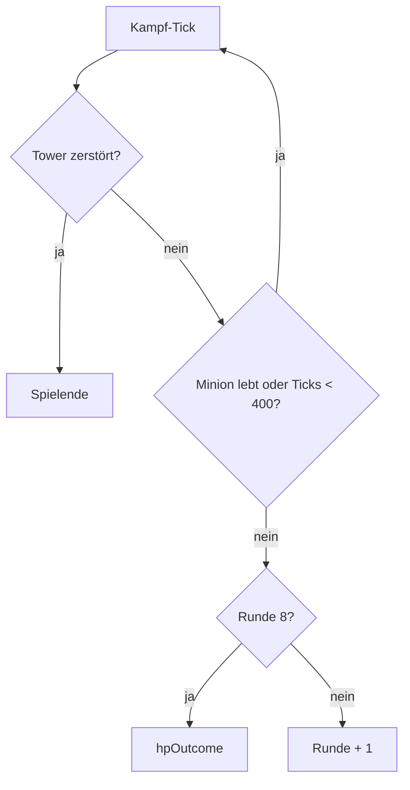

# Anwendung: Runde endet bei toten Einheiten, Bogenschützen wachsen mit der Runde

## Regeln

1. **Vorzeitiges Rundenende** (`advance`, `src/logic/match.ts`): Nach jedem Kampf-Tick gilt der Reihe nach
   `destroyedOutcome` (Tower-Sieg), dann „400 Ticks erreicht **oder** kein Minion mit `hp > 0` mehr“
   (`anyMinionAlive`). Ergebnis: `startRound(round + 1)`, in Runde 8 `finish(hpOutcome)`. Ohne Minions endet die
   Kampfphase also schon nach dem ersten Tick.
2. **Bogenschütze skaliert** (`summonCount`, `src/logic/cards.ts`): `summon-archer` beschwört in Runde N genau N
   Einheiten; andere Karten eine. Kosten bleiben unverändert (eine Karte, einmal Energie).
3. **Slots:** Der gewünschte Slot kommt zuerst, dann die niedrigsten freien der Lane. Sind weniger frei als N,
   werden nur so viele Einheiten gesetzt (Begrenzung, nie ein Slot doppelt). Ist kein Slot frei: `line-full`.
   Eine Lane mit 3 Towern fasst 6 Slots, daher setzen Bogenschützen in Runde 7 und 8 höchstens 6.
4. **Undo:** `placements[].group` (Id des ersten Minions der Karte) verbindet die Einheiten einer Karte.
   `undoSummon` entfernt alle, erstattet Energie und Karte einmal und korrigiert die Statistik je Einheit.

## Aufzeichnung, Bot, Balance

Eine `play`-Aktion bleibt ein Eintrag; die Zahl der Einheiten folgt deterministisch aus Runde und Slots, daher
funktionieren Match-Record, Replay (Undo über die Id der ersten Einheit) und Bot unverändert. `balance-sim.ts` wurde
nicht neu ausgewertet.

## Hinweise

- Die Annahme „N als Multiplikator der Beschwörung“ wurde umgesetzt (keine kostenlosen Einheiten).
- Balance: Aussterben beider Seiten verkürzt Runden; Energie und Zugrate sind unverändert.
- Szenen und Smoke-Test blieben unverändert.
