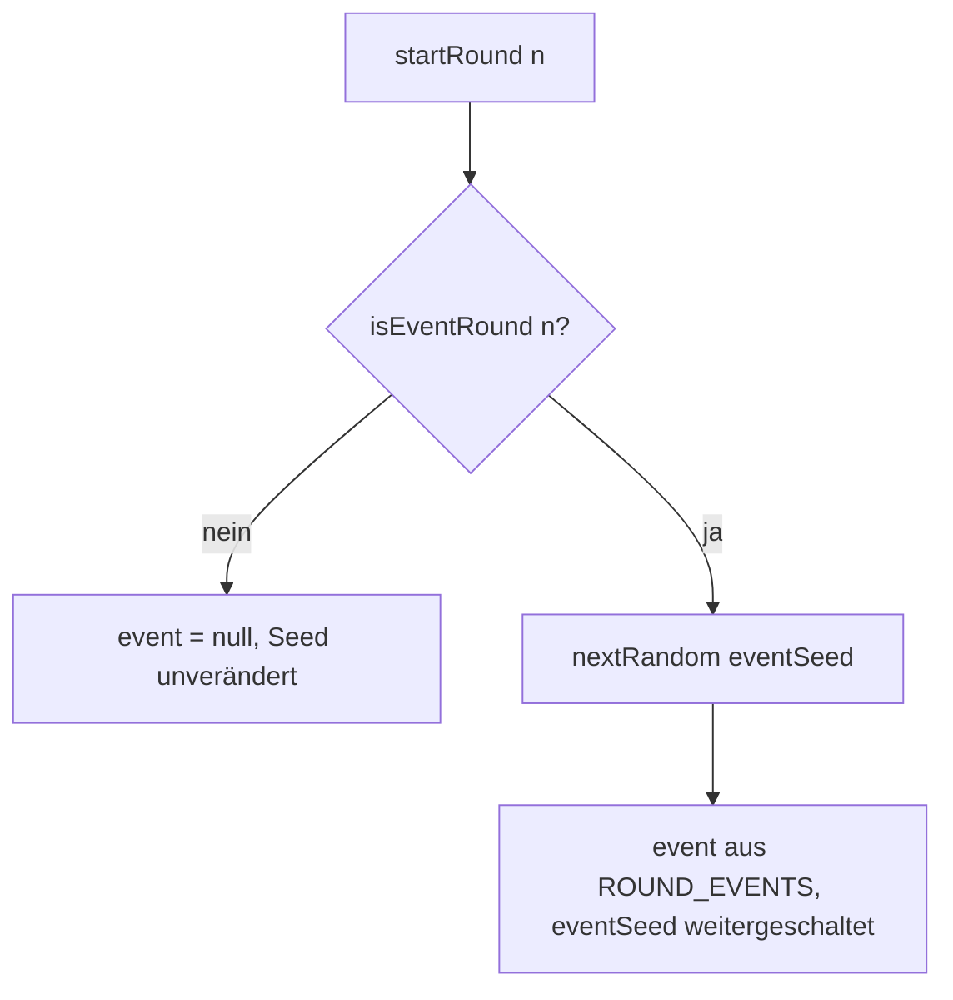

# Anwendung: Runden-Ereignisse als deterministische Modifikatoren

Jede dritte Runde (3 und 6 bei `MAX_ROUNDS = 8`) löst ein Ereignis aus einem festen Pool aus. Es gilt für beide Spieler
gleich, steht beim Rundenstart fest und ist ab der Planung sichtbar. Die Kampfberechnung bleibt zufallsfrei.

## Pool

| ID | Name | Wirkung | Konstante |
| --- | --- | --- | --- |
| `energy` | Energieschub | Energie der Runde +1, höchstens `MAX_ENERGY` (`roundEnergy` in `match.ts`) | `EVENT_ENERGY_BONUS = 1` |
| `early-respawn` | Früher Aufbruch | Überlebende Minions starten die Kampfphase weiter vorn (`applyEarlyRespawn` in `match.ts`, beim Wechsel in die Kampfphase durch `setReady`) | `EARLY_RESPAWN_TICKS = 20` (1 s, Strecke = Tempo × Ticks × `TICK_SECONDS`) |
| `tower-shield` | Tower-Schild | Jeder lebende Tower erhält `Tower.shield`; `combatTick` zieht Schaden zuerst vom Schild ab, erst dann von den HP. Der Schild verfällt am Ende der Kampfphase | `TOWER_SHIELD = 30` |

Neu beschworene Minions erhalten beim „Früheren Aufbruch“ keinen Vorsprung, ihre Slots bleiben in der Planung unberührt.

## Auswahl

- `MatchState.eventSeed` startet bei `deriveEventSeed(seed)`, getrennt vom Deck-Seed. Nur `nextRandom` schaltet ihn
  weiter, daher ändert sich die Kartenreihenfolge nicht.
- `MatchState.event` ist das aktive Ereignis der Runde (`null` ohne Ereignis).
- Replay und Match-Record brauchen keine neuen Felder: Das Ereignis folgt allein aus dem Seed und dem Rundenverlauf, daher
  liefert `?replay=<seed>` dasselbe Ergebnis.

## Anzeige und Balance

- Die Match-Szene zeigt in Ereignisrunden Name und Kurzbeschreibung unter „Gegner: n Karten“. Beim Rundenstart nennt das Banner den Ereignisnamen
  (siehe `anwendung-rundenwechsel-banner.md`).
- `BalanceReport.eventCounts` zählt je Ereignis die Häufigkeit (reproduzierbar über den Startseed); die Balance-Szene
  gibt die Zähler in einer Zeile aus.

## Geänderte Dateien

`src/logic/round-events.ts` (neu), `src/logic/match.ts`, `src/logic/combat.ts`, `src/logic/balance-sim.ts`,
`src/scenes/main-scene.ts`, `src/scenes/balance-scene.ts`, zugehörige Tests, `docs/designkonzept.md`,
`docs/handbuch.md`, `README.md`.

## Worauf zu achten ist

- Kein `Math.random`; neue Ereignistypen gehören in `ROUND_EVENTS` und brauchen einen Test.
- Die Balance-Simulation sollte vor und nach der Änderung verglichen werden: Die Ereignisse verschieben die Siegquoten
  leicht, `eventCounts` zeigt, wie oft jedes Ereignis dran war.
- Kein Schild-Zeichnen: Es gibt bewusst keine neuen Grafiken; der Schild wirkt nur in der Logik.
