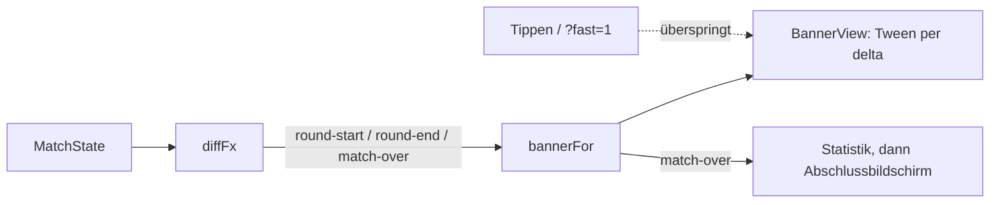

# Anwendung: Rundenwechsel-Banner und Abschlussbildschirm

Rundenstart, Rundenende und Spielende werden mit einem Pergament-/Gold-Banner inszeniert. Nach dem Spielende folgt ein
Abschlussbildschirm. Texte, Farbton und Dauer kommen aus der reinen Logik, die Szene zeichnet nur.

## Logik (`src/logic/phase-banner.ts`)

| Ereignis | Titel | Untertitel | Farbton | Dauer |
| --- | --- | --- | --- | --- |
| `round-start` | „Runde N“ | Ereignisname (Runde 3, 6), sonst „von 8“ (`MAX_ROUNDS`) | `event` / `round` | 1800 ms |
| `round-end` | „Runde N beendet“ | leer | `round` | 900 ms |
| `match-over` | „Sieg“, „Niederlage“, „Unentschieden“ | leer | `victory`, `defeat`, `draw` | 2400 ms |

- `bannerFor(event, state)` liefert `{ title, subtitle, tone, durationMs }` oder `null` für alle anderen Ereignisse.
  Ohne Zufall und Systemzeit.
- Ablauf: `startBanner`, `advanceBanner(run, deltaMs)` (`null` am Ende), `skipBanner` (springt an den Beginn des
  Ausfahrens), `bannerSlide` (0 bis 1, weicher Verlauf über `BANNER_SLIDE_MS = 240`).
- Bilanz: `summarizeStats(stats)` in `match-stats.ts` fasst Beschwörungen, Schaden an Minions und Towern sowie die
  stärkste Karte zusammen. Keine neue Statistik.

## Szene

- `src/scenes/banner-view.ts`: `BannerView` (Container über allem, fährt von links ein und aus), dazu `drawCrest`
  (Wappen) und `drawRays` (drehende Lichtstrahlen, Zeit aus `delta`).
- Das Banner liegt als Streifen bei y 170–246. Nur ein Tippen in diesen Streifen überspringt es und wird verbraucht.
  Karten, „Bereit“ und der Rest der Planung bleiben bedienbar.
- Spielende: erst Banner, dann Statistik (`renderStats`, „Schließen“), dann der Abschlussbildschirm (`renderEndScreen`)
  mit Wappen in der Teamfarbe (blau bei Sieg/Unentschieden, orange bei Niederlage), Strahlen, Bilanz, Teilen-URL,
  „Link kopieren“ und „Tippen für ein neues Spiel“. Ein Tippen während des Banners blendet es aus.
- Schnellvorlauf: `?fast=1` (`parseFast` in `seed.ts`). Dann erscheinen keine Banner, und das Spielende zeigt die
  Statistik sofort. `e2e/helpers.ts` hängt `fast=1` in `openGame` an. Wer das Banner testen will, öffnet `/?seed=1` ohne den
  Parameter (siehe Smoke-Fall „Rundenstart-Banner“).

## Tests

`phase-banner.test.ts` (alle Ereignisarten, Ereignis-/Nicht-Ereignisrunde, drei Ausgänge, Ablauf), `match-stats.test.ts`
(`summarizeStats`), `seed.test.ts` (`parseFast`), Smoke-Fall „Rundenstart-Banner“. Die Baseline `spielende-teilen`
in `e2e/grafik.spec.ts-snapshots/` wurde neu erzeugt, weil sich der Abschlussbildschirm geändert hat.

## Nicht Teil dieses Auftrags

Keine Töne, keine Regeländerung, keine Banner im Replay, nur Deutsch.
