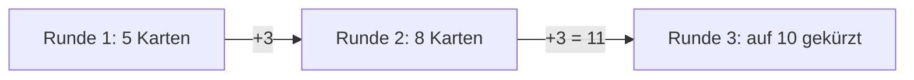

# Anwendung: Start- und Zieh-Konstanten an Soll-Werte anpassen

Diese Seite beschreibt, was der Auftrag „Start- und Zieh-Konstanten an Soll-Werte anpassen“ umgesetzt hat und worauf zu
achten ist. Die Soll-Werte stehen in der Tabelle „Soll-Änderungen an Konstanten“ im [Designkonzept](designkonzept.md),
Abschnitt 3. Die Handlimit-Regel selbst beschreibt [anwendung-handlimit.md](anwendung-handlimit.md).

## Was umgesetzt wurde

In `src/logic/match.ts` wurden zwei Konstanten geändert:

| Konstante | Vorher | Nachher |
| --- | --- | --- |
| `START_HAND` | 7 | 5 |
| `DRAW_PER_ROUND` | 5 | 3 |

Unverändert blieben `HAND_LIMIT = 10`, `MAX_ROUNDS = 8` und die Formel für die Deck-Länge
`START_HAND + DRAW_PER_ROUND * (MAX_ROUNDS - 1)`. Sie ergibt jetzt 26 statt 40 Karten.

Folge: Das Handlimit greift erst in Runde 3 (8 + 3 = 11, davon bleiben 10) und nicht mehr schon in Runde 2
(früher 7 + 5 = 12). In Runde 2 verfällt keine Karte.

## Geänderte Dateien

| Datei | Änderung |
| --- | --- |
| `src/logic/match.ts` | `START_HAND` 5, `DRAW_PER_ROUND` 3 |
| `src/logic/match.test.ts` | Erwartungen auf die neuen Werte; neue Tests für Runde 2 (nichts verfällt) und Runde 3 (Kürzung auf 10) |
| `e2e/gameplay.spec.ts` | Prüft die Handgröße nach dem Neustart mit `START_HAND` statt der festen Zahl 7 |
| `e2e/smoke.spec.ts` | Prüft die Handgröße beim Start mit `START_HAND` statt der festen Zahl 7 |
| `README.md` | Basiswerte: 5 Startkarten, 3 neue pro Runde, Limit erst ab Runde 3 |
| `docs/anwendung-handlimit.md` | Werte, Mermaid-Grafik und Testtabelle auf 5/3 angepasst |

`src/scenes/main-scene.ts` blieb unberührt, es nutzt nur `HAND_LIMIT`. `docs/designkonzept.md` blieb ebenfalls
unverändert; es ist die Soll-Quelle, und die Sätze zum Verfall statt Ablage stimmen bereits mit Zeile 43 überein.

## Tests

- `START_HAND` ist 5, `DRAW_PER_ROUND` ist 3, das Deck hat 26 Karten (feste Soll-Werte, absichtlich nicht aus den
  Konstanten abgeleitet).
- Runde 2: beide Spieler haben 8 Karten, `state.drawn` ist `START_HAND + DRAW_PER_ROUND`, nichts verfällt.
- Runde 3: beide Hände sind auf `HAND_LIMIT` (10) gekürzt, es bleiben die ersten 10 in Ankunftsreihenfolge.
- Der Test „pro Spieler“ setzt für den Gegner eine Hand mit 10 Karten, damit die Kappung sichtbar bleibt.
- Die E2E-Tests lesen die Handgröße aus `START_HAND`, damit sie bei künftigen Wertänderungen nicht brechen.

Testlauf des Testers: `npm run typecheck`, Vitest (40 Tests) und `npm run test:smoke` (10 Tests) waren grün. Der Review
war freigegeben, ohne blockierende Befunde.

## Worauf zu achten ist

- **Balancing nicht neu bewertet:** Mit 26 statt 40 Karten und kleineren Händen ändern sich Spieltempo und Spielfluss.
  `balance-sim` (Bot-Balancing) wurde mit den neuen Werten nicht neu ausgewertet. Das gehört in einen Folgeauftrag.
- **Hinweis aus dem Review:** Der Testtitel „lässt bei genau HAND_LIMIT nach dem Ziehen (7 + 3) nichts verfallen“
  enthält noch feste Zahlen. Sie stimmen, ein Titel nur mit `HAND_LIMIT` wäre robuster.
- **Designkonzept Zeile 71:** Die Begründung „7 + 5 = 12 > 10“ gehört zur Vorher-Nachher-Tabelle und beschreibt den
  alten Ist-Zustand. Das ist so gewollt.
- **Keine Abdeckungsmessung:** Ein `test:coverage`-Skript fehlt im Projekt.
- **Bei weiteren Änderungen** an `START_HAND`, `DRAW_PER_ROUND` oder `HAND_LIMIT` müssen die Tests für Runde 2 und 3
  sowie die Deck-Länge geprüft werden.
