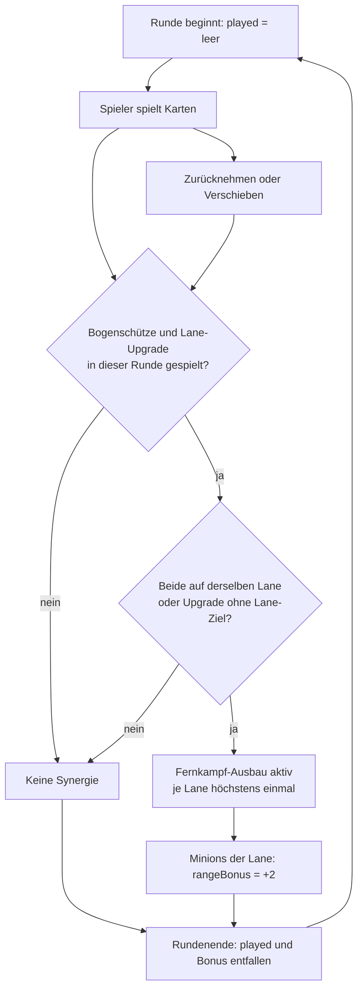

# Anwendung: Karten-Synergien

Spielt ein Spieler in derselben Runde bestimmte Karten zusammen, bekommen seine Minions bis zum Rundenende einen Bonus.
Die Regeln stehen in `src/logic/synergies.ts`; diese Datei ist die massgebliche Quelle. Hier steht nur, wie sich die
Synergie im Spiel verhält. Das Konzept steht in `docs/designkonzept.md` (Abschnitt „Synergien“), die Umsetzung in
`docs/handbuch.md` (Abschnitt „Synergien“).

## Die Synergie

| ID | Name | Karten | Bedingung | Bonus |
| --- | --- | --- | --- | --- |
| `archer-line-upgrade` | Fernkampf-Ausbau | `summon-archer` + `line-upgrade` | `sameLine` | Reichweite +2 (`modifier: { stat: 'range', amount: 2 }`) |

## Wann sie ausgelöst wird

- Beide Karten müssen in derselben Runde vom selben Spieler gespielt werden.
- `line-upgrade` hat kein Lane-Ziel und passt deshalb zur Lane jedes gespielten Bogenschützen (`pairLine`).
- Bogenschütze und Upgrade auf verschiedenen Lanes ergeben keine Synergie.
- Die Reihenfolge der gespielten Karten spielt keine Rolle.

## Bonus

- Reichweite +2 für die Minions des Spielers auf der betroffenen Lane (`synergyBonus`), auch für später beschworene und
  überlebende Minions dieser Lane. Andere Lanes und der Gegner sind nie betroffen.
- Kein Stapeln: Jede Synergie zählt je Lane höchstens einmal, auch bei mehreren Bogenschützen oder Upgrades.

## Nur für die laufende Runde

- Der Bonus steht nie in `LineState.bonus` oder in den Minion-Werten, sondern nur in `Minion.rangeBonus`.
- Zu Rundenbeginn leert `startRound` `player.played`; die Synergien werden neu berechnet (`refreshSynergies` in `match.ts`).
- Zurücknehmen oder Verschieben des Bogenschützen aktualisiert die Synergie sofort.

## Anzeige

Die Szene zeigt die aktive Synergie an der Lane (`describeSynergy`), z. B. „Fernkampf-Ausbau · Reichweite +2“.

## Beispiele

1. **Aktiv:** Bogenschütze auf Lane 1, danach `line-upgrade`. Die Synergie ist auf Lane 1 aktiv, alle Minions dort haben
   `rangeBonus = 2`. Umgekehrte Reihenfolge ergibt dasselbe.
2. **Nicht aktiv:** Nur `line-upgrade` und ein anderer Minion (kein `summon-archer`) oder Bogenschütze auf Lane 0 und
   Upgrade mit ausdrücklich anderer Lane 1 (so in `synergies.test.ts`). Es gibt keine Synergie, kein Minion erhält einen
   Bonus. Im Spiel hat `line-upgrade` kein Lane-Ziel und passt daher zu jedem gespielten Bogenschützen.
3. **Erloschen:** Die Synergie aus Beispiel 1 gilt nur bis zum Rundenende. In der nächsten Runde ist `played` leer,
   `rangeBonus` ist weg; die Karten müssen erneut gespielt werden. Nimmt der Spieler den Bogenschützen innerhalb der Runde
   zurück, erlischt die Synergie sofort.

## Neue Synergie ergänzen

1. Einen Eintrag in `SYNERGY_DEFS` (`src/logic/synergies.ts`) mit `id`, `name`, `cards`, `condition` und `modifier`
   ergänzen.
2. Einen Test in `src/logic/synergies.test.ts` schreiben (aktiv, nicht aktiv, Reihenfolge, kein Stapeln).
3. Diese Doku und den Abschnitt in `docs/designkonzept.md` anpassen.
