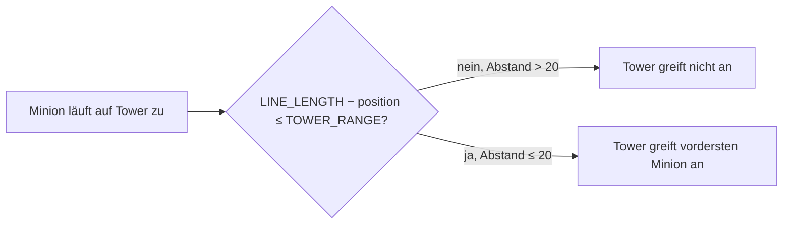

# Anwendung: Tower-Reichweite auf 20 reduzieren

Diese Seite beschreibt, was der Auftrag „Tower-Reichweite auf 20 reduzieren“ umgesetzt hat und worauf zu achten ist. Die
Regel steht im [Designkonzept](designkonzept.md).

## Die Regel

`TOWER_RANGE` (`src/logic/balance-config.ts`, per Re-Export auch aus `combat.ts`) ist jetzt `20` (vorher `25`). Die Zielwahl des Towers blieb **unverändert**:

```ts
LINE_LENGTH - other.position > TOWER_RANGE // Minion außerhalb: kein Ziel
```

Der Tower greift den vordersten Minion an, dessen Abstand zum Tower höchstens `TOWER_RANGE` beträgt. Die Konstante ist
die einzige Stelle mit dem Wert; im Quellcode steht keine feste 20 oder 25. `MINION_RANGE = 4` blieb unverändert.



| Abstand zum Tower | 20 (genau `TOWER_RANGE`) | 21 (`TOWER_RANGE + 1`) | 22 |
| --- | --- | --- | --- |
| Vorher (Reichweite 25) | getroffen | getroffen | getroffen |
| Nachher (Reichweite 20) | getroffen | nicht getroffen | nicht getroffen |

Folge fürs Spiel: Tower greifen Minions erst aus kürzerer Distanz an, Fernkämpfer lassen sich weniger leicht überrennen.

## Geänderte Dateien

| Datei | Änderung |
| --- | --- |
| `src/logic/combat.ts` | `TOWER_RANGE` von 25 auf 20 |
| `src/logic/combat.test.ts` | Drei neue Tests, die `TOWER_RANGE` importieren statt die 20 festzuschreiben: Abstand `TOWER_RANGE` wird getroffen und `TOWER_RANGE + 1` nicht; Abstand 22 bleibt unbeschädigt; ein Minion im Abstand 14 (Fernkampfwert) liegt innerhalb von `TOWER_RANGE` und wird vom Tower getroffen |
| `docs/designkonzept.md` | `TOWER_RANGE` in der Tabelle „Soll-Änderungen“ als umgesetzt markiert (Ist 20, vorher 25) |

`src/logic/match.test.ts` musste nicht angepasst werden. Szenen und Grafiken (`src/scenes/`, `public/assets/`) sind nicht
betroffen.

## Prüfung

`npm run typecheck`, `npx vitest run src/logic/combat.test.ts` (12 Tests), `npm test` (127 Tests), `npm run build` und
`npm run test:smoke` (2 Tests) waren grün. Der Review war freigegeben.

## Worauf zu achten ist

- **Konstante statt Zahl:** Tests und Code sollen `TOWER_RANGE` verwenden, nicht die Zahl 20. Nur der Test für Abstand 22
  nennt eine feste Zahl, weil der Auftrag ihn so verlangt.
- **Offene Lücke Fernkämpfer:** Der Fernkampf-Test prüft nur die Tower-Seite (der Tower trifft einen Minion im Abstand 14).
  Dass der Fernkämpfer den Tower erst in `TOWER_RANGE` trifft, ist nicht getestet, weil `combat.ts` nur `MINION_RANGE = 4`
  kennt. Das gehört zum Folgeauftrag „Reichweite je Rolle“; dort ist der Test um die Minion-Seite zu ergänzen.
- **Balance:** Matchausgänge mit Tower-Kämpfen können sich leicht verschieben. Es wurde keine neue Balance-Simulation
  durchgeführt.
- **Unverändert:** `MINION_RANGE`, Schaden, Lebenspunkte und Tick-Länge; keine weiteren Soll-Änderungen.
- **Kein Login im Projekt:** Der Hinweis „Anmeldung testen“ ließ sich nicht umsetzen, es gibt keine Anmeldung in `src/`
  oder `e2e/`.
