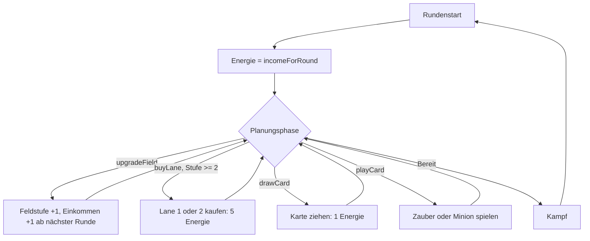

# Anwendung: Neues Wirtschaftskonzept (Einkommen, Upgrade, Lane-Kauf, Karte ziehen)

Diese Seite beschreibt die Regeln, die der Auftrag „Neues Wirtschaftskonzept mit Upgrade, Lane-Kauf und Einkommen“
umsetzt. Energie ist die einzige Währung (das „Gold“ der Idee ist dieselbe Ressource). Alle Werte stehen als Konstanten
in `src/logic/balance-config.ts` (`match.ts` führt sie per Re-Export weiter).

## Regeln

- **Start:** Beide Spieler beginnen auf Feldstufe 1 mit einem Tower-Satz und genau einer Lane (Lane 0, `bought = true`).
- **Einkommen:** `Einkommen = 3 + (Runde − 1) + Festungen + Lanes` (`incomeForRound`). *Festungen* sind die Upgrades über
  die Start-Festung hinaus (Feldstufe − 1), *Lanes* die gekauften Lanes über die Start-Lane hinaus. Start-Festung und
  Start-Lane stecken schon in den 3 (Annahme „Zählweise“ des Auftrags, anpassbar über `BASE_ENERGY`, `ENERGY_PER_ROUND`,
  `INCOME_PER_FORTRESS`, `INCOME_PER_LANE`, `START_FORTRESSES`, `START_LANES`). Zu bestätigen bleibt, ob die Start-Werte
  stattdessen zusätzlich zählen sollen.
- **Upgrade** (`upgradeField`): in jeder Planungsphase, solange `level < MAX_FIELD_LEVEL`, für `UPGRADE_COST` (2) Energie.
  Es bringt ab der nächsten Runde +1 Einkommen. Danach `max-level`. Es ist eine eigene Aktion; die Karte `line-upgrade`
  bleibt als Kartendefinition (Synergie `archer-line-upgrade`), liegt aber nicht mehr im Deck (`COPIES = 0`) und hebt
  nur die Feldstufe, ohne Lanes zu kaufen. Das Upgrade zählt für Synergien wie diese Karte.
- **Lane-Kauf** (`buyLane`): ab Feldstufe 2 (`laneUnlockLevel`) die obere (Lane 1) und/oder die untere Lane (Lane 2),
  je `LANE_COST` (5) Energie, unabhängig voneinander. Auf Stufe 1 gilt `level-too-low`, ohne Energie
  `not-enough-energy`, ein zweiter Kauf derselben Lane `lane-owned`. Die Lane bekommt beim Kauf ihre Tower und bringt +1
  Einkommen ab der nächsten Runde.
- **Karte ziehen** (`drawCard`): `DRAW_COST` (1) Energie, bei 0 Energie `not-enough-energy`, bei vollem Handlimit
  `hand-full`. Beide Spieler ziehen dieselbe Karte (`deck[drawn + extraDrawn]`), damit das Match symmetrisch bleibt.
- **Runde 1:** 3 Energie, damit gehen ein Upgrade, bis zu drei Stufe-1-Zauber (z. B. `tower-hp`) oder Ziehen.
- **`MAX_ENERGY`** = höchstes mögliches Einkommen plus Energieschub-Ereignis = 3 + 7 + 2 + 4 + 1 = **17**. Sie schneidet das
  Einkommen nie ab und begrenzt nur die Energie aus dem Abwerfen. `energyForRound` hat keinen Deckel mehr.

## Bot, Simulation, Aufzeichnung

- **Bot** (`bot.ts`): `PRIORITY` enthält die Wirtschaftsaktionen `upgrade`, `buy-lane`, `draw` (`ECONOMY_ACTIONS`).
  Upgrade und Lane-Kauf nur, solange sich der Preis bis zum Spielende amortisiert (`MAX_ROUNDS − Runde ≥ Preis`). Ziehen ist
  nur der Rückfall, wenn nichts anderes spielbar ist und danach noch 1 Energie bleibt. Das verhindert eine Schleife aus
  Ziehen (−1) und Abwerfen (+1) bei gewürfelter Reihenfolge.
- **Balance-Simulation** (`balance-sim.ts`): würfelt Karten und Wirtschaftsaktionen, zählt gespielte Karten schrittweise
  (Abwerfen und Wirtschaft zählen nicht als Einsatz).
- **Aufzeichnung** (`match-record.ts`): `RECORD_VERSION` 7 mit den Aktionen `upgrade` (`g`), `buy-lane` (`b<Lane>`) und
  `draw` (`w`). Links aus Version 6 und älter werden abgelehnt (Kompatibilität alter Replays ist nicht gefordert).
  `replay.ts` beschreibt die neuen Aktionen und deren Abbruchgründe (`lane-owned`, `hand-full`).
- **UI** (`main-scene.ts`, `field-view.ts`): Tasten „Ziehen −1“ und „Upgrade −2“ im oberen Rand, Zeile mit Feldstufe,
  Einkommen und Einkommen der nächsten Runde, gesperrte Lanes zeigen „tippen zum Kaufen (5 Energie)“ oder „ab Feld Lvl 2
  kaufbar“; Antippen kauft die Lane.

## Tests

`match.test.ts` (Block „Wirtschaft“, Einkommensformel, Upgrade, Lane-Kauf, Ziehen, `MAX_ENERGY`), `bot.test.ts` (Block
„Bot: Wirtschaft“), `match-record.test.ts` (Kodierung, Version 7), `replay.test.ts`, `balance-sim.test.ts`.

## Offen

- Kartenpreise und die Feinabstimmung von `UPGRADE_COST` und `LANE_COST` bleiben einem eigenen Balance-Auftrag überlassen.
- Die Zählweise des Einkommens (Start-Festung und Start-Lane in den 3) ist zu bestätigen.
