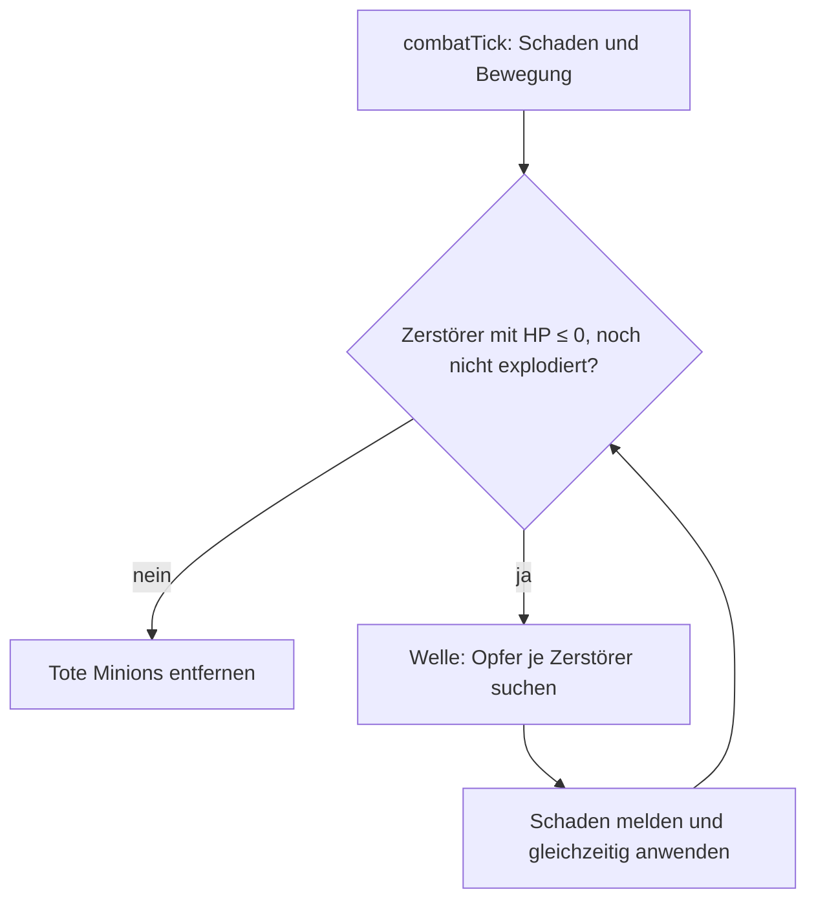

# Anwendung: Zerstörer mit Flächenschaden bei Tod

Die Regel steht im [Designkonzept](designkonzept.md) (Abschnitt 4). Der Zerstörer kämpft wie ein Nahkämpfer; neu ist
die Explosion, wenn er stirbt.

## Die Regel

| Karte | Kosten | LP | Schaden/s | `range` | `speed` | Explosion | Kopien im Deck |
| --- | --- | --- | --- | --- | --- | --- | --- |
| `summon-destroyer` (Zerstörer) | 2 | 40 | 8 | 4 | 8 | Radius 10, Schaden 15 | 1 |

- Die Karte trägt `role: 'destroyer'` und `explodes: { radius, damage }`. `playCard` kopiert `explodes` an den
  `Minion` (eigene Kopie je Minion). Andere Minions haben kein `explodes`.
- `combatTick` wendet zuerst Schaden und Bewegung an. Danach löst `resolveExplosions` (`src/logic/combat.ts`) die
  Explosion jedes Minions mit `explodes` und HP ≤ 0 aus, bevor tote Minions entfernt werden. Die Todesursache spielt
  keine Rolle (Minion oder Tower). Ein Zerstörer, der den Tick überlebt, explodiert nicht. Rückzug gibt es im Spiel
  nicht, die Explosion gilt also nur bei Tod.
- Opfer (`explosionVictims`, rein und ohne Phaser): lebende gegnerische Minions derselben Lane mit
  `|gap| <= radius`. Eigene Minions, andere Lanes und Tower nehmen keinen Schaden. Jedes Opfer wird je Explosion einmal
  getroffen; der Schaden ist fest und hängt nicht von `delta` ab.
- Der Explosionsschaden wird als Minion-Schaden des Zerstörers an den `DamageCollector` gemeldet, gedeckelt auf die
  Rest-HP des Opfers (bei mehreren Explosionen anteilig). Die Signatur bleibt gleich; `match-stats.ts` ordnet ihn über
  die Minion-ID der Karte `summon-destroyer` zu.

## Entscheidung: Kettenreaktion im selben Tick

Stirbt ein Zerstörer durch eine Explosion, explodiert er noch im selben Tick. Das läuft in Wellen: Eine Welle trifft
gleichzeitig aus demselben Vorzustand, danach folgen die in ihr gestorbenen Zerstörer. Jeder Zerstörer explodiert höchstens
einmal (Menge `exploded`), die Kette endet daher nach höchstens so vielen Wellen, wie es Minions gibt. Zwei Zerstörer,
die im selben Tick fallen, treffen sich nicht gegenseitig, sondern nur Unbeteiligte.

## Darstellung

- `minionShape` liefert `'destroyer'` (nach Heiler, vor Reichweite); `field-view.ts` zeichnet eine Stachelkugel mit
  Zündschnur. Die Kartenbeschreibung nennt den Explosionsschaden (`card-style.ts`), das Kartenbild liegt unter
  `public/assets/cards/summon-destroyer.svg`.
- `diffFx` meldet bei Tod im Kampf zusätzlich `explosion` (mit `radius`); `effects.ts` zeigt Funken und zwei Ringe,
  die bis zum Radius wachsen. Hit-Areas und Positionen sind unverändert.

## Aufzeichnung und Replay

Die neue Karte verschiebt Kartenindizes und das gemischte Deck. `RECORD_VERSION` steigt daher auf 3 (`v3…`); Links der
Version 1 und 2 werden als ungültig abgelehnt. Neue Aufzeichnungen bleiben deterministisch (kein neuer Zufall).

## Bot

`summon-destroyer` steht in `PRIORITY` hinter `summon-healer`; Linewahl wie bei jedem `summon`.

## Tests

`combat.test.ts` (Radius, Lane, eigene Minions, Überleben, Tower-Tod, delta, Kette, grosse Kette, Collector),
`cards.test.ts`, `bot.test.ts`, `match.test.ts` (Merkmal, Statistik), `fx-events.test.ts`, `minion-look.test.ts`,
`card-style.test.ts`, `match-record.test.ts` und `e2e/smoke.spec.ts` (Version 3).

## Nicht enthalten

Flächenschaden auf Tower oder über Lanes, weitere Rollen, Rebalancing bestehender Karten, Balance-Feinjustierung
(die Werte sind Startwerte; die Balance-Simulation spielt beide Seiten gleich und zeigt daher keine Siegquoten-Unterschiede).
