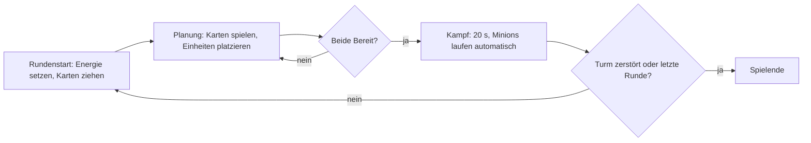

# Designkonzept TowerField

Verbindliches Konzept für das 1v1-Kartenspiel mit Minion-Kämpfen. Stand: Auftrag „Designkonzept: Karten, Minions,
Slots und Iso-Map“. **Hinweis:** Das Spielfeld ist seitdem von drei senkrechten Lines auf waagrechte Lanes mit
Level-Ausbau umgestellt; wo dieses Dokument „Line“, „3 Lines“ oder `MAX_LINE_LEVEL` nennt, gilt
[anwendung-horizontale-lane.md](anwendung-horizontale-lane.md). Werte sind Startwerte; endgültiges Balancing folgt (Abschnitt 9). Konstanten stehen in
`src/logic/` (`cards.ts`, `match.ts`, `combat.ts`, `placement.ts`, `iso.ts`).

## 1. Leitidee

| Vorbild | Übernommen |
|---|---|
| Magic / Hearthstone | Deck, Hand, Energie (Mana), Ablage, Handlimit, Kartentypen |
| Heroes of the Storm | Minions laufen automatisch in Wellen über Lines, kämpfen mit Reichweite, greifen Tower an |
| Mechabellum | Planungsphase: Einheiten platzieren, danach läuft der Kampf ohne Eingriff ab |

Sieg: alle drei gegnerischen Tower zerstört, oder nach der letzten Runde mehr Tower-Lebenspunkte. Gleichstand =
Unentschieden. Kein Zufall im Kampf; Zufall nur in der Deck-Reihenfolge (Seed).

## 2. Rundenablauf



1. **Rundenstart** (`startRound`): Energie = `energyForRound`, beide Spieler ziehen dieselben Karten, Handlimit wird
   angewendet, `placements` wird geleert.
2. **Planung** (`phase = 'planning'`): beide Spieler gleichzeitig. Karten spielen (`playCard`), Beschwörungen verschieben
   (`moveMinion`) oder zurücknehmen (`undoSummon`). „Bereit“ (`setReady`) ist endgültig für diese Runde.
3. **Kampf** (`'combat'`): `advance(state, delta)` in festen Ticks à 50 ms, `COMBAT_TICKS = 400` (20 s). Kein Eingriff.
4. **Auswertung**: nach jedem Tick `destroyedOutcome`; nach 400 Ticks entweder nächste Runde oder – nach `MAX_ROUNDS` –
   `hpOutcome`. Überlebende Minions werden in `startRound` (`respawnSurvivors`)
   nach `id` aufsteigend auf die niedrigsten freien Slots ihrer Line zurückgesetzt (HP, Werte und Line bleiben; sie
   zählen nicht zu `placements`). Gezeichnet wird jeder Minion mittig auf seiner Lane.

## 3. Kartenhandling

- **Deck:** ein per Seed gemischtes Deck, für beide Spieler gleich (`buildDeck`); gleiche Reihenfolge, daher fair und
  testbar. Länge = `START_HAND + DRAW_PER_ROUND × (MAX_ROUNDS − 1)`.
- **Hand:** Reihenfolge = Ankunft. Beim Ziehen über `HAND_LIMIT` hinaus verfallen die zuletzt gezogenen Karten (am Ende der Hand abgeschnitten, es gibt keine Ablage dafür). Verfallene
  Karten zählen als gezogen.
- **Ablage:** gespielte Karten (verfallene kommen nicht hinein; eine Ablage für sie wäre ein Folgeauftrag). Ist nur Anzeige (kein Nachmischen); Datenfeld folgt in Folgeauftrag 4.
  Eine per `undoSummon` zurückgenommene Karte kommt zurück an die Hand (nicht in die Ablage).
- **Energie:** pro Runde neu gesetzt (`3 + (Runde − 1)`, max. `MAX_ENERGY`), nicht übertragbar.
- **Ausspielen:** Phase Planung, Spieler nicht bereit, genug Energie, gültiges Ziel. Sonst Fehler (`PlayError`) und
  unveränderter Zustand.

### Kartenliste (`CARD_DEFS`)

| ID | Name | Typ | Kosten | Wirkung | Ziel | Im Deck |
|---|---|---|---|---|---|---|
| `summon-minion` | Minion | Beschwörung | 1 | Nahkämpfer, 30 LP, 6 Schaden/s | Line + Slot, Line nicht voll | 4 |
| `summon-brute` | Brocken | Beschwörung | 2 | Tank, 80 LP, 12 Schaden/s | Line + Slot, Line nicht voll | 2 |
| `line-upgrade` | Line +1 | Linien-Upgrade | 2 | Line-Stufe +1: Kapazität +1, ein Slot mehr | Line, Stufe < `MAX_LINE_LEVEL` (5) | 2 |
| `tower-hp` | Tower Leben | Turm-Upgrade | 1 | Tower-Max-LP und -LP +30 | eigene Line | 2 |
| `tower-damage` | Tower Schaden | Turm-Upgrade | 2 | Tower-Schaden +4/s | eigene Line | 1 |
| `minion-upgrade-line` | Minions Line | Minion-Upgrade | 1 | Künftige Minions der Line: +10 LP, +2 Schaden | eigene Line | 2 |
| `minion-upgrade-all` | Minions alle | Minion-Upgrade | 3 | Künftige Minions aller Lines: +5 LP, +1 Schaden | keins | 1 |
| `buff-minion` | Minion stärken | Minion-Stärkung | 2 | Ein bestehender Minion: Max-LP, LP und Schaden +50 % (Math.round) | eigener lebender Minion | 1 |

Minion-Upgrades wirken nur auf Beschwörungen **nach** dem Spielen (Bonus liegt an der Line). „Minion stärken“ ist die
Ausnahme: Sie wirkt sofort und nur auf den gewählten Minion, ändert `line.bonus` nicht und trifft später beschworene
Minions nicht. Mehrere Stärkungen wirken nacheinander auf die jeweils aktuellen Werte; der Zuwachs ist
`Math.round(Wert × 0,5)` (`buff.ts`, z. B. 5 → +3). Upgrades und Stärkungen sind nicht zurücknehmbar.

### Soll-Änderungen an Konstanten

| Konstante | Datei | Ist | Soll | Begründung |
|---|---|---|---|---|
| `START_HAND` | `match.ts` | 7 | 5 | Mobile Hand passt auf eine Zeile (5 Karten × 64 px = 320 px); weniger Auswahl, schnellere Entscheidungen |
| `DRAW_PER_ROUND` | `match.ts` | 5 | 3 | Mit 5 + 7 × 3 = 26 Karten im Deck reicht es; Hand wächst langsam, Handlimit wirkt nicht schon in Runde 2 (7 + 5 = 12 > 10) |
| `HAND_LIMIT` | `match.ts` | 10 | 10 (bestätigt) | Bleibt; überzählige Karten verfallen (keine Ablage) |
| `MAX_ENERGY` | `match.ts` | 8 | 8 (umgesetzt, vorher 10) | Energie 3…8 ab Runde 6 hält die Ausgaben begrenzt (günstigste Karte 1, teuerste 3) |
| `BASE_ENERGY`, `ENERGY_PER_ROUND` | `match.ts` | 3 / 1 | unverändert | Reicht für 1–2 Karten in Runde 1, wächst gleichmäßig |
| `MAX_ROUNDS`, `COMBAT_TICKS` | `match.ts` | 8 / 400 | unverändert | Spieldauer ca. 8 × (Planung + 20 s) |
| `TOWER_RANGE` | `combat.ts` | 20 | 20 (umgesetzt, vorher 25) | Fernkämpfer (Reichweite 14) sollen den Tower überhaupt erst treffen, wenn sie in seiner Reichweite stehen, aber nicht lange ungestraft |
| `MINION_RANGE` | `combat.ts` | 4 (alle) | Standardwert 4 bleibt; Reichweite je Minion im Feld `range` (umgesetzt: Minion und Brocken 4, Bogenschütze 14) | Rollen brauchen unterschiedliche Reichweite (Abschnitt 4) |
| `MINION_SPEED` | `combat.ts` | 10 (alle) | Standardwert 10 bleibt; Tempo je Minion im Feld `speed` (umgesetzt: Minion 10, Brocken 8) | Tank langsamer, damit Wellen sich staffeln; Upgrades ändern das Tempo nicht |
| `LINE_COUNT`, `BASE_CAPACITY`, `MAX_LINE_LEVEL`, `TOWER_HP`, `TOWER_DAMAGE` | `match.ts` | 3 / 2 / 5 / 100 / 8 | unverändert | Erst nach Spieltests anpassen |

## 4. Minions (HotS-Stil)

- Minions laufen von ihrem Slot (Position ≤ 30) auf der eigenen Line Richtung gegnerischem Tower (Position 100).
- Sie bleiben stehen und greifen an, sobald ein gegnerischer Minion derselben Line in Reichweite ist (nächster zuerst),
  sonst den Tower, sobald er in Reichweite ist. Tower greifen den vordersten Minion in `TOWER_RANGE` an.
- Alles wird je Tick gleichzeitig verrechnet; die Spielerreihenfolge ändert nichts.
- **Welle:** alle in der Planung beschworenen Minions starten gemeinsam mit „Bereit“ (eine Welle pro Runde). Bei
  Tempo 10 treffen sich die Wellen nach ca. 5 s in der Mitte, danach läuft ein Kampf um die Line.

| Rolle | Beispielkarte | LP | Schaden/s | Reichweite | Tempo | Status |
|---|---|---|---|---|---|---|
| Nahkampf | Minion | 30 | 6 | 4 | 10 | vorhanden |
| Tank | Brocken | 80 | 12 | 4 | 8 | vorhanden |
| Fernkampf | Bogenschütze (`summon-archer`, Kosten 2, 2 Kopien) | 20 | 7 | 14 | 10 | vorhanden |
| Heiler | Heiler (`summon-healer`, Kosten 2, 1 Kopie) | 20 | 5 (Heilung/s) | 10 | 10 | vorhanden, siehe [Heiler](anwendung-heiler.md) |
| Zerstörer | Zerstörer (`summon-destroyer`, Kosten 2, 1 Kopie) | 40 | 8 (Explosion bei Tod: 15 im Radius 10) | 4 | 8 | vorhanden, siehe [Zerstörer](anwendung-zerstoerer.md) |

## 5. Platzierung (Mechabellum-Stil)

Platzierung bestimmt **Line und Slot** (Position innerhalb der Line). Slots sind feste Punkte, kein freies Pixel:

- Slot `n` liegt auf Position `2 + 4 × n` (`slotPosition`, `SLOT_START = 2`, `SLOT_SPACING = 4`). Slot 0 ist am eigenen
  Tower, höhere Slots weiter vorn (vorderer Slot = Tank-Platz, hinterer = Fernkampf).
- **Gültige Zone:** nur die eigene Hälfte, Position ≤ `PLACEMENT_ZONE_END = 30`. Bei Line-Stufe 5 sind das 7 Slots
  (Position 2…26).
- **Kapazität:** Zahl der Slots = `lineCapacity(level)` = 2 + Stufe (Stufe 1: 3 Slots). Es zählen alle lebenden Minions
  der Line, auch Überlebende aus früheren Runden.
- **Belegt:** ein Slot ist belegt, wenn ein eigener Minion der Line näher als 2 (halber Abstand) an seiner Position steht.
- **Fehler (`PlayError`)** bei Beschwörung, in dieser Reihenfolge: `not-planning`, `already-ready`, `no-such-card`,
  `not-enough-energy`, `invalid-line`, `line-full` (Kapazität erreicht), `invalid-slot` (kein Ganzzahl-Slot,
  < 0, ≥ Kapazität oder jenseits der Zone), `slot-taken`. Bei jedem Fehler bleibt der Zustand unverändert, es wird
  weder Energie abgezogen noch eine Karte entfernt.
- **Ohne Slot-Angabe** (z. B. Bot, Tippen auf die Line): erster freier Slot; ist keiner frei, `slot-taken`.
- **Vorschau:** Beim Ziehen oder Tippen zeigt die UI den Ziel-Slot und hebt ungültige Slots rot hervor; die Vorschau
  nutzt `isValidSlot`/`isSlotFree`, ändert den Zustand nicht.
- **Verschieben (`moveMinion`):** nur Minions, die in dieser Planungsphase beschworen wurden, kostenlos und beliebig
  oft, nur vor „Bereit“. Der alte Platz zählt als frei. Dieselben Fehler wie oben, dazu `no-such-minion`.
- **Rückgängig (`undoSummon`):** nur Beschwörungen dieser Planungsphase und nur vor „Bereit“. Entfernt den Minion,
  erstattet die Energie, legt die Karte ans Ende der Hand. Upgrades sind nicht rückgängig zu machen.
- **Nach „Bereit“** ist alles gesperrt (`already-ready`).
- **Bot:** wählt weiter die Line mit den wenigsten Minions und nimmt den ersten freien Slot (keine Bot-Änderung nötig).

## 6. Karte und Kamera (Iso)

- **Darstellung:** halb-diagonale Draufsicht, Kacheln 64 × 32 px (2:1). `worldToScreen`/`screenToWorld` in
  `src/logic/iso.ts` (reine Funktionen, Roundtrip getestet).
- **Welt:** 3 Lines × 4 Kacheln = 12 Kacheln breit, 20 Kacheln lang (eine Kachel = 5 Line-Einheiten); bildschirmseitig
  1024 × 512 px bei Zoom 1. Spieler 0 unten (Tower bei y = 20), Spieler 1 oben (y = 0), Lines nebeneinander
  (`linePointToWorld`).
- **Scrollen:** Touch-Drag und Maus-Drag verschieben die Ansicht. `clampScroll` hält den Ausschnitt in den Kartengrenzen;
  ist die Karte kleiner als der Ausschnitt, wird sie zentriert. Ein Drag ab 8 px Bewegung zählt als Scrollen, kürzer
  als Tippen (Auswahl, Platzieren).
- **Zoom:** optional, Pinch (Touch) und Mausrad, `clampZoom` auf 0,35…2 (bei 0,35 passt die ganze Breite auf 360 px).
- **Tiefensortierung:** Objekte nach Weltwert `x + y` (größer = weiter vorn) zeichnen; Treffer-Bereiche in Weltraum über
  `screenToWorld` prüfen, nicht über Sprite-Rechtecke.

## 7. Mobile und Layout (Hochformat)

Ansicht `VIEW` = 360 × 640, `Scale.FIT`, zentriert. Wireframe (von oben nach unten):

```
+-------------------------------+  y 0
| Runde 3/8 · Planung    [Pause]|  Kopfzeile 48 px: Runde, Phase, Gegner-Kartenzahl
+-------------------------------+
|                               |
|    Iso-Karte (scrollbar)      |  Kartenfläche ca. 360 × 380:
|    Gegner-Tower oben          |  3 Lines, Slots als Rauten,
|    3 Lines, Slots, Minions    |  eigene Tower unten
|    eigene Tower unten         |
|                               |
+-------------------------------+  y 428
| Energie  ●●●○○   [ Bereit ]   |  Statuszeile 52 px: Energie, Bereit-Knopf (≥ 44 px)
+-------------------------------+  y 480
| [K1] [K2] [K3] [K4] [K5]      |  Hand 160 px: Karten 64 × 96 px, am unteren Rand
+-------------------------------+  y 640
```

- **Touch-Ziele mindestens 44 × 44 px** (Karten, Bereit, Rückgängig, Slots); kleinere Grafiken bekommen eine größere
  Treffer-Zone. Abstand zwischen Zielen mindestens 8 px.
- **Handkarten** unten am Rand. Tippen wählt die Karte (angehoben, Ziel-Slots werden hervorgehoben); danach Tippen auf
  einen Slot platziert, oder die Karte wird direkt auf einen Slot gezogen. Zweites Tippen auf die gewählte Karte
  oder auf leere Fläche hebt die Auswahl auf.
- **Eigene Minions** der Planung: Tippen wählt, Tippen auf einen anderen Slot verschiebt, „Zurück“-Knopf nimmt zurück.
- Das Layout nutzt Anteile von `VIEW`, damit es bei anderen Seitenverhältnissen (FIT mit Rändern) bedienbar bleibt.
- Kein Hover als einzige Informationsquelle (Touch kennt keinen Hover).

## 8. Offene Fragen

1. Soll die Ablage nachgemischt werden, wenn das Deck leer ist (derzeit reicht das Deck genau für 8 Runden)?
2. Dürfen Spieler unterschiedliche Decks bauen (Deckbau), oder bleibt es beim gemeinsamen Seed-Deck?
3. Bleibt „kein Zufall im Kampf“ endgültig, oder kommen später Fähigkeiten/Effekte?
4. Soll die gegnerische Planung (Slots) vor dem Kampf sichtbar sein (Mechabellum zeigt sie nicht)?
5. Pinch-Zoom: wirklich nötig, oder genügt ein fester Zoom plus Scrollen?
6. Gewünschtes Format auf Desktop: Hochformat mit Rändern oder zusätzliches Querformat-Layout?
7. Überlebende Minions bleiben stehen und zählen gegen die Kapazität – soll das so bleiben?

## 9. Folgeaufträge (priorisiert)

1. **Iso-Kamera:** `main-scene.ts` auf Iso-Darstellung mit Drag-Scrollen, `clampScroll` und Pinch-Zoom umbauen.
2. **Platzierungs-UI:** Slots sichtbar, Vorschau, Verschieben und Rückgängig in der Szene anbinden (Logik vorhanden).
3. **Hand-UI:** Hand unten, Auswahl per Tippen, Platzieren per Tippen oder Ziehen, 44-px-Treffer-Zonen.
4. **Konstanten und Ablage:** Soll-Werte aus Abschnitt 3 übernehmen, Ablage als Zustandsfeld, Tests und README anpassen.
5. ~~**Minion-Rollen:** Reichweite und Tempo je Minion, Karte `summon-archer`, Bot-Priorität anpassen.~~ (umgesetzt)
6. **Balancing:** Bot-gegen-Bot-Simulation über viele Seeds, Werte in Abschnitt 3 und 4 justieren.
7. **Grafiken und Töne:** Platzhalter ersetzen (`public/assets/`).

## 10. Umgesetzt in diesem Auftrag

- `src/logic/placement.ts` + `placement.test.ts`: Slots und Regeln; `match.ts`: Slot-Parameter bei `playCard`,
  `moveMinion`, `undoSummon`, `placements`.
- `src/logic/iso.ts` + `iso.test.ts`: Welt ↔ Iso, Karte-Grenzen, Kamera- und Zoom-Begrenzung.
- Die Soll-Konstanten aus Abschnitt 3 sind noch **nicht** geändert (Folgeauftrag 4).
