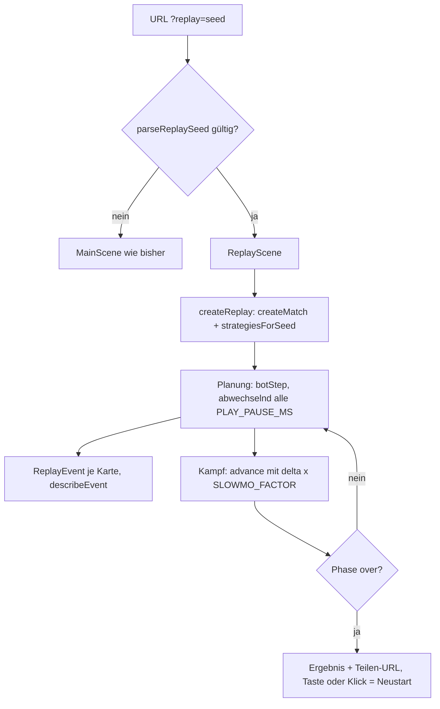
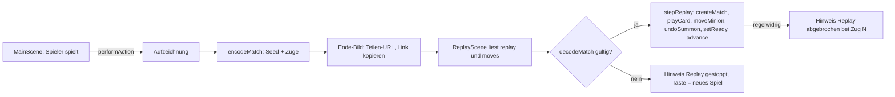
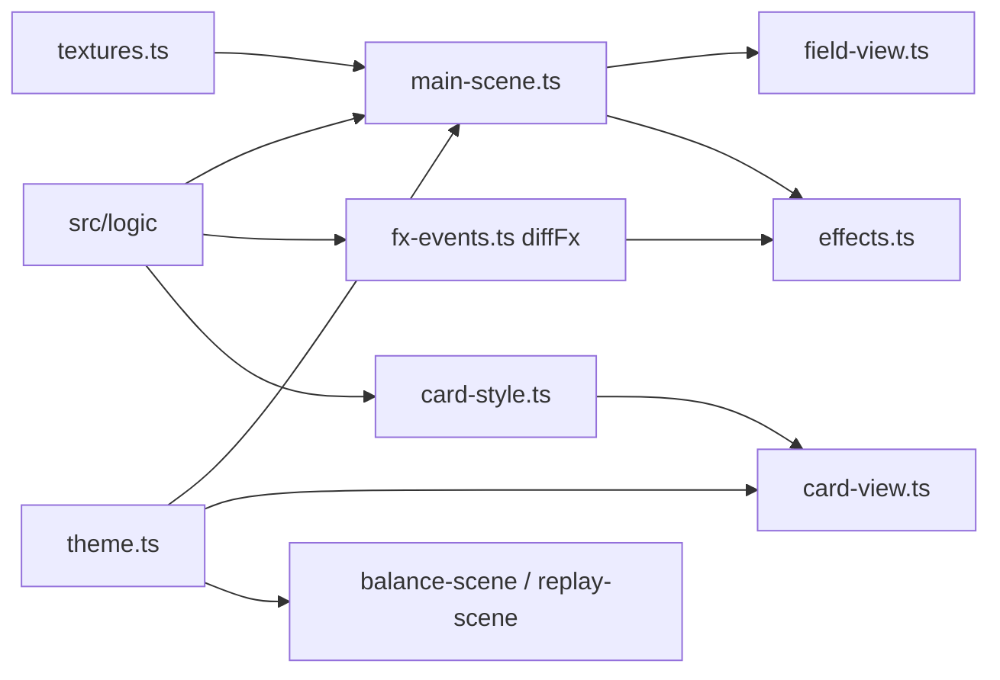
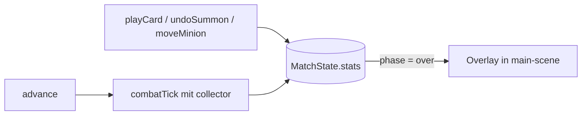

# TowerField – Technisches Handbuch

Stand: Auftrag „Replay gespielter Matches per URL-Parameter“ (Version 0.1.0). Der Stand baut auf den
Aufträgen „Grafische Überarbeitung im Fantasy-Kartenspiel-Stil“, „Heiler-Karte“, „Kartenfilter für die Hand im Match“, „Replay-Szene“, „Minion-Statistik-Overlay nach Match-Ende“, „Fernkämpfer Bogenschütze“, „Start- und Zieh-Konstanten“, „E2E-Tests“, „Dev-Szene mit Balancing-Statistik“,
„Minion-Tempo“, „Tower-Reichweite 20“, „Energie-Maximum 8“, „Bot-Strategie“, „Handlimit“, „Drag-and-Drop“,
„Designkonzept“ und „Kern-Logik“ auf.

> **Quellenlage**
> - Geprüft gegen den Code: `package.json` (Skripte), `src/logic/combat.ts`, `src/logic/match.ts` (Kopf, Konstanten,
>   Typen), `src/logic/match-stats.ts`, `src/logic/replay.ts`, `src/logic/seed.ts`, `src/scenes/replay-scene.ts`,
>   `src/main.ts`, `src/logic/hand-filter.ts`, die Filter-Stellen in `src/scenes/main-scene.ts`. `bot.ts` nur an den
>   Schnittstellen (`botStep`, `botPlan`).
> - Aus dem bisherigen Handbuch und den Einzeldokumenten übernommen, nicht neu gegen den Code geprüft: Kartenwerte,
>   Rundenablauf, Platzierung, `main-scene.ts`, Tests.
> - Heiler: gegen `cards.ts`, `combat.ts` (Felder `maxHp`, `heals`, Heilformel) und `match.ts` (Beschwören) geprüft sowie
>   gegen `docs/anwendung-heiler.md`.
> - Grafik: gegen `docs/grafik-stil.md`, `docs/anwendung-grafik-ueberarbeitung.md`, die Dateiliste der Szenen und die
>   Exporte von `field-view.ts`, `labels.ts`, `effects.ts`, `card-view.ts`, `textures.ts` geprüft. Das Innenleben der
>   Zeichenfunktionen habe ich nicht neu gelesen.
> - Ich habe keine Tests und keinen Build ausgeführt. Laut Tester: Typecheck grün, Unit-Tests zu `card-style` und
>   `fx-events` (11) grün, Smoke 17 bestanden; Screenshots wurden nicht geprüft. Der Review war freigegeben.
> - Teilen und Abspielen von Matches: gegen `docs/anwendung-replay.md` (vom Dokumentierer mit dem Code abgeglichen) und die
>   Berichte von Entwickler und Reviewer. `match-record.ts`, `share.ts` und die Szenen habe ich nicht selbst neu gelesen.
>   Laut Tester: Typecheck, 43 Unit-Tests der betroffenen Dateien und 20 Smoke-Fälle grün; der Review war freigegeben.
> - Nichts committet. Zeilenangaben für `main-scene.ts` sind ungefähr.

## Änderungen in diesem Stand

| Thema | Vorher | Jetzt | Datei |
|---|---|---|---|
| Aufzeichnung | keine | `MainScene` zeichnet jede erfolgreiche Aktion beider Spieler auf (außerhalb von `MatchState`) | `match-record.ts`, `main-scene.ts` |
| Format | – | kompakter String `v1…` aus Seed und Aktionen, `encodeMatch`/`decodeMatch` mit Versionskennung | `match-record.ts` |
| URL | `?replay=<seed>` (nur Bot) | zusätzlich `?replay=<seed>&moves=<kodiert>`; ohne `moves` weiter Bot-Replay | `seed.ts`, `replay-scene.ts` |
| Replay-Quelle | nur Bots | Bots oder vorgegebene Aktionen; `ReplayEvent` kennt Verschieben, Zurücknehmen, Bereit | `replay.ts` |
| Ende-Bild | Statistik, Tippen = neues Spiel | zeigt zusätzlich Teilen-URL und Knopf „Link kopieren“ | `main-scene.ts`, `share.ts` |
| Ungültige Links | – | Hinweis „Replay gestoppt“ bzw. „Replay abgebrochen bei Zug N“, kein `console.error` | `replay.ts`, `replay-scene.ts` |
| Smoke | 17 Fälle | 20 Fälle (gültige Züge, ungültige Zugdaten, Teilen-URL) | `e2e/smoke.spec.ts` |

Nicht geändert (Teilen): `match.ts` und alle Regeln, `MatchState`, `main.ts`, Bot-Replay ohne `moves`, `parseReplaySeed`.
Details: `docs/anwendung-replay.md`.

Frühere Änderung (Grafik):

| Thema | Vorher | Jetzt | Datei |
|---|---|---|---|
| Stil | Farben verstreut (`COLORS` in `main-scene.ts`) | zentral: Palette, Schriften, Rahmen, Panel/Balken/Knopf | `theme.ts` |
| Hintergrund, Boden, Partikel | einfarbige Flächen | Texturen zur Laufzeit (Verlauf, Vignette, Wege, Holztisch) | `textures.ts` |
| Handkarten | einfache Rechtecke | Rahmen, Name, Kosten-Kristall, Bild, Text, Banner; Typ durch Farbe und Symbol | `card-view.ts`, `card-style.ts` |
| Hover/Auswahl | – | Anheben (bis 110 %), Schatten, Leuchten; Ausspielen animiert | `card-view.ts`, `main-scene.ts` |
| Feld | flach | Tower, Minions, Bauplätze mit Schatten, Leuchten, Teamfarben | `field-view.ts` |
| Effekte | keine | Partikel, Ringe, Schadenszahlen, Kamerawackeln; Ereignisse aus `diffFx` | `effects.ts`, `fx-events.ts` |
| Hilfsmodule | `LabelPool`, `drawBoard`, `drawMinions` in `main-scene.ts` | `labels.ts` und `field-view.ts` | `src/scenes/` |
| E2E | – | `e2e/grafik.spec.ts` liest das Feld `lifts` der Szene | `e2e/grafik.spec.ts` |

Nicht geändert (Grafik): Regeln, Kartenwerte, Bot, Seed, alle bestehenden Unit-Tests. Keine Fremdassets,
`public/assets/` bleibt leer. Details: `docs/grafik-stil.md`, `docs/anwendung-grafik-ueberarbeitung.md`.

Frühere Änderung (Heiler):

| Thema | Vorher | Jetzt | Datei |
|---|---|---|---|
| Heiler-Karte | keine | `summon-healer`: Kosten 2, 20 LP, 5 Heilung/s, Reichweite 10, 1 Kopie im Deck | `cards.ts` |
| Heilung im Kampf | keine | `combatTick` heilt pro Tick einen verwundeten Verbündeten derselben Line | `combat.ts` |
| `Minion` | ohne `maxHp`, `heals` | optionale Felder `maxHp` und `heals`; `match.ts` setzt sie beim Beschwören | `combat.ts`, `match.ts` |
| Bot | Prioritätsliste ohne Heiler | `summon-healer` direkt hinter `summon-archer` | `bot.ts` |
| Anzeige | – | Heiler mit grünem Punkt in der Mitte | `main-scene.ts` |

Nicht geändert (Heiler): `match-stats.ts` und `DamageCollector` (Heilung zählt nicht als Schaden), Tower-Regeln,
Szenen, Smoke-Test. Details: `docs/anwendung-heiler.md`.

Frühere Änderung (Kartenfilter):

| Thema | Vorher | Jetzt | Datei |
|---|---|---|---|
| Kartenfilter | keiner | Taste schaltet Alle → Beschwörung → Upgrade → Tower; nicht passende Karten abgedunkelt und tot | `hand-filter.ts`, `main-scene.ts` |
| Smoke-Test | – | Fall „Kartenfilter“ (Reihenfolge, Abwahl, tote Karten, echter Hand-Index) | `e2e/smoke.spec.ts` |

Nicht geändert (Kartenfilter): `match.ts`, `combat.ts`, `bot.ts`, `cards.ts`, Bot, Match-Ablauf, Statistik-Overlay.
(Gilt für den Stand vor dem Heiler.)

Frühere Änderung (Replay):

| Thema | Vorher | Jetzt | Datei |
|---|---|---|---|
| Replay | keine | `?replay=<seed>`: Bot gegen Bot, Zeitlupe, Kommentare | `replay.ts`, `replay-scene.ts` |
| Seed-Parser | `parseSeed` | zusätzlich `parseReplaySeed` | `src/logic/seed.ts` |
| Bot | `botPlan` mit eigener Schleife | neu `botStep` (ein Zug); `botPlan` ruft es auf, Verhalten gleich | `src/logic/bot.ts` |
| Zeichnen | privat in `MainScene` | `LabelPool`, `drawBoard`, `drawMinions`, `drawTower` exportiert | `src/scenes/main-scene.ts` |
| Szenenauswahl | `MainScene` / Dev: `?scene=balance` | gültiges `?replay=` startet `ReplayScene` zuerst (Dev und Produktion) | `src/main.ts` |

Frühere Änderung (Minion-Statistik):

| Thema | Vorher | Jetzt | Datei |
|---|---|---|---|
| Statistik | keine | `MatchState.stats` (nur Spieler 0) | `src/logic/match-stats.ts`, `match.ts` |
| `combatTick` | `(players, deltaSeconds)` | optionaler dritter Parameter `collector` | `src/logic/combat.ts` |
| Match-Ende | Ergebnistext, Tippen startet neu | Overlay mit zwei Tabellen, erst „Schließen“, dann Tippen | `src/scenes/main-scene.ts` |
| E2E-Neustart | tippt direkt | prüft Overlay, tippt daneben, schließt, startet neu | `e2e/gameplay.spec.ts` |

Nicht geändert: Balance, Regeln, Kampfablauf, `MatchState`, Balance-Szene. Details: `docs/anwendung-kartenfilter.md`,
`docs/anwendung-replay.md` und `docs/anwendung-minion-statistik.md`.

## 1. Zweck

Mobiles 1-gegen-1-Tower-Defense-Spiel mit Karten im Browser (Phaser 3, TypeScript, Vite).

- Hochformat 360 × 640, Touch und Maus, `Phaser.Scale.FIT`.
- Lokal gegen einen deterministischen Bot. Kein Online-Spiel, keine Accounts, keine Töne. Die Grafik entsteht komplett im Code (Abschnitt „Grafik“).
- Kampf ohne Zufall. Der Seed legt nur die Kartenreihenfolge fest; beide Spieler erhalten dieselben Karten.
- Phaser bleibt auf Version 3 (API-Doku: https://newdocs.phaser.io/docs/3.90.0).

Weiterführend unter `docs/`: `designkonzept.md` (Soll-Regeln) und die `anwendung-*.md` je Auftrag (Bogenschütze,
Start-/Zieh-Konstanten, Handlimit, Iso-Platzierung, Drag-and-Drop, Bot-Tests, Energie-Maximum, Tower-Reichweite,
Minion-Tempo, Balance-Szene, E2E, Minion-Statistik, Replay, Kartenfilter, Heiler, Grafik-Überarbeitung; Stil und Lizenzen: `grafik-stil.md`).

### Umsetzungsstand

| Bereich | Stand |
|---|---|
| Kernlogik (Karten, Runden, Kampf, Bot) | fertig, getestet |
| **Grafik im Fantasy-Kartenspiel-Stil** | **umgesetzt, getestet (ohne Screenshot-Prüfung)** |
| Reichweite je Minion, Bogenschütze | umgesetzt |
| **Heiler (`summon-healer`)** | **umgesetzt, getestet** |
| Start 5 / Ziehen 3, Handlimit 10, Energie-Max. 8, Tower-Reichweite 20, Minion-Tempo | umgesetzt |
| Minion-Statistik und Overlay nach Match-Ende | umgesetzt, getestet |
| Replay-Szene `?replay=<seed>` | umgesetzt, getestet |
| **Teilen und Abspielen gespielter Matches (`&moves=`)** | **umgesetzt, getestet; „Zurücknehmen“ in der `MainScene` nicht bedienbar** |
| **Kartenfilter für die Hand** | **umgesetzt, getestet** |
| Balance-Szene `balance` | nur im Dev-Server, nicht neu bewertet |
| Drag-and-Drop von Minions | umgesetzt |
| `iso.ts` (Iso-Umrechnung, Kamera) | fertig, von der Szene nicht genutzt |
| Iso-Szene, Hand-UI, Ablage, Undo-Knopf, Projektile, Tempo-Anzeige | offen |
| Balance Tower 20 gegen Reichweite 14 | offen |

## 2. Spielregeln

| Thema | Regel |
|---|---|
| Spielfeld | 3 Lines, pro Spieler und Line 1 Tower am eigenen Ende. Spieler 0 (Mensch) unten, Spieler 1 (Bot) oben. |
| Start | 5 identische Handkarten (`START_HAND`). |
| Ziehen | Ab Runde 2 dieselben 3 Karten für beide (`DRAW_PER_ROUND`). |
| Handlimit | `HAND_LIMIT = 10`, überzählige Karten verfallen. |
| Runden | Planung, dann Kampf, höchstens `MAX_ROUNDS = 8`. |
| Energie | `min(8, 3 + (Runde - 1))`: 3, 4, 5, 6, 7, 8, 8, 8. Unverbrauchte Energie verfällt. |
| Kampf | 400 Ticks à 50 ms (20 s) über `delta`. Überlebende bleiben stehen. |
| Sieg | Alle 3 gegnerischen Tower zerstört; nach Runde 8 zählen die Tower-LP; Gleichstand ist Unentschieden. |

Deck-Länge: `START_HAND + DRAW_PER_ROUND * (MAX_ROUNDS - 1)` = 26 Karten, Mischung per Seed (Fisher-Yates).

### Karten (`src/logic/cards.ts`)

| ID | Name | Kosten | Wirkung | Reichw. | Tempo | Kopien |
|---|---|---|---|---|---|---|
| `summon-minion` | Minion | 1 | 30 LP, 6 Schaden/s | 4 | 10 | 4 |
| `summon-brute` | Brocken | 2 | 80 LP, 12 Schaden/s | 4 | 8 | 2 |
| `summon-archer` | Bogenschütze | 2 | 20 LP, 7 Schaden/s | 14 | 10 | 2 |
| `summon-healer` | Heiler | 2 | 20 LP, heilt 5 LP/s (`damage`), greift nie an | 10 | 10 | 1 |
| `line-upgrade` | Line +1 | 2 | Stufe +1 (max. 5), ein Slot mehr | – | – | 2 |
| `tower-hp` | Tower Leben | 1 | +30 max. LP und +30 LP | – | – | 2 |
| `tower-damage` | Tower Schaden | 2 | +4 Schaden/s | – | – | 1 |
| `minion-upgrade-line` | Minions Line | 1 | +10 LP, +2 Schaden für künftige Minions der Line | – | – | 2 |
| `minion-upgrade-all` | Minions alle | 3 | +5 LP, +1 Schaden für künftige Minions aller Lines | – | – | 1 |

Upgrades ändern nur `hp` und `damage`, wirken nur auf später beschworene Minions und sind nicht rücknehmbar.
Eine abgelehnte Karte lässt den Zustand unverändert (`PlayResult.ok === false`, mit `reason`).

### Kampfmodell (`src/logic/combat.ts`)

- Line-Länge `LINE_LENGTH = 100`; Position 0 am eigenen, 100 am gegnerischen Tower.
- Pflichtfelder eines `Minion`: `id`, `line`, `position`, `hp`, `damage`, `range`, `speed`. Standardwerte
  `MINION_RANGE = 4`, `MINION_SPEED = 10`. Neue `Minion`-Literale in Tests brauchen `range` und `speed`.
- Ein Minion greift einen gegnerischen Minion auf derselben Line an, wenn der Abstand (`gap`) höchstens `range` ist
  (nächster zuerst). Sonst greift er den Tower an, wenn der höchstens `range` entfernt ist. Sonst läuft er
  `speed * deltaSeconds` weiter. Hat er ein Ziel, bleibt er stehen.
- Tower (100 LP, 8 Schaden/s) treffen den am weitesten vorgerückten Gegner innerhalb `TOWER_RANGE = 20`.
- Beide Seiten werden pro Tick aus demselben Zustand berechnet und gleichzeitig angewendet.
- Minions mit `hp <= 1e-9` werden nach dem Tick entfernt.
- Optionale Felder: `maxHp` (fehlt es, gilt `hp` als Maximum) und `heals` (Heiler-Merkmal). Literale in Tests brauchen
  beide nicht.

#### Heilung

- `CardDef` für `summon` hat das optionale Feld `role?: 'healer'`. Beim Beschwören setzt `playCard` `maxHp = def.hp +
  Line-Bonus` und bei `role === 'healer'` zusätzlich `heals: true`.
- Ein Heiler heilt pro Tick `damage * deltaSeconds` auf **einen** Verbündeten: gleiche Line, Abstand
  `|position − heiler.position| <= range`, lebend, verwundet (`hp < maxHp`), nicht er selbst. Gewählt wird der niedrigste
  HP-Anteil, bei Gleichstand der kleinere Index (kein Zufall).
- Der Heiler greift nie an, weder Minion noch Tower, auch ohne Ziel. Er läuft immer mit seinem Tempo weiter.
- Heilung wird wie Schaden aus dem Zustand vor dem Tick berechnet und danach angewendet:
  `hp = min(maxHp, hp − Schaden + Heilung)`. Wer im selben Tick auf `hp <= 1e-9` fällt, wird entfernt; Heilung belebt
  nicht wieder. Das Ergebnis hängt nicht von der Spielerreihenfolge ab.
- Minion-Upgrades wirken nur über den Line-Bonus beim Beschwören; bereits stehende Minions und ihr `maxHp` ändern sich
  nicht.
- Heilung erscheint nicht in `DamageCollector` und `match-stats.ts`. Eine Heilstatistik wäre eine eigene Änderung.
- Mehrere Heiler wirken gleichzeitig aus demselben Vorzustand und können dasselbe Ziel gemeinsam heilen.
- Das Deck hat eine Karte mehr im Pool, die Kartenreihenfolge je Seed ändert sich (bleibt deterministisch).

### Platzierung

Slot `n` liegt bei `2 + 4n`, gültig bis `PLACEMENT_ZONE_END = 30`. Slot-Zahl = `lineCapacity(Stufe) = 2 + Stufe`.
Ohne Slot-Angabe gilt der erste freie Slot. `moveMinion` und `undoSummon` gehen nur für Minions der aktuellen Planung
(`placements`), kostenlos und vor „Bereit“.

## 3. Architektur

```
src/
  logic/   reine Funktionen, kein Phaser/DOM/Canvas, mit Vitest testbar
    cards.ts       Kartendefinitionen, Deck
    combat.ts      combatTick, Tower, Minion
    match.ts       MatchState, playCard, moveMinion, undoSummon, setReady, advance
    match-stats.ts Statistik des eigenen Spielers
    hand-filter.ts Kartenfilter der Hand (Sichtbarkeit je Kartentyp)
    replay.ts      Replay (Bots oder aufgezeichnete Züge), Zeitlupe, Kommentartexte
    match-record.ts Aufzeichnen, encodeMatch/decodeMatch, Nachspielen mit Prüfung
    seed.ts        parseSeed, parseReplaySeed, parseReplayMoves
    card-style.ts  Kartentyp → Farbe, Symbol, Banner; describeCard (Darstellung, rein)
    fx-events.ts   diffFx: Effekt-Ereignisse aus zwei Spielzuständen (rein)
    placement.ts, iso.ts, bot.ts, balance-sim.ts
  scenes/  main-scene.ts (Spiel), replay-scene.ts (Replay), balance-scene.ts (Dev), share.ts (Teilen-URL)
           theme.ts, textures.ts, card-view.ts, field-view.ts, effects.ts, labels.ts (Phaser-Code, nicht in logic/)
  main.ts  wählt die Start-Szene
e2e/       smoke.spec.ts, gameplay.spec.ts, grafik.spec.ts (Playwright)
docs/      designkonzept.md, grafik-stil.md, anwendung-*.md, handbuch.md
```

Grundsätze (aus `AGENTS.md`):

- Regeln, Zustand, Kollisionen, Punkte, Zeit gehören nach `src/logic/`. Szenen lesen Eingaben, rufen die Logik auf und
  zeichnen. Keine Regeln in `update()`.
- Alle Logikfunktionen liefern einen neuen Zustand; der alte bleibt unverändert.
- Zeit nur über `delta`, Zufall nur über den Seed (`nextRandom` in `game-state.ts`).
- Assets unter `public/assets/`, im `preload()` ohne führendes `public/` laden.
- Keine `console.error` für erwartete Fälle (der Smoke-Test wertet sie als Fehler).

### Replay (`?replay=<seed>`)



Ein Seed legt Deck und Bot-Strategien fest, keine menschlichen Züge. `?replay=<seed>` ohne `moves` ist ein
Bot-gegen-Bot-Match zum Seed; gleicher Seed ergibt denselben Endzustand und dieselbe Ereignisliste. Mit
`&moves=<kodiert>` spielt die Szene stattdessen die aufgezeichneten Züge eines in der `MainScene` gespielten Matches nach
(Abschnitt „Teilen und Abspielen gespielter Matches“ unten).

**Logik (`src/logic/replay.ts`)**, rein, ohne Phaser/DOM/Canvas:

| Name | Aufgabe |
|---|---|
| `createReplay(seed)` | `ReplayState`: `match`, `strategies`, `events`, `pauseMs`, `turn` |
| `stepReplay(replay, deltaMs)` | neuer Zustand nach `deltaMs`; Ende oder `deltaMs <= 0` liefern den Zustand unverändert |
| `isReplayOver(replay)` | `match.phase === 'over'` |
| `combatDelta(deltaMs)` | `deltaMs * SLOWMO_FACTOR`, Spielzeit der Kampfphase |
| `describeEvent(event)` | Text, z. B. „Runde 2 · Blau spielt Minion auf Line 3“ (Line 1-basiert, 0-basiert gespeichert) |
| `playerName(player)` | `Blau` (0), `Orange` (1) |

- **Planung:** Sobald `pauseMs` den Wert `PLAY_PAUSE_MS` erreicht, zieht der Spieler am Zug mit `botStep`. Gibt es
  keinen Zug mehr, wird er mit `setReady` bereit gemeldet. Jede gespielte Karte erzeugt genau ein `ReplayEvent`
  (`round`, `player`, `cardId`, `line | null`).
- **Kampf:** `advance(match, combatDelta(deltaMs))`. Beim Wechsel zurück in die Planung werden `pauseMs` und `turn`
  zurückgesetzt (Spieler 0 beginnt).
- Keine neue Regel: Karten, Energie und Kampf kommen unverändert aus `match.ts`; `botStep` kommt aus `bot.ts`.
  `botPlan` ruft `botStep` in einer Schleife auf und verhält sich wie zuvor.

**Szene (`src/scenes/replay-scene.ts`, Key `replay`):** `update` ruft nur `stepReplay`, dann zeichnet `render()` mit
`drawBoard`, `drawMinions` (`field-view.ts`) und `LabelPool` (`labels.ts`). Das Kommentarband zeigt die letzten 6 Ereignisse
(Blau blau, Orange orange). Bei `over` erscheinen Ergebnis und Teilen-URL (`origin` + `pathname` + `?replay=<seed>`).
Taste oder Klick starten das Replay nur nach `over` neu (`scene.restart`); sonst gibt es keine Eingabe. Für Tests
liefern die Getter `current` und `comments` den Zustand.

**Szenenauswahl (`src/main.ts`):** Bei gültigem `?replay=` ist `ReplayScene` die erste Szene, im Dev-Build vor
`MainScene` und `BalanceScene`, im Produktions-Build vor `MainScene`. Sonst unverändert (`MainScene`,
`?scene=balance` im Dev-Server). Ungültige Werte (`abc`, leer) fallen ohne Konsolenfehler auf `MainScene` zurück.

**Auf einen Blick:**
- Ein Replay über alle Runden kann in echter Zeit bis etwa 450 s dauern. Pause, Spulen und Geschwindigkeitswahl gibt es
  bewusst nicht.
- `LabelPool` (`labels.ts`) sowie `drawBoard`, `drawMinions` und `drawTower` (`field-view.ts`) nutzen `MainScene` und `ReplayScene` gemeinsam. Bei
  Änderungen beide Szenen prüfen (Smoke-Tests Gameplay, Drag, Replay).
- `ReplayScene.create` fällt bei ungültigem Wert auf Seed 1 zurück; das ist nur eine Absicherung, `main.ts` startet die
  Szene nur bei gültigem Wert.
- Eine neue Szene, die ohne Eingabe erreichbar ist, gehört in `e2e/smoke.spec.ts`.

### Teilen und Abspielen gespielter Matches (`&moves=`)



**Für Spieler:** Nach Spielende zeigt die `MainScene` (nach „Schließen“ der Statistik) die Teilen-URL, umgebrochen und bei
sehr langen Links gekürzt. Der Knopf **Link kopieren** legt die vollständige URL in die Zwischenablage. Öffnet jemand
sie, spielt die Replay-Szene beide Seiten Zug für Zug nach, mit Kommentaren („Runde 2 · Blau spielt Minion auf Line 3“,
dazu „verschiebt …“, „nimmt … zurück“, „ist bereit“). Takt `PLAY_PAUSE_MS`, Kampf mit `SLOWMO_FACTOR`; Pause, Spulen und
Geschwindigkeitswahl gibt es nicht.

**Format `moves` (Version 1):** Nur die Zeichen `0-9 a-z . -`. Aufbau `v1` und je Aktion ein Token mit `.` davor.

| Aktion | Token | Felder |
|---|---|---|
| Karte spielen | `p<R><P>-<Karte>[-<Line>]` | Karte = Index in `CARD_DEFS`, Line 0–2 (bei Karten ohne Ziel weggelassen) |
| Minion verschieben | `m<R><P>-<Minion>-<Line>-<Slot>` | Minion-Id, Ziel-Line, Slot |
| Beschwörung zurücknehmen | `u<R><P>-<Minion>` | Minion-Id |
| Bereit | `r<R><P>` | – |

`<R>` ist die Runde (1–8), `<P>` der Spieler (0 Blau, 1 Orange). Beispiel: `v1.p10-3-1.m10-1-2-0.r10`. Grenzen beim
Lesen: 4000 Zeichen und 800 Aktionen.

**Ungültige Links** führen nie zu Absturz oder `console.error`:

| Fall | Verhalten |
|---|---|
| `?replay=abc` oder leer (kein gültiger Seed) | normale `MainScene` |
| `moves` unlesbar (leer, abgeschnitten, unbekannte Version, Zeichen oder Zahlen außerhalb des Formats, zu lang) | Hinweis „Replay gestoppt – Die Zugdaten sind ungültig.“ |
| `moves` lesbar, aber regelwidrig (zu wenig Energie, Karte nicht auf der Hand, falsche Runde), Aufzeichnung endet vor Spielende oder enthält danach noch Züge | Replay läuft bis zur letzten gültigen Aktion, dann „Replay abgebrochen bei Zug N: <Grund>“ |

In beiden Hinweisfällen startet eine Taste oder ein Klick ein neues Spiel (`MainScene`).

**Logik (`src/logic/match-record.ts`)**, rein, ohne Phaser/DOM/Canvas: `createRecord`, `performAction` und `botPlanRecorded`
(Aufzeichnen), `applyAction`, `encodeMatch`/`decodeMatch`, `shareQuery`, `replayRecorded` (Nachspielen mit Prüfung, ohne
Zeitlupe). `replay.ts` ergänzt `createRecordedReplay`, `createInvalidReplay` und `describeAbort`; Bot-Pfad und
aufgezeichneter Pfad teilen sich `stepReplay`, den Takt und `describeEvent`. `ReplayEvent` hat das optionale Feld
`action` (`move`, `undo`, `ready`; ohne Angabe eine gespielte Karte). Karten werden beim Nachspielen über ihre ID in der
Hand gefunden, nicht über den Handindex. `match.ts` ist unverändert; die Aufzeichnung liegt außerhalb des `MatchState`.

**Auf einen Blick:**
- **Versionierung:** Ändern sich Regeln oder Kartenliste, muss `RECORD_VERSION` steigen. `match-record.test.ts` hält die
  Kartenliste fest und erinnert daran. Ohne Versionssprung brechen alte Links an der ersten abweichenden Aktion ab oder
  enden anders.
- **Lange Seeds:** `decodeMatch` kürzt Seeds mit bis zu 15 Ziffern auf 32 Bit; Aufzeichnen und Nachspielen verhalten sich
  gleich, das Replay bleibt konsistent.
- **Teilen-URL:** aus `window.location.origin` und `pathname` plus `shareQuery` (`src/scenes/share.ts`). Text auf der
  Leinwand lässt sich nicht markieren, daher der Knopf „Link kopieren“.
- **Zurücknehmen:** Format und Replay kennen die Aktion (Tests auf Logikebene), die `MainScene` bietet sie noch nicht an.
- Gespeichert wird nur in der URL, nicht auf einem Server.

### Grafik

Reine Darstellung; Regeln, Werte und Seed bleiben unverändert. Ausführlich: `docs/grafik-stil.md`.



| Modul | Aufgabe |
|---|---|
| `theme.ts` | `PALETTE`, `TEXT`, `FONTS`, `FRAME`; `fillGradient`, `drawPanel`, `drawBar`, `drawButton`. Einzige Quelle für Farben und Schriften. |
| `textures.ts` | `ensureTextures`, `addBackdrop`: Hintergrund, Vignette, Boden, Wege, Partikeltexturen (`backdrop`, `spark`, `glow`) per Canvas-Textur; eigener fester Zeichen-Zufall, nicht der Spiel-Seed. |
| `card-view.ts` | `drawCard`: Rahmen, Kopfzeile, Kosten-Kristall, Bildfläche mit Symbol, Textfeld, Typ-Banner. |
| `field-view.ts` | `drawBoard`, `drawMinions`, `drawTower`, `drawMinionBody`; Blau = du, Orange = Gegner. Minion-Form nach Rolle: Kreis, Raute (Fernkämpfer), Kreuz (Heiler). |
| `effects.ts` | Klasse `Effects`: Partikel, Leuchtringe, Schadenszahlen, Kamerawackeln beim Tower-Fall, Animation beim Ausspielen. |
| `card-style.ts` | `cardTypeStyle` (Typ → Rahmenfarbe, Symbol, Banner) und `describeCard` (Kurztext); mit Test. |
| `fx-events.ts` | `diffFx` leitet Treffer, Tod, Beschwörung und Turmschaden aus zwei Zuständen ab; mit Test. |

Kartentypen: `summon` Rot/Schwert, `tower-upgrade` Blau/Turm, `line-upgrade` Grün/Pfeil, `minion-upgrade` Violett/Edelstein.

**Regeln für Änderungen:**
- Farben und Schriften nur aus `theme.ts`. Neue Szenen nutzen `ensureTextures`/`addBackdrop`.
- Bewegung, Anheben und Effekte über `delta` bzw. Phaser-Tweens, nie über Frames. Bei Zeitsprüngen über 500 ms
  (Tab im Hintergrund) entfallen Effekte.
- Obergrenzen: höchstens 20 Schadenszahlen und 150 lebende Partikel je Emitter gleichzeitig.
- Neue Effekt-Auslöser gehören als reine Regel nach `fx-events.ts` mit Test, nicht in `update()`.
- Schriften sind Systemschriften mit Fallback (Georgia/Palatino für Überschriften, Trebuchet/Segoe UI/Verdana für Text),
  kein Webfont; Labels werden mit doppelter Auflösung gerendert.
- Assets: keine Fremddateien, `public/assets/` bleibt leer. Kommen Dateien hinzu, im `preload()` ohne `public/` laden und
  in `grafik-stil.md` mit Quelle und Lizenz eintragen. Keine Originalgrafiken oder Logos von MTG, Hearthstone oder HotS.
- `e2e/grafik.spec.ts` liest das Szenenfeld `lifts`; bei Umbenennung den Test anpassen. Die Felder `state`,
  `handFilter` und `selected` bleiben für die E2E-Tests stabil.

### Kartenfilter (`src/logic/hand-filter.ts`)

Reine Darstellungs- und Eingabehilfe für die Hand des Menschen (Handlimit 10). Keine Regel ändert sich.

| Name | Aufgabe |
|---|---|
| `HandFilter` | `'all'`, `'summon'`, `'upgrade'`, `'tower'` |
| `HAND_FILTERS`, `HAND_FILTER_NAMES` | Reihenfolge und Anzeigenamen (Alle, Beschwörung, Upgrade, Tower) |
| `nextHandFilter(filter)` | nächster Filter, nach Tower wieder Alle |
| `isCardVisible(type, filter)` | ist eine Karte dieses `CardType` beim Filter sichtbar |

Zuordnung: `summon` → Beschwörung; `line-upgrade` und `minion-upgrade` → Upgrade; `tower-upgrade` → Tower.

**Szene (`main-scene.ts`):**
- `LAYOUT.filterButton`: x 122, y 592, 102 × 40, links neben der Taste bei 230/592 und unter den Handkarten (bis ca.
  y 572). Beschriftung „Filter: X (n)“, `n` ist die Zahl der passenden Handkarten.
- Feld `handFilter`, in `create()` auf `'all'` gesetzt, nicht gespeichert.
- Die Karten bleiben auf ihren festen Slots (`cardRect(index)`). Eine Abbildung Anzeige-Slot → Hand-Index gibt es
  nicht; `handleTap` und `playCard` nutzen den echten Hand-Index. Nicht passende Karten sind abgedunkelt, ohne Text und
  nicht antippbar.
- Wird die gewählte Karte durch den Wechsel ausgeblendet, ist `selected` danach `null`. Das Feld heißt `selected`, nicht
  `selectedCard`.
- Die Taste reagiert nur in der Planung (`handleTap` kehrt sonst vorher zurück). Ein gesetzter Filter bleibt im Kampf
  aktiv.

**Auf einen Blick:**
- Neuer `CardType` in `cards.ts`: die Zuordnung `GROUPS` in `hand-filter.ts` ergänzen. Der Typ `Record<CardType, …>`
  meldet das Fehlen beim Typecheck.
- Der Meldungstext unten (`this.message`) hat keine Breitenbegrenzung; ein sehr langer Text kann unter die Filtertaste
  ragen.

### Minion-Statistik



`MatchStats` (`src/logic/match-stats.ts`) ist rein und serialisierbar:

| Feld | Inhalt |
|---|---|
| `played` | Karten-ID → Anzahl je Line (Index = Line) |
| `damage` | Karten-ID → `{ minionDamage, towerDamage }` |
| `cardByMinion` | Minion-ID → Karten-ID, bleibt über Runden erhalten |

Funktionen: `createStats`, `recordSummon`, `recordUndo`, `recordMove`, `recordDamage`.

- **Nur Spieler 0.** `match.ts` filtert über `STATS_PLAYER = 0`. Minion-IDs sind je Spieler vergeben, daher würde eine
  Vermischung mit dem Gegner IDs kollidieren lassen.
- **Zuordnung:** `cardByMinion` darf nicht aus `PlayerState.placements` abgeleitet werden; das wird pro Planung geleert.
- **Zählung:** `playCard` +1, `undoSummon` −1 (Line vor dem Entfernen), `moveMinion` −1 alte und +1 neue Line.
  `addPlayed` begrenzt auf mindestens 0.
- **Sammler:** `type DamageCollector = (side, minionId, kind: 'minion' | 'tower', amount) => void`, dritter Parameter von
  `combatTick`. Ohne Sammler ändert sich nichts.
- **Deckelung:** Pro Ziel wird der eingehende Gesamtschaden mit der Rest-HP verglichen. Übersteigt er sie, wird jeder
  Treffer mit `remaining / incoming` skaliert. Das gilt auch, wenn ein Tower mit trifft. So ist die Summe der
  gezählten Treffer nie größer als der echte Schaden.
- **Zurechnung:** Tower-Schaden an Minions zählt nirgends. Minion-Schaden an einem Tower zählt als `towerDamage` des
  Kartentyps.
- **Neue Schadensquelle** in `combatTick`: den Sammler mit dem gedeckelten Wert aufrufen, sonst stimmt die Summe nicht.

### Overlay (`src/scenes/main-scene.ts`)

- Bei `phase === 'over'` zeigt `renderStats` zwei Tabellen (Karten pro Line, Schaden je Typ). Namen aus
  `getCardDef(...).name`. Die Szene rechnet nichts.
- „Schließen“ (ca. x 180, y 524) blendet das Overlay aus; danach startet Tippen wie bisher ein neues Spiel. Tippen
  neben den Button startet nichts.
- `statsClosed` wird in `create()` zurückgesetzt.
- Das Panel hat feste Höhe. Ab etwa 10 Kartentypen können Zeilen den Button überlappen.

## 4. Konfiguration

| Konstante | Wert | Datei |
|---|---|---|
| `START_HAND`, `DRAW_PER_ROUND`, `HAND_LIMIT` | 5, 3, 10 | `match.ts` |
| `MAX_ROUNDS`, `BASE_ENERGY`, `ENERGY_PER_ROUND`, `MAX_ENERGY` | 8, 3, 1, 8 | `match.ts` |
| `LINE_COUNT`, `MAX_LINE_LEVEL`, `BASE_CAPACITY` | 3, 5, 2 | `match.ts` |
| `TOWER_HP`, `TOWER_DAMAGE`, `COMBAT_TICKS` | 100, 8, 400 | `match.ts` |
| `LINE_LENGTH`, `TICK_MS`, `MINION_RANGE`, `MINION_SPEED`, `TOWER_RANGE` | 100, 50, 4, 10, 20 | `combat.ts` |
| `SLOWMO_FACTOR`, `PLAY_PAUSE_MS` | 0,35, 700 | `replay.ts` |

- URL-Parameter `?seed=<1–15 Ziffern>` legt den Seed fest (genutzt von den E2E-Tests).
- URL-Parameter `?replay=<1–15 Ziffern>` startet die Replay-Szene (Dev und Produktion). Beide Parameter werden mit
  `>>> 0` auf 32 Bit gekürzt; ungültige Werte ergeben `null`.
- URL-Parameter `&moves=<kodiert>` (zusammen mit `replay`) spielt aufgezeichnete Züge ab; Format und Grenzen siehe
  „Teilen und Abspielen gespielter Matches“. `main.ts` liest nur `replay`, `moves` liest die Szene.
- `RECORD_VERSION` (`match-record.ts`): Formatversion der Aufzeichnung, aktuell 1.
- Die Szene `balance` ist nur im Dev-Server registriert, nicht im Produktions-Build.

## 5. Betrieb und Entwicklung

| Befehl | Zweck |
|---|---|
| `npm run dev` | Dev-Server (Vite) |
| `npm run build` | Typprüfung und Produktions-Build |
| `npm run preview` | gebauten Stand lokal ansehen |
| `npm run review` | Build, dann Preview |
| `npm run typecheck` | `tsc --noEmit` |
| `npm test` / `npm run test:watch` | Vitest |
| `npm run test:smoke` | Build, dann Playwright (Smoke und Gameplay) |

Vor jeder Übergabe müssen `npm run build`, `npm test` und `npm run test:smoke` grün sein.

## 6. Tests

- Jede neue Regel bekommt einen Unit-Test neben der Datei (`src/logic/<name>.test.ts`).
- Statistik: `match-stats.test.ts` (Zählen, Zurücknehmen, Verschieben, Deckelung), `match.test.ts` (nur Spieler 0,
  gleicher Seed gleiche `stats`), `combat.test.ts` (Sammler, Tower-Schaden, Ergebnis mit und ohne Sammler gleich).
- `e2e/gameplay.spec.ts`: vollständige Spielabläufe. Nach Match-Ende zuerst Overlay prüfen, daneben tippen (kein
  Neustart), „Schließen“, dann Neustart. Tests, die direkt neu starten, scheitern sonst.
- Kartenfilter: `hand-filter.test.ts` (jeder `CardType` gegen jeden Filter, Umschaltreihenfolge). Smoke-Fall
  „Kartenfilter“: Tastenreihenfolge, Abwahl der gewählten Karte, tote Karten, Spielen mit echtem Hand-Index.
- Replay: `replay.test.ts` (gleicher Seed gleiches Ergebnis, verschiedene Seeds verschiedene Ereignisse, ein Ereignis
  je Karte, `describeEvent` nicht leer, Kampf verbraucht weniger Spielzeit, Ende in `over` mit gültigem `Outcome`),
  `seed.test.ts` (`parseReplaySeed`), `bot.test.ts` (`botPlan` nach dem `botStep`-Umbau unverändert).
- Teilen: `match-record.test.ts` (Aufzeichnen ändert `MatchState` nicht, `encode`/`decode` Round-Trip mit Seeds von 1 und
  15 Ziffern, nachgespieltes Match endet im identischen `MatchState`, leere/abgeschnittene/manipulierte Daten und unbekannte
  Version ergeben `null` oder Fehlerwert, regelwidrige Aktion bricht kontrolliert ab), `replay.test.ts` und `seed.test.ts`
  (`parseReplayMoves`). Smoke: gültige Züge, ungültige Zugdaten, Teilen-URL der `MainScene` öffnet dasselbe Match.
  `match-record-fixture.ts` ist nur eine Testhilfe.
- Grafik: `card-style.test.ts` (vier Typen unterscheidbar), `fx-events.test.ts` (6 Fälle für `diffFx`),
  `e2e/grafik.spec.ts` (Hover/Auswahl über `lifts`). Smoke gesamt laut letztem Lauf: 20 Fälle.
- `e2e/smoke.spec.ts`: Canvas zeichnet, keine Konsolenfehler, Dev-Szene `balance`, Drag eines Minions, `?replay=`
  (Canvas, Kommentar, Ende mit Ergebnis und Teilen-URL, Neustart per Taste) und ungültiges `?replay=` fällt auf
  `MainScene` zurück.
- Heiler: `combat.test.ts` (Heilung pro Tick, Reichweite, Line, Gegner, `maxHp`-Grenze, keine Selbstheilung, Zielwahl,
  kein Schaden, vertauschte Spielerreihenfolge), `cards.test.ts` (Karte, Deck), `match.test.ts` (`maxHp` mit Line-Bonus),
  `bot.test.ts` (Heiler nach `PRIORITY`, `botPlan` deterministisch).
- Fixtures mit `Minion`-Literalen brauchen `range` und `speed`. Das Deck ändert sich bei neuen Karten, feste
  Kartenreihenfolgen in Tests müssen dann angepasst werden.

## 7. Offene Punkte

- Balance Tower (Reichweite 20) gegen Bogenschütze (14) und `balance-sim` mit den aktuellen Werten neu bewerten.
- Panelhöhe des Overlays an die Zahl der Kartentypen anpassen, falls Karten dazukommen.
- Test „volle Line“ im Browser (in Runde 1 ist keine vierte Beschwörung bezahlbar).
- Replay: sehr lange Laufzeit (bis etwa 450 s) bei vollen Runden; falls gewünscht, später Geschwindigkeitswahl
  (laut Auftrag ausgeschlossen).
- Teilen: „Zurücknehmen“ ist in der `MainScene` nicht bedienbar. Nach jeder Regeländerung `RECORD_VERSION` prüfen, sonst
  geben alte Links ein anderes Match wieder oder brechen ab.
- Smoke-Test „Drag eines beschworenen Minions“: überspringt sich per `test.skip`, wenn die Starthand keinen Minion
  enthält (`smoke.spec.ts`, ca. Zeile 261). Im letzten Lauf liefen alle 17 Smoke-Fälle.
- Heiler: Balance (Werte sind Startwerte) und Stehenbleiben hinter Verbündeten sind nicht Teil des Auftrags. Der Panel-
  und Filtertext der Szene enthält keine Heiler-Sonderfälle; der Typ `summon` fällt unter „Beschwörung“.
- Grafik: Karten sind klein (66×62 px), der Text hat etwa 6,5 px und ist auf zwei kurze Zeilen gekürzt. Lesbarkeit auf
  echten Geräten, Rahmen und Effekte sind nicht per Screenshot geprüft.
- Grafik (Review): einzelne Farben und Maße in `card-view.ts` (z. B. `0x3a3068`) nach `theme.ts`; der Energie-Kristall in
  `main-scene.ts` ist mit Pixelkoordinaten verdrahtet.
- Hand-UI, Undo-Knopf, Iso-Szene, Projektile, Tempo-Anzeige auf Karten.
- Reviewer-Hinweise: lange `hits.push(...)`-Zeilen in `combat.ts` ggf. mit Hilfstyp lesbarer machen; fehlendes
  Leerzeichen in `this.graphics =this.add.graphics();` in `main-scene.ts`.
