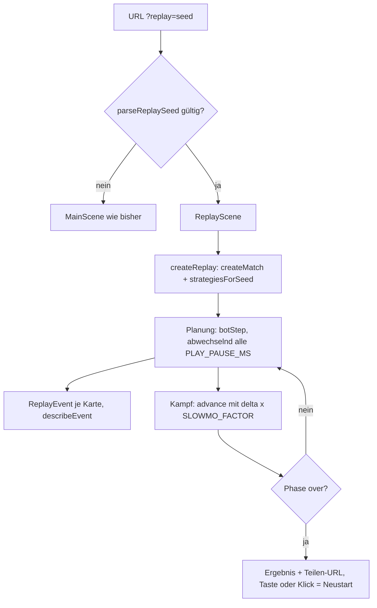
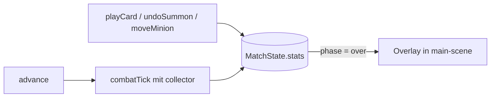

# TowerField – Technisches Handbuch

Stand: Auftrag „Replay-Szene per ?replay=Seed mit Zeitlupe und Kommentaren“ (Version 0.1.0). Der Stand baut auf den
Aufträgen „Minion-Statistik-Overlay nach Match-Ende“, „Fernkämpfer Bogenschütze“, „Start- und Zieh-Konstanten“, „E2E-Tests“, „Dev-Szene mit Balancing-Statistik“,
„Minion-Tempo“, „Tower-Reichweite 20“, „Energie-Maximum 8“, „Bot-Strategie“, „Handlimit“, „Drag-and-Drop“,
„Designkonzept“ und „Kern-Logik“ auf.

> **Quellenlage**
> - Geprüft gegen den Code: `package.json` (Skripte), `src/logic/combat.ts`, `src/logic/match.ts` (Kopf, Konstanten,
>   Typen), `src/logic/match-stats.ts`, `src/logic/replay.ts`, `src/logic/seed.ts`, `src/scenes/replay-scene.ts`,
>   `src/main.ts`. `bot.ts` nur an den Schnittstellen (`botStep`, `botPlan`).
> - Aus dem bisherigen Handbuch und den Einzeldokumenten übernommen, nicht neu gegen den Code geprüft: Kartenwerte,
>   Rundenablauf, Platzierung, `main-scene.ts`, Tests.
> - Ich habe keine Tests und keinen Build ausgeführt. Laut Tester: Typecheck grün, Vitest (57 Tests in 3 Dateien) grün,
>   Smoke 12 bestanden, 1 übersprungen. Der Review war freigegeben.
> - Nichts committet. Zeilenangaben für `main-scene.ts` sind ungefähr.

## Änderungen in diesem Stand

| Thema | Vorher | Jetzt | Datei |
|---|---|---|---|
| Replay | keine | `?replay=<seed>`: Bot gegen Bot, Zeitlupe, Kommentare | `replay.ts`, `replay-scene.ts` |
| Seed-Parser | `parseSeed` | zusätzlich `parseReplaySeed` | `src/logic/seed.ts` |
| Bot | `botPlan` mit eigener Schleife | neu `botStep` (ein Zug); `botPlan` ruft es auf, Verhalten gleich | `src/logic/bot.ts` |
| Zeichnen | privat in `MainScene` | `LabelPool`, `drawBoard`, `drawMinions`, `drawTower` exportiert | `src/scenes/main-scene.ts` |
| Szenenauswahl | `MainScene` / Dev: `?scene=balance` | gültiges `?replay=` startet `ReplayScene` zuerst (Dev und Produktion) | `src/main.ts` |

Frühere Änderung (Minion-Statistik):

| Thema | Vorher | Jetzt | Datei |
|---|---|---|---|
| Statistik | keine | `MatchState.stats` (nur Spieler 0) | `src/logic/match-stats.ts`, `match.ts` |
| `combatTick` | `(players, deltaSeconds)` | optionaler dritter Parameter `collector` | `src/logic/combat.ts` |
| Match-Ende | Ergebnistext, Tippen startet neu | Overlay mit zwei Tabellen, erst „Schließen“, dann Tippen | `src/scenes/main-scene.ts` |
| E2E-Neustart | tippt direkt | prüft Overlay, tippt daneben, schließt, startet neu | `e2e/gameplay.spec.ts` |

Nicht geändert: Balance, Regeln, Kampfablauf, `MatchState`, Balance-Szene. Details: `docs/anwendung-replay.md` und
`docs/anwendung-minion-statistik.md`.

## 1. Zweck

Mobiles 1-gegen-1-Tower-Defense-Spiel mit Karten im Browser (Phaser 3, TypeScript, Vite).

- Hochformat 360 × 640, Touch und Maus, `Phaser.Scale.FIT`.
- Lokal gegen einen deterministischen Bot. Kein Online-Spiel, keine Accounts, keine finale Grafik oder Töne.
- Kampf ohne Zufall. Der Seed legt nur die Kartenreihenfolge fest; beide Spieler erhalten dieselben Karten.
- Phaser bleibt auf Version 3 (API-Doku: https://newdocs.phaser.io/docs/3.90.0).

Weiterführend unter `docs/`: `designkonzept.md` (Soll-Regeln) und die `anwendung-*.md` je Auftrag (Bogenschütze,
Start-/Zieh-Konstanten, Handlimit, Iso-Platzierung, Drag-and-Drop, Bot-Tests, Energie-Maximum, Tower-Reichweite,
Minion-Tempo, Balance-Szene, E2E, Minion-Statistik, Replay, Kartenfilter).

### Umsetzungsstand

| Bereich | Stand |
|---|---|
| Kernlogik (Karten, Runden, Kampf, Bot) | fertig, getestet |
| Reichweite je Minion, Bogenschütze | umgesetzt |
| Start 5 / Ziehen 3, Handlimit 10, Energie-Max. 8, Tower-Reichweite 20, Minion-Tempo | umgesetzt |
| Minion-Statistik und Overlay nach Match-Ende | umgesetzt, getestet |
| **Replay-Szene `?replay=<seed>`** | **umgesetzt, getestet** |
| Balance-Szene `balance` | nur im Dev-Server, nicht neu bewertet |
| Drag-and-Drop von Minions | umgesetzt |
| `iso.ts` (Iso-Umrechnung, Kamera) | fertig, von der Szene nicht genutzt |
| Iso-Szene, Hand-UI, Ablage, Undo-Knopf, Projektile, Tempo-Anzeige | offen |
| Balance Tower 20 gegen Reichweite 14 | offen |

## 2. Spielregeln

| Thema | Regel |
|---|---|
| Spielfeld | 3 Lines, pro Spieler und Line 1 Tower am eigenen Ende. Spieler 0 (Mensch) unten, Spieler 1 (Bot) oben. |
| Start | 5 identische Handkarten (`START_HAND`). |
| Ziehen | Ab Runde 2 dieselben 3 Karten für beide (`DRAW_PER_ROUND`). |
| Handlimit | `HAND_LIMIT = 10`, überzählige Karten verfallen. |
| Runden | Planung, dann Kampf, höchstens `MAX_ROUNDS = 8`. |
| Energie | `min(8, 3 + (Runde - 1))`: 3, 4, 5, 6, 7, 8, 8, 8. Unverbrauchte Energie verfällt. |
| Kampf | 400 Ticks à 50 ms (20 s) über `delta`. Überlebende bleiben stehen. |
| Sieg | Alle 3 gegnerischen Tower zerstört; nach Runde 8 zählen die Tower-LP; Gleichstand ist Unentschieden. |

Deck-Länge: `START_HAND + DRAW_PER_ROUND * (MAX_ROUNDS - 1)` = 26 Karten, Mischung per Seed (Fisher-Yates).

### Karten (`src/logic/cards.ts`)

| ID | Name | Kosten | Wirkung | Reichw. | Tempo | Kopien |
|---|---|---|---|---|---|---|
| `summon-minion` | Minion | 1 | 30 LP, 6 Schaden/s | 4 | 10 | 4 |
| `summon-brute` | Brocken | 2 | 80 LP, 12 Schaden/s | 4 | 8 | 2 |
| `summon-archer` | Bogenschütze | 2 | 20 LP, 7 Schaden/s | 14 | 10 | 2 |
| `line-upgrade` | Line +1 | 2 | Stufe +1 (max. 5), ein Slot mehr | – | – | 2 |
| `tower-hp` | Tower Leben | 1 | +30 max. LP und +30 LP | – | – | 2 |
| `tower-damage` | Tower Schaden | 2 | +4 Schaden/s | – | – | 1 |
| `minion-upgrade-line` | Minions Line | 1 | +10 LP, +2 Schaden für künftige Minions der Line | – | – | 2 |
| `minion-upgrade-all` | Minions alle | 3 | +5 LP, +1 Schaden für künftige Minions aller Lines | – | – | 1 |

Upgrades ändern nur `hp` und `damage`, wirken nur auf später beschworene Minions und sind nicht rücknehmbar.
Eine abgelehnte Karte lässt den Zustand unverändert (`PlayResult.ok === false`, mit `reason`).

### Kampfmodell (`src/logic/combat.ts`)

- Line-Länge `LINE_LENGTH = 100`; Position 0 am eigenen, 100 am gegnerischen Tower.
- Pflichtfelder eines `Minion`: `id`, `line`, `position`, `hp`, `damage`, `range`, `speed`. Standardwerte
  `MINION_RANGE = 4`, `MINION_SPEED = 10`. Neue `Minion`-Literale in Tests brauchen `range` und `speed`.
- Ein Minion greift einen gegnerischen Minion auf derselben Line an, wenn der Abstand (`gap`) höchstens `range` ist
  (nächster zuerst). Sonst greift er den Tower an, wenn der höchstens `range` entfernt ist. Sonst läuft er
  `speed * deltaSeconds` weiter. Hat er ein Ziel, bleibt er stehen.
- Tower (100 LP, 8 Schaden/s) treffen den am weitesten vorgerückten Gegner innerhalb `TOWER_RANGE = 20`.
- Beide Seiten werden pro Tick aus demselben Zustand berechnet und gleichzeitig angewendet.
- Minions mit `hp <= 1e-9` werden nach dem Tick entfernt.

### Platzierung

Slot `n` liegt bei `2 + 4n`, gültig bis `PLACEMENT_ZONE_END = 30`. Slot-Zahl = `lineCapacity(Stufe) = 2 + Stufe`.
Ohne Slot-Angabe gilt der erste freie Slot. `moveMinion` und `undoSummon` gehen nur für Minions der aktuellen Planung
(`placements`), kostenlos und vor „Bereit“.

## 3. Architektur

```
src/
  logic/   reine Funktionen, kein Phaser/DOM/Canvas, mit Vitest testbar
    cards.ts       Kartendefinitionen, Deck
    combat.ts      combatTick, Tower, Minion
    match.ts       MatchState, playCard, moveMinion, undoSummon, setReady, advance
    match-stats.ts Statistik des eigenen Spielers
    replay.ts      Bot-gegen-Bot-Replay zu einem Seed, Zeitlupe, Kommentartexte
    seed.ts        parseSeed, parseReplaySeed
    placement.ts, iso.ts, bot.ts, balance-sim.ts
  scenes/  main-scene.ts (Spiel, gemeinsame Zeichenhelfer), replay-scene.ts (Replay), balance-scene.ts (Dev)
  main.ts  wählt die Start-Szene
e2e/       smoke.spec.ts, gameplay.spec.ts (Playwright)
docs/      designkonzept.md, anwendung-*.md, handbuch.md
```

Grundsätze (aus `AGENTS.md`):

- Regeln, Zustand, Kollisionen, Punkte, Zeit gehören nach `src/logic/`. Szenen lesen Eingaben, rufen die Logik auf und
  zeichnen. Keine Regeln in `update()`.
- Alle Logikfunktionen liefern einen neuen Zustand; der alte bleibt unverändert.
- Zeit nur über `delta`, Zufall nur über den Seed (`nextRandom` in `game-state.ts`).
- Assets unter `public/assets/`, im `preload()` ohne führendes `public/` laden.
- Keine `console.error` für erwartete Fälle (der Smoke-Test wertet sie als Fehler).

### Replay (`?replay=<seed>`)



Ein Seed legt Deck und Bot-Strategien fest, keine menschlichen Züge. „Replay“ ist ein Bot-gegen-Bot-Match zum Seed;
gleicher Seed ergibt denselben Endzustand und dieselbe Ereignisliste. Aufzeichnung menschlicher Partien gibt es nicht.

**Logik (`src/logic/replay.ts`)**, rein, ohne Phaser/DOM/Canvas:

| Name | Aufgabe |
|---|---|
| `createReplay(seed)` | `ReplayState`: `match`, `strategies`, `events`, `pauseMs`, `turn` |
| `stepReplay(replay, deltaMs)` | neuer Zustand nach `deltaMs`; Ende oder `deltaMs <= 0` liefern den Zustand unverändert |
| `isReplayOver(replay)` | `match.phase === 'over'` |
| `combatDelta(deltaMs)` | `deltaMs * SLOWMO_FACTOR`, Spielzeit der Kampfphase |
| `describeEvent(event)` | Text, z. B. „Runde 2 · Blau spielt Minion auf Line 3“ (Line 1-basiert, 0-basiert gespeichert) |
| `playerName(player)` | `Blau` (0), `Orange` (1) |

- **Planung:** Sobald `pauseMs` den Wert `PLAY_PAUSE_MS` erreicht, zieht der Spieler am Zug mit `botStep`. Gibt es
  keinen Zug mehr, wird er mit `setReady` bereit gemeldet. Jede gespielte Karte erzeugt genau ein `ReplayEvent`
  (`round`, `player`, `cardId`, `line | null`).
- **Kampf:** `advance(match, combatDelta(deltaMs))`. Beim Wechsel zurück in die Planung werden `pauseMs` und `turn`
  zurückgesetzt (Spieler 0 beginnt).
- Keine neue Regel: Karten, Energie und Kampf kommen unverändert aus `match.ts`; `botStep` kommt aus `bot.ts`.
  `botPlan` ruft `botStep` in einer Schleife auf und verhält sich wie zuvor.

**Szene (`src/scenes/replay-scene.ts`, Key `replay`):** `update` ruft nur `stepReplay`, dann zeichnet `render()` mit
`drawBoard`, `drawMinions` und `LabelPool` aus `main-scene.ts`. Das Kommentarband zeigt die letzten 6 Ereignisse
(Blau blau, Orange orange). Bei `over` erscheinen Ergebnis und Teilen-URL (`origin` + `pathname` + `?replay=<seed>`).
Taste oder Klick starten das Replay nur nach `over` neu (`scene.restart`); sonst gibt es keine Eingabe. Für Tests
liefern die Getter `current` und `comments` den Zustand.

**Szenenauswahl (`src/main.ts`):** Bei gültigem `?replay=` ist `ReplayScene` die erste Szene, im Dev-Build vor
`MainScene` und `BalanceScene`, im Produktions-Build vor `MainScene`. Sonst unverändert (`MainScene`,
`?scene=balance` im Dev-Server). Ungültige Werte (`abc`, leer) fallen ohne Konsolenfehler auf `MainScene` zurück.

**Auf einen Blick:**
- Ein Replay über alle Runden kann in echter Zeit bis etwa 450 s dauern. Pause, Spulen und Geschwindigkeitswahl gibt es
  bewusst nicht.
- `LabelPool`, `drawBoard`, `drawMinions` und `drawTower` nutzen `MainScene` und `ReplayScene` gemeinsam. Bei
  Änderungen beide Szenen prüfen (Smoke-Tests Gameplay, Drag, Replay).
- `ReplayScene.create` fällt bei ungültigem Wert auf Seed 1 zurück; das ist nur eine Absicherung, `main.ts` startet die
  Szene nur bei gültigem Wert.
- Eine neue Szene, die ohne Eingabe erreichbar ist, gehört in `e2e/smoke.spec.ts`.

### Minion-Statistik



`MatchStats` (`src/logic/match-stats.ts`) ist rein und serialisierbar:

| Feld | Inhalt |
|---|---|
| `played` | Karten-ID → Anzahl je Line (Index = Line) |
| `damage` | Karten-ID → `{ minionDamage, towerDamage }` |
| `cardByMinion` | Minion-ID → Karten-ID, bleibt über Runden erhalten |

Funktionen: `createStats`, `recordSummon`, `recordUndo`, `recordMove`, `recordDamage`.

- **Nur Spieler 0.** `match.ts` filtert über `STATS_PLAYER = 0`. Minion-IDs sind je Spieler vergeben, daher würde eine
  Vermischung mit dem Gegner IDs kollidieren lassen.
- **Zuordnung:** `cardByMinion` darf nicht aus `PlayerState.placements` abgeleitet werden; das wird pro Planung geleert.
- **Zählung:** `playCard` +1, `undoSummon` −1 (Line vor dem Entfernen), `moveMinion` −1 alte und +1 neue Line.
  `addPlayed` begrenzt auf mindestens 0.
- **Sammler:** `type DamageCollector = (side, minionId, kind: 'minion' | 'tower', amount) => void`, dritter Parameter von
  `combatTick`. Ohne Sammler ändert sich nichts.
- **Deckelung:** Pro Ziel wird der eingehende Gesamtschaden mit der Rest-HP verglichen. Übersteigt er sie, wird jeder
  Treffer mit `remaining / incoming` skaliert. Das gilt auch, wenn ein Tower mit trifft. So ist die Summe der
  gezählten Treffer nie größer als der echte Schaden.
- **Zurechnung:** Tower-Schaden an Minions zählt nirgends. Minion-Schaden an einem Tower zählt als `towerDamage` des
  Kartentyps.
- **Neue Schadensquelle** in `combatTick`: den Sammler mit dem gedeckelten Wert aufrufen, sonst stimmt die Summe nicht.

### Overlay (`src/scenes/main-scene.ts`)

- Bei `phase === 'over'` zeigt `renderStats` zwei Tabellen (Karten pro Line, Schaden je Typ). Namen aus
  `getCardDef(...).name`. Die Szene rechnet nichts.
- „Schließen“ (ca. x 180, y 524) blendet das Overlay aus; danach startet Tippen wie bisher ein neues Spiel. Tippen
  neben den Button startet nichts.
- `statsClosed` wird in `create()` zurückgesetzt.
- Das Panel hat feste Höhe. Ab etwa 10 Kartentypen können Zeilen den Button überlappen.

## 4. Konfiguration

| Konstante | Wert | Datei |
|---|---|---|
| `START_HAND`, `DRAW_PER_ROUND`, `HAND_LIMIT` | 5, 3, 10 | `match.ts` |
| `MAX_ROUNDS`, `BASE_ENERGY`, `ENERGY_PER_ROUND`, `MAX_ENERGY` | 8, 3, 1, 8 | `match.ts` |
| `LINE_COUNT`, `MAX_LINE_LEVEL`, `BASE_CAPACITY` | 3, 5, 2 | `match.ts` |
| `TOWER_HP`, `TOWER_DAMAGE`, `COMBAT_TICKS` | 100, 8, 400 | `match.ts` |
| `LINE_LENGTH`, `TICK_MS`, `MINION_RANGE`, `MINION_SPEED`, `TOWER_RANGE` | 100, 50, 4, 10, 20 | `combat.ts` |
| `SLOWMO_FACTOR`, `PLAY_PAUSE_MS` | 0,35, 700 | `replay.ts` |

, `PLAY_PAUSE_MS` | 0,35, 700 | `replay.ts` |

- URL-Parameter `?seed=<1–15 Ziffern>` legt den Seed fest (genutzt von den E2E-Tests).
- URL-Parameter `?replay=<1–15 Ziffern>` startet die Replay-Szene (Dev und Produktion). Beide Parameter werden mit
  `>>> 0` auf 32 Bit gekürzt; ungültige Werte ergeben `null`.
- Die Szene `balance` ist nur im Dev-Server registriert, nicht im Produktions-Build.

## 5. Betrieb und Entwicklung

| Befehl | Zweck |
|---|---|
| `npm run dev` | Dev-Server (Vite) |
| `npm run build` | Typprüfung und Produktions-Build |
| `npm run preview` | gebauten Stand lokal ansehen |
| `npm run review` | Build, dann Preview |
| `npm run typecheck` | `tsc --noEmit` |
| `npm test` / `npm run test:watch` | Vitest |
| `npm run test:smoke` | Build, dann Playwright (Smoke und Gameplay) |

Vor jeder Übergabe müssen `npm run build`, `npm test` und `npm run test:smoke` grün sein.

## 6. Tests

- Jede neue Regel bekommt einen Unit-Test neben der Datei (`src/logic/<name>.test.ts`).
- Statistik: `match-stats.test.ts` (Zählen, Zurücknehmen, Verschieben, Deckelung), `match.test.ts` (nur Spieler 0,
  gleicher Seed gleiche `stats`), `combat.test.ts` (Sammler, Tower-Schaden, Ergebnis mit und ohne Sammler gleich).
- `e2e/gameplay.spec.ts`: vollständige Spielabläufe. Nach Match-Ende zuerst Overlay prüfen, daneben tippen (kein
  Neustart), „Schließen“, dann Neustart. Tests, die direkt neu starten, scheitern sonst.
- Replay: `replay.test.ts` (gleicher Seed gleiches Ergebnis, verschiedene Seeds verschiedene Ereignisse, ein Ereignis
  je Karte, `describeEvent` nicht leer, Kampf verbraucht weniger Spielzeit, Ende in `over` mit gültigem `Outcome`),
  `seed.test.ts` (`parseReplaySeed`), `bot.test.ts` (`botPlan` nach dem `botStep`-Umbau unverändert).
- `e2e/smoke.spec.ts`: Canvas zeichnet, keine Konsolenfehler, Dev-Szene `balance`, Drag eines Minions, `?replay=`
  (Canvas, Kommentar, Ende mit Ergebnis und Teilen-URL, Neustart per Taste) und ungültiges `?replay=` fällt auf
  `MainScene` zurück.
- Fixtures mit `Minion`-Literalen brauchen `range` und `speed`. Das Deck ändert sich bei neuen Karten, feste
  Kartenreihenfolgen in Tests müssen dann angepasst werden.

## 7. Offene Punkte

- Balance Tower (Reichweite 20) gegen Bogenschütze (14) und `balance-sim` mit den aktuellen Werten neu bewerten.
- Panelhöhe des Overlays an die Zahl der Kartentypen anpassen, falls Karten dazukommen.
- Test „volle Line“ im Browser (in Runde 1 ist keine vierte Beschwörung bezahlbar).
- Replay: sehr lange Laufzeit (bis etwa 450 s) bei vollen Runden; falls gewünscht, später Geschwindigkeitswahl
  (laut Auftrag ausgeschlossen).
- Smoke-Test: ein Fall (Drag eines beschworenen Minions) wird übersprungen; Grund im Test prüfen.
- Hand-UI, Undo-Knopf, Iso-Szene, Projektile, Tempo-Anzeige auf Karten.
- Reviewer-Hinweise: lange `hits.push(...)`-Zeilen in `combat.ts` ggf. mit Hilfstyp lesbarer machen; fehlendes
  Leerzeichen in `this.graphics =this.add.graphics();` in `main-scene.ts`.
